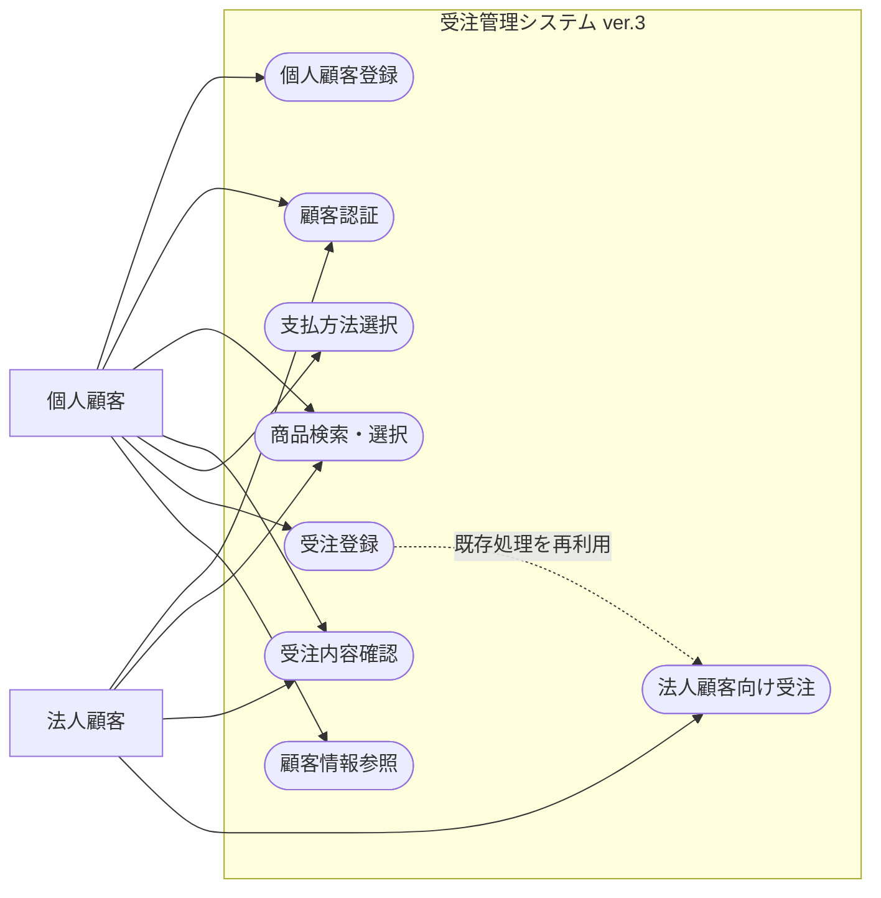
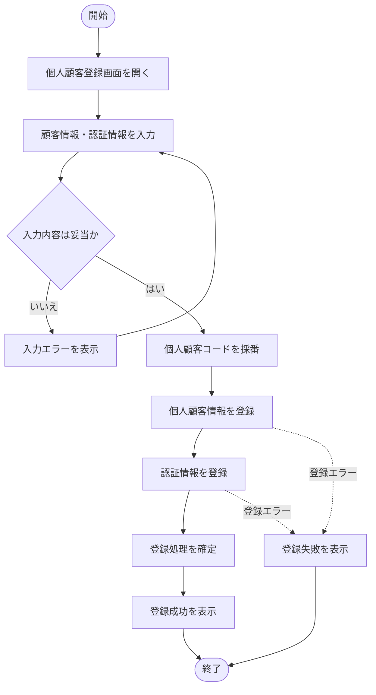
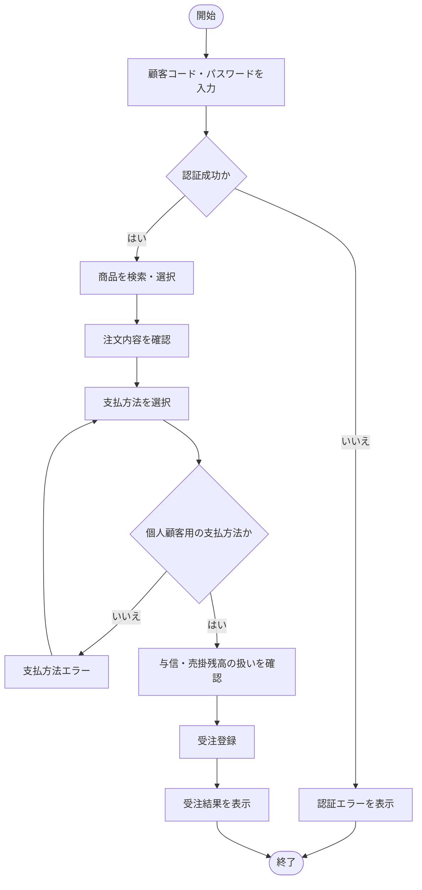
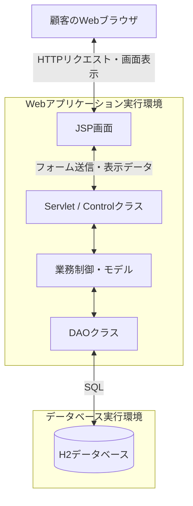
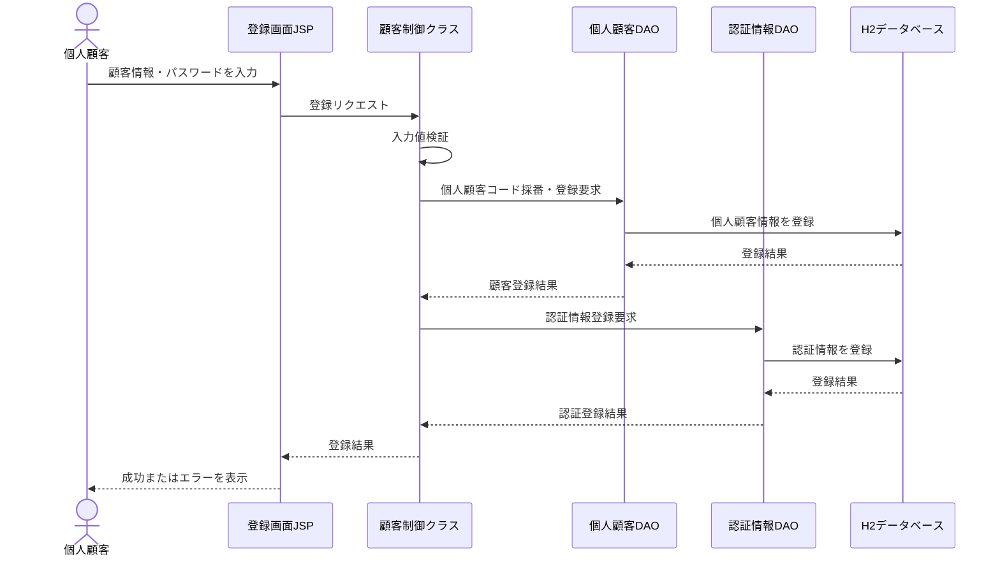
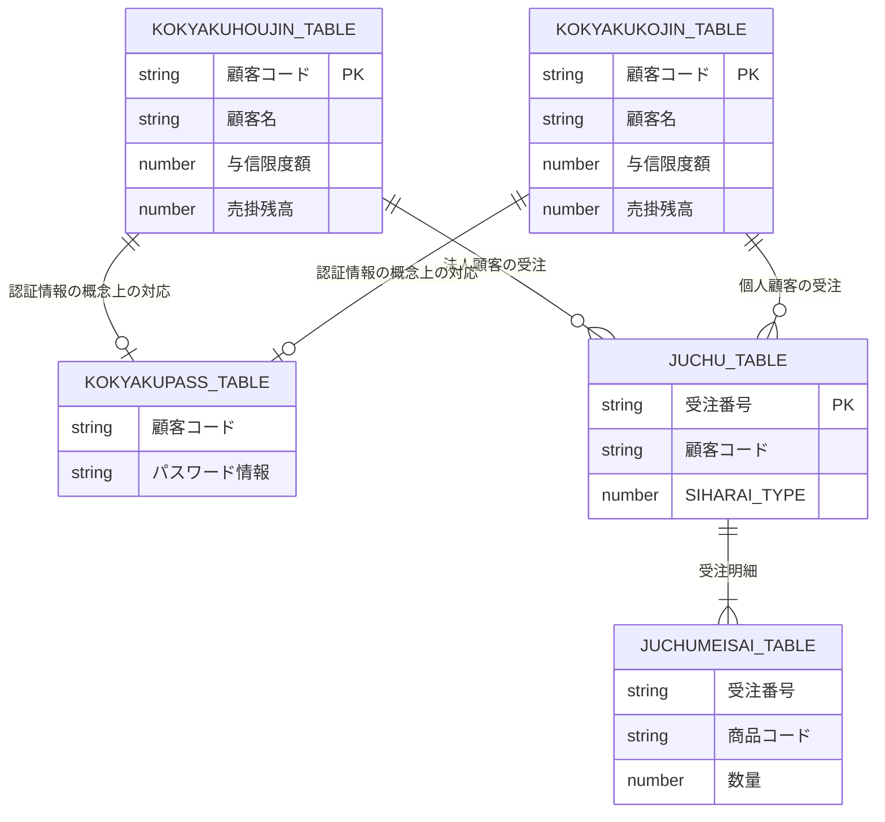

# ver.3 仕様書

## 1. 文書情報

| 項目 | 内容 |
|---|---|
| 対象システム | 受注管理システム `juchu03` |
| 改修対象バージョン | ver.3 |
| 基準バージョン | ver.2（`juchu02`） |
| 文書名 | 仕様書 |
| ファイル名 | `ver.3_仕様書.md` |
| 作成目的 | 個人顧客対応に関する機能・データ・処理の振る舞いを定義し、設計書・テスト仕様書の基準とする |
| 文書状態 | 初版案 |

## 2. 改修の目的と範囲

### 2.1 改修の目的

ver.3では、既存の法人顧客を対象とした受注管理システムを拡張し、個人顧客の登録・認証・受注に対応する。

個人顧客の受注処理は、基本的に既存の法人顧客向け処理を再利用する。ただし、顧客情報の保存先、顧客コード、与信限度額、支払方法など、法人顧客と個人顧客の違いを考慮する。

本改修の目的は次のとおりとする。

- 個人顧客情報を登録・管理できるようにする。
- 個人顧客が認証し、商品を受注できるようにする。
- 法人顧客と個人顧客で異なる支払方法に対応する。
- 個人顧客の顧客コードおよび与信限度額の条件を満たす。
- 既存の法人顧客向け機能への影響を抑える。
- 提供された個人顧客サンプルデータを利用して機能を検証する。

### 2.2 対象機能

| 機能ID | 機能名 | 概要 |
|---|---|---|
| F-01 | 個人顧客登録 | 個人顧客情報と認証情報を登録する |
| F-02 | 個人顧客情報参照 | 個人顧客の情報を取得する |
| F-03 | 個人顧客認証 | 顧客コードとパスワードによる認証を行う |
| F-04 | 商品選択 | 既存の商品検索・選択機能を利用する |
| F-05 | 受注登録 | 個人顧客の商品注文を登録する |
| F-06 | 支払方法選択 | 顧客種別に応じた支払方法を表示・保存する |
| F-07 | 与信・売掛残高管理 | 個人顧客に対する与信判定・残高管理を扱う |
| F-08 | 法人顧客機能の維持 | 既存の法人顧客機能を従来どおり利用できるようにする |

### 2.3 対象外

以下は、改修要件資料に明記されていないため、本改修の対象外とする。

- 外部決済サービスとの連携
- 代金引換に関する配送業者との連携
- 銀行振込の入金消込処理
- 商品マスタ・商品検索機能の全面的な再設計
- 受注ヘッダ・受注明細の業務構造の全面的な変更
- 要求資料に記載されていない新規業務機能

本改修で扱う支払方法は、受注時の選択と受注データへの記録を中心とする。決済実行や入金確認などの追加処理は、別途要求が確認された場合に検討する。

## 3. 用語と顧客種別

| 用語 | 定義 |
|---|---|
| 法人顧客 | 既存の `KOKYAKUHOUJIN_TABLE` で管理する顧客 |
| 個人顧客 | ver.3で登録・受注に対応する個人の顧客 |
| 顧客種別 | 法人顧客または個人顧客の区分 |
| 個人顧客コード | 先頭1桁を4～8とする要求がある顧客識別コード |
| 与信限度額 | 顧客に設定する与信上限額 |
| 売掛残高 | 顧客に対して管理する売掛金の残高 |
| 支払方法 | 月末一括払い、代金引換、銀行振込などの支払区分 |

## 4. 基本仕様

### 4.1 顧客種別ごとの業務条件

| 項目 | 法人顧客 | 個人顧客 |
|---|---|---|
| 顧客情報 | 既存の `KOKYAKUHOUJIN_TABLE` を利用 | `KOKYAKUKOJIN_TABLE` を利用 |
| 認証情報 | 既存認証方式を維持 | 既存認証機能との連携を追加 |
| 顧客コード | 既存ルールを維持 | 先頭1桁を4～8とする |
| 与信限度額 | 既存仕様を維持 | 1,000,000円 |
| 支払方法 | 月末一括払い | 代金引換、銀行振込 |
| 受注処理 | 既存処理を利用 | 既存処理を可能な範囲で再利用 |

個人顧客の情報は、法人顧客の情報と混同しないように管理する。

### 4.2 顧客コード

個人顧客コードは6桁とし、先頭1桁が4～8であることを満たさなければならない。

個人顧客コードの採番には、既存の `CTR_CURCODE_TABLE` の個人顧客用管理行を使用する。

個人顧客のサンプルデータとして、顧客コード `400000`～`400003` を使用する。これらのデータを登録した後の次回採番値は `400004` とする。

法人顧客用の採番管理情報は変更しない。個人顧客の新規登録時には、既存データと重複しない顧客コードを採番する。

採番処理の実装箇所、採番管理情報の更新タイミング、および同時登録時の競合対策は詳細設計で定義する。新たな同時実行制御方式は追加せず、既存の採番処理の方式を踏襲する。

### 4.3 与信限度額

個人顧客の与信限度額は1,000,000円とする。

個人顧客の与信判定および売掛残高更新は、支払方法に応じて次のように扱う。

| 支払方法 | 与信判定 | 売掛残高更新 |
|---|---|---|
| 代金引換 | 実施しない | 実施しない |
| 銀行振込 | 実施する | 実施する |

銀行振込の場合は、個人顧客の与信限度額と売掛残高を用いて与信判定を行う。与信判定に必要な条件を満たした場合、受注に応じて個人顧客の売掛残高を更新する。

代金引換の場合は、与信判定および売掛残高更新を行わない。

個人顧客の受注では、個人顧客の情報を参照し、売掛残高を更新する場合は個人顧客用の保存先を更新する。法人顧客の売掛残高を誤って更新しないこと。

法人顧客の既存の与信処理は、確定した改修要求がない限り維持する。具体的な処理の組み込み方法や更新処理の実装箇所は詳細設計で定義する。

### 4.4 顧客データの基本ルール

- 顧客コード、営業所コードなどの識別コードは、先頭ゼロを保持できる形式で扱う。
- FAX番号・メールアドレスには未設定のサンプルデータがあるため、未設定値を適切に扱う。
- 登録日・誕生日は、Excel上の値とDBの型・保存形式を整合させる。
- DBに保存する未設定値を `NULL` とするか空文字とするかは、詳細設計で確定する。
- 顧客情報と認証情報の関連付けが正しく行われること。

## 5. 機能仕様

### 5.1 F-01 個人顧客登録

#### 5.1.1 概要

個人顧客情報を登録する機能を追加する。

登録先は法人顧客情報の保存先と区別し、個人顧客情報が誤って法人顧客テーブルに登録されないようにする。

#### 5.1.2 登録項目

| 項目 | 仕様 |
|---|---|
| 顧客コード | システムで採番する。6桁とし、先頭1桁は4～8とする |
| 顧客名 | 個人顧客の氏名 |
| 顧客名カナ | 氏名のカナ表記 |
| 郵便番号 | 郵便番号 |
| 県コード | 都道府県コード |
| 住所1 | 住所の前半部分 |
| 住所2 | 住所の後半部分 |
| 連絡先電話番号 | 電話番号 |
| FAX番号 | 未設定を許容する。DBではNULLを許容する |
| メールアドレス | 新規登録時は必須とする。DBではNULLを許容する |
| 売掛残高 | 新規登録時の初期値は0とする。銀行振込の受注時に更新する |
| 与信限度額 | 1,000,000円 |
| 営業所コード | 担当営業所のコード |
| 登録日 | 登録日を保持する |
| 誕生日 | 必須とする。DBではDATE型で管理する |
| パスワード | 既存の認証方式に対応する認証情報 |

DBの列名、データ型、桁数およびNULL可否はDB設計書に従う。メールアドレスの必須チェックなど、アプリケーション側で行う入力チェックは詳細設計書に従う。

#### 5.1.3 処理仕様

1. 利用者が個人顧客登録画面を開く。
2. 利用者が登録項目を入力する。
3. システムが入力値を検証する。
4. システムが個人顧客コードを採番する。
5. システムが個人顧客情報を個人顧客用の保存先に登録する。
6. システムが認証情報を登録し、顧客情報と関連付ける。
7. システムが登録結果を表示する。

登録処理の途中でエラーが発生した場合、顧客情報だけ、または認証情報だけが不整合な状態で残らないようにする。トランザクション範囲とエラー処理は設計書で定義する。

### 5.2 F-02 個人顧客情報参照

- 個人顧客コードに対応する個人顧客情報を取得できること。
- 個人顧客の情報を取得する際に、法人顧客テーブルを誤って参照しないこと。
- 取得した個人顧客情報を認証後の画面や受注処理に利用できること。
- 顧客種別による検索先の振り分け方法は設計書で定義する。

### 5.3 F-03 個人顧客認証

- 個人顧客が顧客コードとパスワードを用いて認証できること。
- 認証後に取得する顧客情報が、認証対象の顧客と一致していること。
- 認証処理で法人顧客と個人顧客の検索先を混同しないこと。
- 既存の法人顧客の認証が従来どおり動作すること。
- 認証失敗時の画面表示とセッション処理は、既存仕様との整合を維持すること。

認証情報は、法人顧客と個人顧客で既存の `KOKYAKUPASS_TABLE` を共有する。

個人顧客コードの先頭1桁は4～8とし、認証後は顧客種別に応じて適切な顧客情報を取得する。

個人顧客の顧客情報は `KOKYAKUKOJIN_TABLE` から取得する。法人顧客の認証・情報参照処理は既存仕様を維持する。

### 5.4 F-04 商品選択

個人顧客は、認証後に既存の商品検索・選択機能を利用できること。

- 商品一覧から注文対象の商品を選択できること。
- 商品コード、商品情報、在庫情報などは既存機能を利用すること。
- カートへの追加や注文内容の確認は、既存の処理を可能な範囲で再利用すること。
- 個人顧客への対応によって既存の商品検索・選択機能が損なわれないこと。

### 5.5 F-05 受注登録

個人顧客の受注処理は、基本的に法人顧客向けの既存処理を再利用する。

1. 個人顧客が認証する。
2. 個人顧客が商品を選択する。
3. システムが注文内容を表示する。
4. 個人顧客が支払方法を選択する。
5. システムが顧客情報、商品、数量、金額、支払方法を用いて受注登録を行う。
6. システムが受注結果を表示する。

受注ヘッダと受注明細は、既存の `JUCHU_TABLE` および `JUCHUMEISAI_TABLE` を可能な範囲で再利用する。

受注ヘッダの顧客コードには、法人顧客または個人顧客の顧客コードを保存する。顧客種別に応じた顧客情報の取得先と更新先を適切に判定し、別の顧客種別の情報を誤って参照・更新しないこと。

既存SQL・DAOの変更範囲、顧客情報の取得・更新処理、および必要なDB変更の有無は、既存テーブル定義と実装を確認したうえで設計書に定義する。

### 5.6 F-06 支払方法選択・保存

#### 5.6.1 顧客種別ごとの支払方法

| 顧客種別 | 支払方法 |
|---|---|
| 法人顧客 | 月末一括払い |
| 個人顧客 | 代金引換、銀行振込 |

法人顧客には従来の月末一括払いを継続して提供する。

個人顧客には代金引換と銀行振込を選択肢として提供する。顧客種別に応じて、利用できない支払方法を選択できないようにする。

#### 5.6.2 支払方法コード

支払方法コードは次のとおりとする。

| コード | 支払方法 | 対象顧客 |
|---:|---|---|
| 0 | 月末一括払い | 法人顧客 |
| 1 | 代金引換 | 個人顧客 |
| 2 | 銀行振込 | 個人顧客 |

既存の法人顧客の支払方法コード `0` は変更しない。

選択された支払方法は、既存の `JUCHU_TABLE.SIHARAI_TYPE` に保存する。

画面に表示する支払方法、画面から送信するコード値、受注処理で判定するコード値、およびDBに保存するコード値を一致させる。

顧客種別に応じて利用できる支払方法を制限する。法人顧客には月末一括払い、個人顧客には代金引換と銀行振込を提供する。

### 5.7 F-07 与信判定・売掛残高

個人顧客の与信限度額は1,000,000円とする。

個人顧客の与信判定および売掛残高更新は、支払方法に応じて次のように扱う。

| 支払方法 | 与信判定 | 売掛残高更新 |
|---|---|---|
| 代金引換 | 実施しない | 実施しない |
| 銀行振込 | 実施する | 実施する |

銀行振込の場合は、個人顧客の与信限度額と売掛残高を用いて与信判定を行う。与信判定に必要な条件を満たした場合、受注に応じて個人顧客の売掛残高を更新する。

代金引換の場合は、与信判定および売掛残高更新を行わない。

個人顧客の受注では、個人顧客の情報を参照し、売掛残高を更新する場合は個人顧客用の保存先を更新する。法人顧客の売掛残高を誤って更新しないこと。

法人顧客の与信判定および売掛残高更新は、既存仕様を維持する。

### 5.8 F-08 法人顧客機能の維持

個人顧客対応の追加後も、以下の既存機能が従来どおり動作すること。

- 法人顧客の登録
- 法人顧客の認証
- 商品選択
- 受注登録
- 月末一括払いの選択・保存
- 法人顧客の与信判定・売掛残高更新

## 6. 個人顧客サンプルデータ

提供されたサンプルデータ4件を、個人顧客の登録・参照・認証などのテストに利用する。

| 顧客コード | 顧客名 | 営業所コード | 与信限度額 |
|---|---|---|---:|
| 400000 | 山田太郎 | 01 | 1,000,000円 |
| 400001 | 山田花子 | 02 | 1,000,000円 |
| 400002 | 鈴木一郎 | 03 | 1,000,000円 |
| 400003 | 花山治郎 | 03 | 1,000,000円 |

サンプルデータにはFAX番号・メールアドレスが未設定のレコードが含まれる。未設定値の登録・参照についても確認する。

サンプルデータのコードと新規登録時の採番値が重複しないように、テストデータの投入方法と採番管理を設計書で定義する。

## 7. 画面仕様

### 7.1 個人顧客登録画面

個人顧客情報を入力し、登録できる画面を用意する。

画面を新設するか既存画面を拡張するかは、既存JSPと画面遷移を調査して設計書で確定する。

### 7.2 支払方法選択画面

既存の `cosd1060.jsp` を改修対象とする。

ログイン中の顧客種別に応じて、以下の支払方法を表示する。

- 法人顧客：月末一括払い
- 個人顧客：代金引換、銀行振込

選択された支払方法は受注処理に引き渡し、確定したコード値で保存する。

### 7.3 登録・認証・受注結果の表示

登録・認証・受注の結果は、既存画面の構成と表示方式に合わせる。

具体的なメッセージ、遷移先、入力値の再表示、セッション処理は設計書で定義する。

## 8. データ仕様

### 8.1 個人顧客テーブル

法人顧客テーブル `KOKYAKUHOUJIN_TABLE` とは別に、個人顧客用の `KOKYAKUKOJIN_TABLE` を使用する。

個人顧客テーブルは、個人顧客の情報を管理する。列名、データ型、桁数、NULL可否および主キーはDB設計書に従う。

主なデータ上の条件は次のとおりとする。

- 顧客コードは6桁とし、先頭1桁を4～8とする。
- 顧客名、郵便番号、県コード、住所1、住所2、電話番号、営業所コード、登録日、誕生日など、DB設計書で必須とされた項目を適切に登録する。
- FAX番号およびメールアドレスはDB上でNULLを許容する。
- 誕生日は必須とし、DATE型で管理する。
- 新規登録時のメールアドレス必須チェックはアプリケーション側で行う。
- メールアドレスに一意制約を設定しない。

### 8.2 認証情報

認証情報は、既存の `KOKYAKUPASS_TABLE` を法人顧客と個人顧客で共有する。

個人顧客の登録時には、個人顧客情報と認証情報を正しく関連付ける。

顧客コードは法人顧客と個人顧客で重複しないように管理し、認証後は顧客種別に応じた顧客情報を取得する。

### 8.3 受注データ

受注ヘッダと受注明細には、既存の `JUCHU_TABLE` および `JUCHUMEISAI_TABLE` を利用する。

受注ヘッダの顧客コードには、法人顧客または個人顧客の顧客コードを保存する。

支払方法は `JUCHU_TABLE.SIHARAI_TYPE` に保存する。コード値は次のとおりとする。

| コード | 支払方法 | 対象顧客 |
|---:|---|---|
| 0 | 月末一括払い | 法人顧客 |
| 1 | 代金引換 | 個人顧客 |
| 2 | 銀行振込 | 個人顧客 |

顧客種別と支払方法の組み合わせをアプリケーション側で検証する。受注データの登録によって、別の顧客種別の情報を誤って更新しないこと。

### 8.4 コード管理

個人顧客コードの採番には、`CTR_CURCODE_TABLE` の個人顧客用管理行を使用する。

個人顧客の初期データとして `400000`～`400003` を登録し、初期データ登録後の次回採番値は `400004` とする。

法人顧客用の採番管理情報は変更しない。個人顧客の新規登録時には、初期データと重複しないコードを採番する。

同時登録時の採番競合対策は既存の採番処理の方式を踏襲する。

## 9. 図表

### 9.1 ユースケース図

本図は、顧客種別ごとの利用機能と、システムが提供する機能の関係を示す。

#### 図の説明

- 個人顧客は登録・認証後、商品を選択し、支払方法を選択して受注する。
- 法人顧客は既存の認証・商品選択・受注機能を利用する。
- 受注処理は可能な範囲で既存処理を再利用する。
- 本図は機能の関係を示す概念図であり、詳細な画面遷移やクラス呼び出し順序を示すものではない。

### 9.2 個人顧客登録のアクティビティ図

#### 図の説明

入力値の検証に成功した場合、個人顧客コードを採番し、顧客情報と認証情報を登録する。

顧客情報と認証情報の登録途中でエラーが発生した場合のロールバック範囲、再試行方法、エラー表示は設計書で定義する。図中の登録処理の順序は業務上の流れを示しており、DB操作の厳密なトランザクション境界は未確定である。

### 9.3 個人顧客の認証から受注までのアクティビティ図

#### 図の説明

個人顧客は認証後に商品を選択し、注文内容を確認して支払方法を選択する。

支払方法は代金引換または銀行振込とする。代金引換では与信判定および売掛残高更新を行わず、銀行振込では与信判定および売掛残高更新を行う。

法人顧客の受注処理は既存仕様を維持する。

### 9.4 配置図

本図は、既存のJava/JSPを利用するWebアプリケーションの論理配置を示す。実際の配置先・サーバ構成は、既存プロジェクトの実行環境を確認して確定する。

#### 図の説明

- ブラウザはJSP画面を通じてシステムを利用する。
- ServletやControlクラスがリクエストを受け付け、業務制御を行う。
- DAOクラスがデータベースへの検索・登録・更新を担当する。
- H2データベースには顧客情報、認証情報、受注情報などを保存する。
- 本図は論理配置図であり、TomcatとH2が同一PCか別環境かなどの物理構成は断定しない。

### 9.5 個人顧客登録のシーケンス図

#### 図の説明

本図は、個人顧客登録で想定する論理的な呼び出し関係を示す。個人顧客DAOや認証情報DAOの具体的なクラス名、採番の担当クラス、トランザクション管理方法は設計書で確定する。

### 9.6 概念ER図

本図は、顧客・認証・受注の概念的な関係を示す。列定義、外部キー、厳密な多重度はDB設計時に確定する。

#### 図の説明

- 法人顧客と個人顧客は、それぞれ別の顧客情報テーブルで管理する。
- 認証情報は、既存の `KOKYAKUPASS_TABLE` を法人顧客と個人顧客で共有する。
- 個人顧客の情報は `KOKYAKUKOJIN_TABLE` から取得する。
- 個人顧客コードは先頭1桁が4～8であることを利用し、顧客種別に応じて参照先を判定する。
- 受注情報は `JUCHU_TABLE` に保存し、顧客コードによって顧客情報と関連付ける。
- 顧客情報と受注情報の関連付けはアプリケーション側で管理し、新たな外部キー制約は追加しない。
- 図中のテーブル間の線は概念上の対応関係を示すものであり、実際の外部キー制約や厳密な多重度を示すものではない。
- 本図は概念ER図であり、そのままDDLとして利用するものではない。

## 10. 非機能・整合性要件

1. 法人顧客の登録・認証・受注・支払方法は、ver.2での動作を維持する。
2. 個人顧客の情報が法人顧客テーブルに誤登録されないこと。
3. 顧客情報と認証情報の登録結果に不整合が生じないこと。
4. 顧客コードおよび支払方法コードの重複・不正値を防止すること。
5. DAO・SQLの変更による既存機能への影響を確認すること。
6. 提供されたサンプルデータを用いて再現可能なテストを行うこと。
7. 仕様・設計・テスト仕様書・実装の間で、項目名や処理条件を一致させること。

## 11. 受入条件

本改修は、少なくとも以下を満たすこと。

| ID | 受入条件 |
|---|---|
| AC-01 | 個人顧客を登録し、個人顧客用の保存先に正しく保存できる |
| AC-02 | 個人顧客コードが6桁で、先頭1桁が4～8の条件を満たす |
| AC-03 | 個人顧客情報を正しく参照できる |
| AC-04 | 個人顧客が顧客コードとパスワードで認証できる |
| AC-05 | 個人顧客が商品を選択して受注登録できる |
| AC-06 | 個人顧客には代金引換・銀行振込が表示される |
| AC-07 | 法人顧客には月末一括払いが表示される |
| AC-08 | 支払方法が確定したコード値で `JUCHU_TABLE.SIHARAI_TYPE` に保存される |
| AC-09 | 個人顧客の与信限度額が1,000,000円として扱われ、銀行振込では与信判定が行われる |
| AC-10 | 代金引換では与信判定・売掛残高更新が行われず、銀行振込では与信判定・売掛残高更新が行われる。また、個人顧客の受注によって法人顧客の情報・売掛残高が誤更新されない |
| AC-11 | サンプルデータ4件を用いて、個人顧客情報の登録・参照・認証などを確認できる |
| AC-12 | 法人顧客の既存登録・認証・受注機能が従来どおり動作する |

各受入条件の具体的な入力値、操作手順、期待結果は、テスト仕様書に定義する。

## 12. 詳細設計で確定する事項

本節では、業務ルールとして確定済みの事項と、実装方法として詳細設計で決定する事項を区別する。

### 12.1 確定済みの仕様

以下の事項は、本書の基本仕様として確定している。詳細設計では、これらの仕様を満たす具体的な実装方法を定義する。

| ID | 項目 | 確定内容 |
|---|---|---|
| C-01 | 個人顧客コード | 6桁とし、先頭1桁は4～8とする |
| C-02 | 個人顧客コードの初期値 | サンプルデータは `400000`～`400003` とし、次回採番値は `400004` とする |
| C-03 | 支払方法コード | `0`：月末一括払い（法人）、`1`：代金引換（個人）、`2`：銀行振込（個人） |
| C-04 | 与信限度額 | 個人顧客の与信限度額は1,000,000円とする |
| C-05 | 代金引換 | 与信判定および売掛残高更新を行わない |
| C-06 | 銀行振込 | 与信判定および売掛残高更新を行う |
| C-07 | メールアドレス | 新規登録時は必須とするが、DB列はNULLを許容する |
| C-08 | FAX番号 | 未設定を許容し、DB列はNULLを許容する |
| C-09 | メールアドレスの重複 | 個人顧客同士、および法人顧客と個人顧客の間では重複を許容する。既存の法人顧客同士の重複チェックは維持する |
| C-10 | 誕生日 | 必須とし、DBではDATE型で管理する |
| C-11 | 認証情報 | 既存の `KOKYAKUPASS_TABLE` を法人顧客と個人顧客で共有する |
| C-12 | 個人顧客情報 | `KOKYAKUKOJIN_TABLE` で管理する |
| C-13 | 受注データ | 既存の `JUCHU_TABLE` および `JUCHUMEISAI_TABLE` を可能な範囲で再利用する |
| C-14 | 法人顧客機能 | 既存の登録・認証・受注・与信処理を維持する |

### 12.2 詳細設計で決定する実装事項

| ID | 項目 | 確定している前提 | 詳細設計で決定する内容 |
|---|---|---|---|
| D-01 | 個人顧客登録画面 | 個人顧客情報と認証情報を登録する | 新規画面か既存画面の拡張か、画面遷移、入力項目、入力チェック、エラー表示 |
| D-02 | 個人顧客コード採番処理 | 初期データは `400000`～`400003`、次回採番値は `400004`。`CTR_CURCODE_TABLE` の個人顧客用管理行を使用する | 採番処理の実装箇所、更新タイミング、既存採番処理との整合性 |
| D-03 | 日付の入出力 | 登録日はDATETIME型、誕生日はDATE型で管理する | 画面入力・表示形式、JavaとDB間の変換方法 |
| D-04 | 顧客コードの重複防止 | 法人顧客と個人顧客で顧客コードを重複させない | 採番処理と既存データを考慮した重複確認方法 |
| D-05 | 未設定値の処理 | FAX番号・メールアドレスのDB列はNULLを許容し、新規登録時のメールアドレスは必須とする | 画面入力値からDBへ保存する際のNULL・空文字の扱い、既存NULLデータの参照処理 |
| D-06 | 認証処理 | `KOKYAKUPASS_TABLE` を共有し、個人顧客情報は `KOKYAKUKOJIN_TABLE` から取得する | 顧客コードの判定方法、認証後の顧客情報取得処理、既存認証処理との共通化範囲 |
| D-07 | 受注と顧客情報の関連付け | 受注ヘッダの顧客コードに法人顧客または個人顧客の顧客コードを保存する | 顧客情報の取得・更新先の判定方法、既存SQL・DAOの変更範囲 |
| D-08 | トランザクション管理 | 顧客情報と認証情報の不整合を防止する | トランザクション境界、コミット・ロールバック、エラー発生時の処理 |
| D-09 | 受注登録処理 | 代金引換では与信判定・売掛残高更新を行わず、銀行振込では両方を行う | 既存受注処理への組み込み方法、個人顧客用の参照・更新処理 |
| D-10 | 支払方法選択画面 | 法人顧客は月末一括払い、個人顧客は代金引換・銀行振込を利用する | 画面表示、送信値、サーバ側の入力検証、受注データへの保存処理 |
| D-11 | テストデータ管理 | 個人顧客のサンプルコードは `400000`～`400003`、次回採番値は `400004` とする | 初期データ投入手順、テスト後のデータ復旧方法、採番状態の確認方法 |

詳細設計では、上記の確定済み仕様を変更せず、既存実装との整合を確認したうえで実装方法を決定する。実装上の制約によって業務仕様の変更が必要となる場合は、変更理由と影響範囲を明示し、本書にも反映する。

## 13. 後続成果物との関係

### 13.1 設計書

本書で定義した振る舞いを、画面、クラス、DAO、SQL、テーブル、処理フローに具体化する。

### 13.2 テスト仕様書

本書の機能仕様と受入条件を、前提条件、操作手順、期待結果が明確なテストケースにする。テスト仕様書はテスト実施前に作成する。

### 13.3 改修詳細報告書

実装した変更点、変更理由、変更ファイル、処理内容を記録する。

### 13.4 テスト結果報告書

テスト仕様書に基づく実施結果、実際の結果、合否、障害対応を記録する。

## 14. 仕様確定の方針

本書では、要求資料および既存実装から確認できた事項を仕様の根拠とし、確定済みの業務ルールと実装上の検討事項を区別する。

以下の事項は、業務仕様として確定済みである。

1. 個人顧客コードは6桁とし、先頭1桁を4～8とする。サンプルデータは `400000`～`400003`、次回採番値は `400004` とする。
2. 支払方法コードは、`0` を月末一括払い、`1` を代金引換、`2` を銀行振込とする。
3. 個人顧客の与信限度額は1,000,000円とする。
4. 代金引換では与信判定・売掛残高更新を行わず、銀行振込では与信判定・売掛残高更新を行う。
5. 認証情報は既存の `KOKYAKUPASS_TABLE` を共有し、個人顧客情報は `KOKYAKUKOJIN_TABLE` で管理する。
6. メールアドレスは新規登録時に必須とするが、DB列はNULLを許容する。FAX番号もDB列でNULLを許容する。
7. 個人顧客同士、および法人顧客と個人顧客の間ではメールアドレスの重複を許容する。既存の法人顧客同士の重複チェックは維持する。
8. 誕生日は必須とし、DBではDATE型で管理する。

詳細設計では、上記の仕様を満たすために必要な画面、クラス、DAO、SQL、トランザクション、入力チェック、エラー処理などの実装方法を決定する。

決定内容は設計書・テスト仕様書・実装に反映し、各成果物の整合性を確保する。実装上の判断によって確定済みの業務仕様を変更する場合は、変更理由と影響範囲を明示し、本書を含む関連成果物を更新する。
