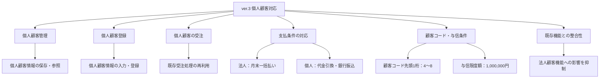

# ver.3 要求分析書

## 1. 文書情報

| 項目 | 内容 |
|---|---|
| 対象システム | 受注管理システム `juchu03` |
| 改修対象バージョン | ver.3 |
| 基準バージョン | ver.2（`juchu02`） |
| 文書名 | 要求分析書 |
| ファイル名 | `要求分析.md` |
| 作成状況 | 初版 |
| 作成目的 | 改修要求を整理し、仕様書・設計書・テスト仕様書の作成につなげる |

## 2. 改修の背景と目的

本改修では、既存の法人顧客を対象とした受注管理システムを拡張し、個人顧客に対しても顧客登録および受注を行えるようにする。

個人顧客の受注処理は、基本的に既存の法人顧客向け受注処理を再利用する。ただし、顧客情報の管理、与信限度額、売掛残高、支払方法など、法人顧客と個人顧客で異なる条件を考慮する必要がある。

本改修の目的は、次のとおりとする。

- 個人顧客を登録・管理できるようにする。
- 個人顧客が商品を注文できるようにする。
- 法人顧客と個人顧客の支払条件の違いを扱えるようにする。
- 既存の受注処理を可能な限り再利用し、既存機能への影響を抑える。
- 提供されたサンプルデータを利用して、個人顧客の登録・受注機能を検証できるようにする。

## 3. 要求の情報源

本書では、以下の資料および既存実装を要求分析の情報源とする。

| ID | 情報源 | 用途 |
|---|---|---|
| SRC-01 | ver.3 改修要件PDF | 改修目的、個人顧客の業務要件、支払条件の確認 |
| SRC-02 | 個人顧客サンプルデータExcel | 個人顧客の登録項目およびテストデータの確認 |
| SRC-03 | `juchu02` の既存ソースコード | 既存の顧客管理、受注、DAO、画面処理の調査 |
| SRC-04 | ver.2 データベース定義SQL | 既存テーブル構成とデータ構造の確認 |
| SRC-05 | 全体改修方針の各資料 | DB改修方針およびバージョンアップ手順の確認 |

※ 要求の根拠が資料から直接確認できる事項と、既存実装を踏まえた検討事項は区別する。詳細な実装方式は設計工程で決定する。

## 4. 現状の整理

### 4.1 既存システム

ver.2では、法人顧客を中心とした顧客管理および受注処理が実装されている。

既存実装の調査対象は次のとおりである。

| 対象 | 主な確認内容 |
|---|---|
| `KokyakuControl.java` | 顧客情報の取得・登録などの制御 |
| `DaoControl.java` | 顧客種別に応じたDAOの振り分け |
| `DaoJuchu.java` | 受注処理および売掛残高更新処理 |
| `cosd1060.jsp` | 支払方法の選択画面 |
| `KOKYAKUHOUJIN_TABLE` | 法人顧客情報の管理 |
| `KOKYAKUPASS_TABLE` | 顧客認証情報の管理 |
| `CTR_CURCODE_TABLE` | コード管理に関係する既存処理 |
| `JUCHU_TABLE` | 受注情報および支払区分の管理 |
| `JUCHUMEISAI_TABLE` | 受注明細の管理 |

### 4.2 現状の課題

1. 顧客管理処理が法人顧客を前提としている箇所がある。
2. 個人顧客を登録・管理するためのデータ構造および処理を追加する必要がある。
3. 顧客種別に応じた登録・検索・認証処理の対応が必要である。
4. 支払方法の選択画面は、現状では「月末一括お支払い」を中心とした構成である。
5. 個人顧客の受注時には、法人顧客とは異なる支払条件および与信条件を考慮する必要がある。
6. 既存の受注処理を再利用する範囲と、個人顧客向けに分岐させる範囲を明確にする必要がある。

## 5. 改修要求一覧

要求IDを後続の仕様書・設計書・テスト仕様書でも共通して使用する。

| 要求ID | 要求内容 | 優先度 | 状態 |
|---|---|---|---|
| REQ-01 | 個人顧客情報を登録・管理できること | 必須 | 要求資料に記載 |
| REQ-02 | 個人顧客の新規登録機能を追加すること | 必須 | 要求資料に記載 |
| REQ-03 | 個人顧客が商品を受注できること | 必須 | 要求資料に記載 |
| REQ-04 | 個人顧客の受注処理は、基本的に法人顧客の受注処理と同様に扱うこと | 必須 | 要求資料に記載 |
| REQ-05 | 法人顧客は月末一括払いとすること | 必須 | 要求資料に記載 |
| REQ-06 | 個人顧客は代金引換または銀行振込で支払えること | 必須 | 要求資料に記載 |
| REQ-07 | 個人顧客の顧客コードは先頭1桁を4～8とすること | 必須 | 要求資料に記載 |
| REQ-08 | 個人顧客の与信限度額を1,000,000円とすること | 必須 | 要求資料に記載 |
| REQ-09 | 提供された個人顧客サンプルデータをテストに利用すること | 必須 | 要求資料に記載 |
| REQ-10 | 既存の法人顧客向け機能への影響を抑えること | 高 | 改修方針上の検討事項 |
| REQ-11 | 顧客種別に応じて顧客情報の登録・参照・認証処理を適切に行うこと | 高 | 既存実装から導出 |
| REQ-12 | 個人顧客の受注において、支払条件および与信条件を適切に扱うこと | 高 | 要求内容から導出 |

※ REQ-10～REQ-12は、改修を実現するために必要と考えられる検討事項である。具体的な振る舞いは仕様書で確定する。

## 6. 要求図

### 6.1 要求図の説明

本改修の中心は、個人顧客の登録・管理および受注機能の追加である。

支払方法については、法人顧客と個人顧客で選択肢が異なるため、顧客種別に応じた制御が必要となる。また、顧客コードおよび与信限度額に関する条件を満たしつつ、既存の受注処理との整合性を確保する。

本図は要求の関係を示すものであり、画面遷移やプログラム内部の呼び出し順序を示すものではない。

## 7. 個人顧客データの分析

### 7.1 サンプルデータの項目

提供されたExcelには、以下の個人顧客情報が含まれている。

| 項目 | 内容 |
|---|---|
| 顧客コード | 個人顧客を識別するコード |
| 顧客名 | 顧客の氏名 |
| 顧客名カナ | 氏名のカナ表記 |
| 郵便番号 | 郵便番号 |
| 県コード | 都道府県を識別するコード |
| 住所1 | 住所の前半部分 |
| 住所2 | 住所の後半部分 |
| 連絡先電話番号 | 顧客の電話番号 |
| FAX番号 | FAX番号 |
| メールアドレス | メールアドレス |
| 売掛残高 | 顧客の売掛残高 |
| 与信限度額 | 顧客の与信限度額 |
| 営業所コード | 顧客を担当する営業所のコード |
| 登録日 | 顧客の登録日 |
| 誕生日 | 顧客の誕生日 |

### 7.2 サンプルデータの概要

| 顧客コード | 顧客名 | 与信限度額 | 営業所コード |
|---|---|---:|---|
| 400000 | 山田太郎 | 1,000,000円 | 01 |
| 400001 | 山田花子 | 1,000,000円 | 02 |
| 400002 | 鈴木一郎 | 1,000,000円 | 03 |
| 400003 | 花山治郎 | 1,000,000円 | 03 |

サンプルデータは4件であり、顧客コードはすべて4から始まっている。与信限度額はすべて1,000,000円である。

### 7.3 データ処理上の確認事項

- FAX番号およびメールアドレスには、値が設定されていないレコードがある。
- 顧客コードや営業所コードは、数値ではなくコードとして扱う必要がある。
- 登録日および誕生日は、Excel上の表記とデータベース上の型・保存形式を確認する必要がある。
- サンプルデータの値を登録処理でどのように変換するかは、入力チェックおよびDB設計時に確認する。

※ 個人情報を含むサンプルデータは、開発・テスト用途の範囲で適切に取り扱う。

## 8. データベース改修の検討

### 8.1 個人顧客テーブル

既存の法人顧客テーブル `KOKYAKUHOUJIN_TABLE` とは別に、個人顧客を管理する `KOKYAKUKOJIN_TABLE` を新設する案を検討する。

これは全体改修方針を踏まえた設計候補であり、最終的なテーブル名・列定義・制約は設計書で確定する。

### 8.2 関連テーブル

| テーブル | 改修上の確認事項 |
|---|---|
| `KOKYAKUHOUJIN_TABLE` | 法人顧客の既存データ・処理を維持できるか |
| `KOKYAKUKOJIN_TABLE` | 個人顧客情報の保存先として新設するか |
| `KOKYAKUPASS_TABLE` | 法人・個人で認証情報を共有する構造が適切か |
| `CTR_CURCODE_TABLE` | 個人顧客コードを既存のコード管理方式で採番できるか |
| `JUCHU_TABLE` | 支払区分を保存する既存項目を利用できるか |
| `JUCHUMEISAI_TABLE` | 個人顧客の受注明細を既存構造で扱えるか |

### 8.3 売掛残高の扱い

既存の受注処理では、法人顧客テーブルを対象に売掛残高を更新する処理が存在する。

個人顧客を追加する際は、個人顧客の支払条件と売掛残高の扱いを確認し、必要に応じて顧客種別に応じた更新処理を検討する。

個人顧客について、売掛残高をどのタイミングで更新するか、また代金引換・銀行振込のそれぞれでどのように扱うかは、現段階では確定しない。

## 9. 機能別の分析

### 9.1 個人顧客登録

個人顧客の氏名、住所、連絡先などを登録できる機能を追加する。

検討事項：

- 入力項目および必須項目
- 顧客コードの採番方法
- 顧客コードの重複防止
- 入力値の形式チェック
- 未入力のFAX番号・メールアドレスの扱い
- 登録成功・失敗時の画面表示
- 認証情報との関連付け

### 9.2 個人顧客認証

既存の認証処理が法人顧客を前提としている場合、個人顧客も認証できるように変更する必要がある。

検討事項：

- 法人顧客と個人顧客の識別方法
- 顧客コードによる検索先の振り分け
- パスワード情報を共有する場合の識別方法
- 既存法人顧客のログイン動作への影響

### 9.3 個人顧客の受注

個人顧客の受注処理は、基本的に法人顧客向けの既存処理を再利用する。

検討事項：

- ログイン中の顧客情報の取得方法
- 受注データと顧客情報の関連付け
- 支払方法の選択と保存
- 与信限度額の適用方法
- 売掛残高の更新要否および更新タイミング
- 受注明細の既存構造を再利用できるか

### 9.4 支払方法

要求資料に記載された支払条件は以下のとおりである。

| 顧客種別 | 支払方法 |
|---|---|
| 法人顧客 | 月末一括払い |
| 個人顧客 | 代金引換、銀行振込 |

画面の表示条件、内部コード、DBへの保存値、および受注後の処理については、既存の `SIHARAI_TYPE` の利用状況を調査したうえで仕様化する。

## 10. 未確定事項・追加調査事項

以下は、仕様書を確定する前に調査または判断が必要な事項である。

| ID | 確認事項 | 確認する理由 | 次の対応 |
|---|---|---|---|
| U-01 | 個人顧客登録画面を新設するか、既存画面を拡張するか | 画面構成と既存機能への影響が変わる | JSP・画面遷移を調査 |
| U-02 | 個人顧客コードの採番方法 | 先頭1桁の条件と一意性を満たす必要がある | 既存のコード管理処理を調査 |
| U-03 | 個人顧客の誕生日・登録日の保存形式 | Excelの値とDBの型を整合させる必要がある | DB定義と既存DAOを調査 |
| U-04 | 支払方法コードの対応関係 | 画面表示と `SIHARAI_TYPE` の保存値を一致させる必要がある | 既存コード・SQLを調査 |
| U-05 | 個人顧客の与信限度額を登録時に固定するか | 登録処理と受注時のチェックに影響する | 既存の与信チェック処理を調査 |
| U-06 | 法人・個人間で顧客コードやメールアドレスの重複を許容するか | 顧客識別および認証の一意性に影響する | DB制約・認証処理を調査 |
| U-07 | FAX番号・メールアドレスの未設定値をどう扱うか | NULL、空文字などの保存方法を統一する必要がある | 既存DB・入力チェックを調査 |
| U-08 | 個人顧客の受注で売掛残高を更新するか | 支払方法と債権管理の整合性に影響する | `DaoJuchu.java` と関連仕様を調査 |
| U-09 | 代金引換・銀行振込を選択した後の業務処理 | 支払方法の記録だけでよいか、追加処理が必要かを判断する | 改修要件と既存受注処理を確認 |

未確定事項は、既存コード・DB定義・提供資料を追加調査し、資料で判断できないものだけを仕様決定事項として残す。

## 11. 影響範囲

現時点で、以下の領域を主な影響範囲として想定する。

| 領域 | 影響内容 |
|---|---|
| 画面 | 個人顧客登録画面、支払方法選択画面 |
| 顧客制御 | 個人顧客の登録・検索・認証 |
| DAO | 個人顧客テーブルへの登録・参照処理 |
| データベース | 個人顧客テーブル、必要に応じた関連定義 |
| 受注処理 | 顧客種別に応じた顧客情報取得、支払条件、与信条件 |
| テスト | 個人顧客登録、認証、受注、支払方法、既存法人顧客機能の回帰確認 |

実際に変更するクラス・JSP・SQLは、設計工程で既存コードを確認して確定する。

## 12. テスト観点の初期整理

テスト仕様書の作成時には、少なくとも以下の観点を含める。

1. 個人顧客を正常に登録できること。
2. 登録した個人顧客情報を正しく参照できること。
3. 個人顧客コードが要求された条件を満たすこと。
4. 必須項目や入力形式のチェックが適切に行われること。
5. 個人顧客が認証できること。
6. 個人顧客が商品を受注できること。
7. 代金引換・銀行振込の支払方法を適切に選択・保存できること。
8. 与信限度額が要求どおりに扱われること。
9. 法人顧客の登録・認証・受注・支払処理が従来どおり動作すること。
10. サンプルデータ4件を使用して、登録・参照などの確認ができること。

具体的なテスト条件、操作手順、期待結果は、仕様・設計を確定した後にテスト仕様書へ記載する。

## 13. 初版のまとめ

ver.3では、個人顧客の登録・管理と受注を追加し、法人顧客とは異なる支払条件を扱えるようにすることが主な改修要求である。

実装にあたっては、既存の法人顧客向け処理を可能な限り再利用しながら、個人顧客情報の管理、認証、顧客コード、与信限度額、支払方法および売掛残高の扱いを整理する必要がある。

次工程では、未確定事項を既存コード・DB定義・改修要件資料から追加調査し、確定した要求を基に `ver.3_仕様書.md` を作成する。
