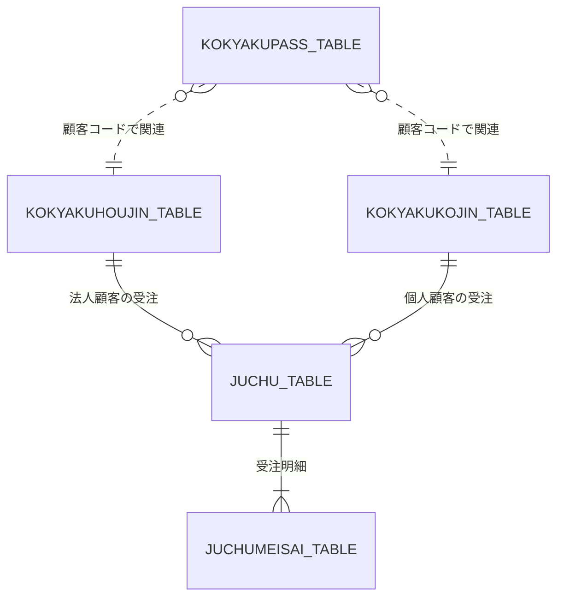

# Web注文システム ver.3 DB設計書

## 1. 文書情報

| 項目 | 内容 |
|---|---|
| システム名 | Web注文システム |
| 対象バージョン | ver.3 |
| 対象プロジェクト | `juchu03`（予定） |
| 対象データベース | `COSCOMMON03`（予定） |
| 基準バージョン | ver.2 / `juchu02` |
| 文書種別 | DB設計書 |
| 文書状態 | 初版更新・未確定事項あり |

※ プロジェクト名およびデータベース名は予定名称である。実際の作成環境に合わせて確定する。

---

## 2. 目的

本書は、Web注文システム ver.3 において個人顧客を扱えるようにするため、データベースの変更方針、テーブル構成、項目、制約およびテーブル間の関連を定義する。

ver.3では、既存の法人顧客向け機能を維持しながら、次の機能に対応する。

- 個人顧客情報の登録・管理
- 個人顧客のログイン認証
- 個人顧客による受注
- 個人顧客の与信限度額の管理
- 法人・個人それぞれの支払方法への対応

本書では、ver.2のDDL、初期データSQL、Javaソースおよび個人顧客のサンプルデータから確認できた情報と、ver.3で追加・変更する設計案を区別する。

---

## 3. DB設計方針

### 3.1 基本方針

1. ver.2の既存テーブルを基準とし、法人顧客の既存機能に影響を与えない。
2. 個人顧客情報は、法人顧客情報と区別して管理する方針とする。
3. 顧客認証には既存の `KOKYAKUPASS_TABLE` を利用する方針とする。
4. 受注情報には既存の `JUCHU_TABLE` を利用し、顧客コードによって顧客を識別する。
5. 個人顧客の与信限度額は1,000,000円とする。
6. 個人顧客コードは6桁とし、先頭桁が4～8の範囲となるようにする。
7. ver.3のDB変更はver.3用の環境で実施し、ver.2以前の環境は変更しない。
8. 顧客種別に応じた顧客情報の取得、与信判定および残高更新について、DB構造とJavaソースの整合性を確保する。

### 3.2 DB変更対象の概要

| 区分 | テーブル | ver.3での方針 |
|---|---|---|
| 既存 | `KOKYAKUHOUJIN_TABLE` | 法人顧客情報を管理する。既存構造を維持する |
| 既存 | `KOKYAKUPASS_TABLE` | 顧客認証情報を管理する。個人顧客にも利用する方針 |
| 既存 | `JUCHU_TABLE` | 受注情報を管理する。支払方法コードと顧客種別の整合性を確認する |
| 既存 | `JUCHUMEISAI_TABLE` | 受注明細を管理する。既存構造を基本的に維持する |
| 既存 | `CTR_CURCODE_TABLE` | 顧客コードなどの採番管理に利用する。個人顧客用の管理方法を検討する |
| 新設候補 | `KOKYAKUKOJIN_TABLE` | 個人顧客情報を管理する |
| 既存 | `ERR_JUCHU_TABLE` | エラー受注情報を管理する。個人顧客対応への影響を確認する |
| 既存 | `ERR_JUCHUMEISAI_TABLE` | エラー受注明細を管理する。個人顧客対応への影響を確認する |

※ `KOKYAKUKOJIN_TABLE` は初版で使用している候補名であり、実装時の命名規則との最終照合が必要である。

---

## 4. テーブル関連

### 4.1 論理関連図

### 4.2 関連図の補足

- `JUCHU_TABLE` は顧客コードを保持する既存構成を利用する。
- 法人・個人の顧客情報は、顧客コードの先頭桁に応じて参照先を切り替える方針とする。
- `KOKYAKUPASS_TABLE` と顧客情報テーブルの関連は論理的な関連を示す。既存DDLで外部キー制約が定義されていることを意味しない。
- `JUCHUMEISAI_TABLE` と `JUCHU_TABLE` の物理的な関連制約は、既存DDLに基づいて扱う。
- 顧客コードを参照するテーブルが複数存在するため、顧客種別による参照先の判定をアプリケーション側で一貫させる。

---

## 5. テーブル定義

### 5.1 `KOKYAKUHOUJIN_TABLE`（既存）

#### 役割

法人顧客の基本情報、連絡先、売掛残高、与信限度額などを管理する。

#### 既存DDLで確認できた定義

| No. | カラム名 | データ型 | NULL制約・備考 |
|---:|---|---|---|
| 1 | `KOKYAKUCD` | `CHAR(6)` | 主キー |
| 2 | `KOKYAKUNAME` | `VARCHAR(50)` | `NOT NULL` |
| 3 | `KOKYAKUKANA` | `VARCHAR(50)` | NULL許容 |
| 4 | `ZIP` | `CHAR(8)` | `NOT NULL` |
| 5 | `KENCD` | `CHAR(2)` | `NOT NULL` |
| 6 | `ADDRESS1` | `VARCHAR(50)` | `NOT NULL` |
| 7 | `ADDRESS2` | `VARCHAR(50)` | `NOT NULL` |
| 8 | `TEL` | `CHAR(13)` | `NOT NULL` |
| 9 | `FAX` | `CHAR(13)` | NULL許容 |
| 10 | `MAIL` | `VARCHAR(256)` | NULL許容 |
| 11 | `URIKAKE_ZAN` | `INT(8)` | `NOT NULL` |
| 12 | `YOSIN_GENDO` | `INT(8)` | `NOT NULL` |
| 13 | `EIGYOUSHOCD` | `CHAR(2)` | `NOT NULL` |
| 14 | `TOUROKU_D` | `DATETIME` | `NOT NULL` |
| 15 | `TANTOUNAME` | `VARCHAR(50)` | NULL許容 |
| 16 | `TANTOUBUSHO` | `VARCHAR(50)` | NULL許容 |
| 17 | `GYOUSHU` | `VARCHAR(20)` | NULL許容 |

#### ver.3での方針

- 法人顧客向けの既存テーブル構造を維持する。
- 法人顧客コードは既存の採番方式を維持する。
- 法人顧客の与信限度額や売掛残高の処理を、個人顧客対応のために不必要に変更しない。
- 受注DAOが本テーブルを直接参照・更新している処理について、個人顧客対応の変更範囲を明確にする。

---

### 5.2 `KOKYAKUKOJIN_TABLE`（新設候補）

#### 役割

個人顧客の基本情報、連絡先、売掛残高、与信限度額および誕生日を管理する。

#### 項目定義案

次の定義は、既存の法人顧客テーブルと個人顧客サンプルデータを基にした設計案である。既存DDLで確認された定義ではない。

| No. | 論理項目 | カラム名案 | データ型案 | NULL制約案 | 備考 |
|---:|---|---|---|---|---|
| 1 | 顧客コード | `KOKYAKUCD` | `CHAR(6)` | `NOT NULL` | 主キー候補 |
| 2 | 顧客名 | `KOKYAKUNAME` | `VARCHAR(50)` | `NOT NULL` | 個人顧客の氏名 |
| 3 | 顧客名カナ | `KOKYAKUKANA` | `VARCHAR(50)` | 要確認 | 氏名のカナ表記 |
| 4 | 郵便番号 | `ZIP` | `CHAR(8)` | `NOT NULL` | 既存形式を踏襲 |
| 5 | 県コード | `KENCD` | `CHAR(2)` | `NOT NULL` | 既存形式を踏襲 |
| 6 | 住所1 | `ADDRESS1` | `VARCHAR(50)` | `NOT NULL` | 都道府県・市区町村等 |
| 7 | 住所2 | `ADDRESS2` | `VARCHAR(50)` | `NOT NULL` | 番地・建物等 |
| 8 | 連絡先電話番号 | `TEL` | `CHAR(13)` | `NOT NULL` | 既存形式を踏襲 |
| 9 | FAX番号 | `FAX` | `CHAR(13)` | NULL許容案 | サンプルにNULLあり |
| 10 | メールアドレス | `MAIL` | `VARCHAR(256)` | NULL許容案 | サンプルにNULLあり |
| 11 | 売掛残高 | `URIKAKE_ZAN` | `INT(8)` | `NOT NULL` | 初期サンプル値は0 |
| 12 | 与信限度額 | `YOSIN_GENDO` | `INT(8)` | `NOT NULL` | 1,000,000円 |
| 13 | 営業所コード | `EIGYOUSHOCD` | `CHAR(2)` | `NOT NULL` | 既存形式を踏襲 |
| 14 | 登録日 | `TOUROKU_D` | `DATETIME` | `NOT NULL` | 顧客登録日 |
| 15 | 誕生日 | `BIRTHDAY` | `DATETIME` | 要確認 | 個人顧客固有項目 |

#### 制約・設計上の注意

- 顧客コードは6桁とし、先頭桁が4～8の範囲となるようにする。
- 顧客コードの主キー制約により、同一テーブル内の重複を防止する。
- 法人顧客テーブルとは別テーブルであるため、主キー制約だけでは法人・個人間の顧客コード重複を防止できない。採番処理でも重複を防止する。
- FAX番号とメールアドレスはサンプルデータにNULLがあるため、NULL許容を基本案とする。
- 電話番号・郵便番号は数値ではなく文字列として管理する。
- `BIRTHDAY` の型は既存テーブルの `DATETIME` を参考にした案であり、登録処理との照合後に確定する。
- 法人顧客テーブルと共通する項目であっても、既存コードとの互換性を確認せずにテーブルを統合しない。

---

### 5.3 `KOKYAKUPASS_TABLE`（既存）

#### 役割

顧客コードとパスワードを管理する認証テーブルである。

#### 既存DDLで確認できた定義

| No. | カラム名 | データ型 | NULL制約・備考 |
|---:|---|---|---|
| 1 | `KOKYAKUCD` | `CHAR(6)` | 主キー |
| 2 | `PASSWORD` | `CHAR(20)` | `NOT NULL` |

#### ver.3での方針

- 法人顧客と個人顧客で共通利用する方針とする。
- 個人顧客情報を登録する際にも、同じ顧客コードを認証テーブルに登録する。
- 認証情報と顧客情報の両方が存在することを、ログイン処理で確認する。
- 顧客情報登録と認証情報登録は、途中失敗時に不整合な状態が確定しないようトランザクションを検討する。
- パスワードの保存・照合方式は既存実装に従う。ver.3で保存方式を変更する場合は、別途設計する。
- 既存DDLに外部キー制約が明示されていない場合、新たな制約を追加するかは既存処理への影響を確認して決定する。

---

### 5.4 `JUCHU_TABLE`（既存）

#### 役割

受注情報を管理する。法人顧客の既存受注機能を維持しながら、個人顧客の受注にも対応する。

#### 既存DDLで確認できた主要項目

| No. | カラム名 | データ型 | NULL制約・備考 |
|---:|---|---|---|
| 1 | `JUCHUCD` | `CHAR(10)` | 主キー |
| 2 | `KOKYAKUCD` | `CHAR(6)` | `NOT NULL` |
| 3 | `JUCHU_D` | `DATETIME` | `NOT NULL` |
| 4 | `TOTALKINGAKU` | `INT(8)` | `NOT NULL` |
| 5 | `SIHARAI_TYPE` | `TINYINT(1)` | `NOT NULL` |
| 6 | `A_NOUHINYOTEI_D` | `DATETIME` | `NOT NULL` |
| 7 | `A_NOUHINYOTEITRANGE` | `VARCHAR(15)` | `NOT NULL` |
| 8 | `A_NOUHINSHOBAN` | `CHAR(10)` | NULL許容 |
| 9 | `A_PICKING_FLG` | `TINYINT(1)` | `DEFAULT 0` |
| 10 | `A_PICKING_D` | `DATETIME` | NULL許容 |
| 11 | `A_SHUKKAEND_FLG` | `TINYINT(1)` | `DEFAULT 0` |
| 12 | `A_SHUKKAEND_D` | `DATETIME` | NULL許容 |
| 13 | `A_NOUHINEND_FLG` | `TINYINT(1)` | `DEFAULT 0` |
| 14 | `A_NOUHINEND_D` | `DATETIME` | NULL許容 |
| 15 | `A_CANCEL_FLG` | `TINYINT(1)` | `DEFAULT 0` |
| 16 | `A_CANCEL_D` | `DATETIME` | NULL許容 |

#### ver.3での方針

- 受注テーブルは既存構造を基本的に維持する。
- `KOKYAKUCD` に法人顧客コードまたは個人顧客コードを保存する。
- 顧客種別に応じて、顧客情報の取得先と与信判定対象を切り替える。
- 支払方法は既存の `SIHARAI_TYPE` を使用する方針とする。
- 現行画面で確認できた法人向け「月末一括お支払い」の送信値は `0` である。
- 個人向けの代金引換・銀行振込のコード値は未確定とし、仕様確認後に決定する。
- 受注DAOの与信判定および売掛残高更新処理を、個人顧客にも対応させる必要がある。

---

### 5.5 `JUCHUMEISAI_TABLE`（既存）

#### 役割

受注に含まれる商品、数量、金額、納品予定などの明細情報を管理する。

#### 既存DDLで確認できた主要項目

| No. | カラム名 | データ型 | NULL制約・備考 |
|---:|---|---|---|
| 1 | `JUCHUCD` | `CHAR(10)` | 主キー構成項目 |
| 2 | `GOODSCD` | `CHAR(14)` | 主キー構成項目 |
| 3 | `LINENUM` | `INT(3)` | `NOT NULL` |
| 4 | `SURYOU` | `INT(4)` | `NOT NULL` |
| 5 | `KINGAKU` | `INT(8)` | `NOT NULL` |
| 6 | `NOUHINYOTEI_D` | `DATETIME` | `NOT NULL` |
| 7 | `NOUHINYOTEITRANGE` | `VARCHAR(15)` | `NOT NULL` |
| 8 | `NOUHINSHOBAN` | `CHAR(13)` | NULL許容 |
| 9 | `PICKING_FLG` | `TINYINT(1)` | `DEFAULT 0` |
| 10 | `PICKING_D` | `DATETIME` | NULL許容 |
| 11 | `SHUKKAEND_FLG` | `TINYINT(1)` | `DEFAULT 0` |
| 12 | `SHUKKAEND_D` | `DATETIME` | NULL許容 |
| 13 | `NOUHINEND_FLG` | `TINYINT(1)` | `DEFAULT 0` |
| 14 | `NOUHINEND_D` | `DATETIME` | NULL許容 |
| 15 | `CANCEL_FLG` | `TINYINT(1)` | `DEFAULT 0` |
| 16 | `CANCEL_D` | `DATETIME` | NULL許容 |

主キーは `JUCHUCD` と `GOODSCD` の複合主キーである。

#### ver.3での方針

- 個人顧客対応に伴う直接的なテーブル変更は、現時点では想定しない。
- 受注ヘッダーと明細の登録が既存処理を利用して正常に行われることを確認する。
- 個人顧客の受注においても、受注コードと商品コードの対応を維持する。

---

### 5.6 `CTR_CURCODE_TABLE`（既存）

#### 役割

顧客コード、受注コードなどの採番管理情報を保持する。

#### 既存データで確認できた採番情報

| DATANAME | CODENAME | CURCODE |
|---|---|---|
| `KOKYAKUHOUJIN_TABLE` | `KOKYAKUCD` | `100004` |
| `JUCHU_TABLE` | `JUCHUCD` | `1202000008` |
| `NOUHIN_DATA` | `NOUHINSYOBAN` | `1202000001` |
| `ERR_JUCHU_TABLE` | `JUCHUERRCD` | `0000000001` |

既存の採番処理では、`DATANAME` を指定して `CURCODE` を取得する方式が使われている。

#### 個人顧客の採番設計案

個人顧客コードの先頭桁4～8を実現するため、既存の採番管理テーブルに個人顧客用の管理行を追加する方式を候補とする。

| 項目 | 設計案 |
|---|---|
| `DATANAME` | `KOKYAKUKOJIN_TABLE` |
| `CODENAME` | `KOKYAKUCD` |
| 初期 `CURCODE` | `400003`（サンプル4件を登録済みとする場合） |
| 次回採番候補 | `400004` |
| 許容コード範囲 | `400000`～`899999` |
| 上限到達時 | 採番を中止する |

※ 上記は設計案であり、確定仕様ではない。サンプルデータの投入方法と既存の採番処理を確認してから決定する。

#### 採番時の注意

- 法人顧客用の採番値を変更しない。
- 個人顧客コードの先頭桁が4～8の範囲であることを確認する。
- `899999` を超えるコードを発行しない。
- 同時登録時に同一コードが発行されないよう、採番値の取得・更新方法を検討する。
- 採番処理と顧客情報・認証情報の登録結果の整合性を確保する。
- 初期データ登録時の顧客コードと、登録機能が発行するコードを混同しない。

---

## 6. 個人顧客サンプルデータ

### 6.1 登録対象

個人顧客のサンプルデータとして、次の4件を登録対象とする。

| 顧客コード | 顧客名 | 郵便番号 | 県コード | 住所1 | 住所2 | 電話番号 | FAX番号 | メールアドレス | 売掛残高 | 与信限度額 | 営業所コード | 登録日 | 誕生日 |
|---|---|---|---|---|---|---|---|---|---:|---:|---|---|---|
| 400000 | 山田太郎 | 657-0802 | 28 | 兵庫県神戸市灘区 | 原田18丁目2-3 | 001-124-5543 | 001-124-5545 | yosida@dream.com | 0 | 1000000 | 01 | 20090302 | 19800402 |
| 400001 | 山田花子 | 105-0004 | 13 | 東京都港区 | 新橋12丁目1-6 | 022-887-5454 | NULL | NULL | 0 | 1000000 | 02 | 20090501 | 19850203 |
| 400002 | 鈴木一郎 | 814-0001 | 40 | 福岡県福岡市早良区 | 百道浜15丁目2-2 | 092-833-5191 | NULL | NULL | 0 | 1000000 | 03 | 20101101 | 19760917 |
| 400003 | 花山治郎 | 819-0022 | 40 | 福岡県福岡市西区 | 福重9丁目22-1 | 090-1111-1111 | NULL | NULL | 0 | 1000000 | 03 | 20101101 | 19671111 |

※ 顧客名カナなど、表に含めていない項目については元のサンプルデータを登録SQL作成時に参照する。

### 6.2 登録時の注意

- 顧客コード、郵便番号、電話番号、FAX番号は文字列として扱う。
- 電話番号・郵便番号に含まれるハイフンの形式は、既存の登録処理と統一する。
- FAX番号とメールアドレスにはNULLが含まれるため、NULLと空文字列を区別する。
- 氏名、住所、メールアドレスなどに文字化けがないことを確認する。
- 4件とも売掛残高は0、与信限度額は1,000,000円とする。
- 登録日と誕生日は、登録SQLで使用する日付形式に変換する。
- サンプルデータの登録後、採番管理値が次回採番と矛盾しないことを確認する。

---

## 7. 制約・整合性設計

### 7.1 顧客コード

| 項目 | 方針 |
|---|---|
| 桁数 | 6桁 |
| 法人顧客コード | 既存体系を維持 |
| 個人顧客コード | 先頭桁4～8 |
| 同一テーブル内の一意性 | 主キーで保証する |
| 法人・個人間の一意性 | 採番処理で重複を防止する |
| 不正なコード | 登録・認証時に拒否する |

法人顧客と個人顧客が別テーブルに分かれる場合、各テーブルの主キーだけではテーブル間の顧客コード重複を防止できない。そのため、顧客コードの採番ルールを共通の業務ルールとして扱う。

### 7.2 与信限度額・売掛残高

- 個人顧客の与信限度額は1,000,000円とする。
- 個人顧客のサンプルデータの売掛残高は0とする。
- 既存の `DaoJuchu` では、売掛残高と今回の受注金額を利用した与信判定が行われている。
- 現行の売掛残高更新SQLは `KOKYAKUHOUJIN_TABLE` を対象としているため、個人顧客への対応では更新先の切り替えが必要である。
- 個人顧客の代金引換・銀行振込に対して、どのタイミングで与信判定や売掛残高更新を行うかは、業務仕様の確定後に設計する。
- 金額カラムのデータ型、桁数およびNULL制約は既存DDLとの整合性を維持する。

### 7.3 メールアドレス

- 個人顧客のサンプルデータにはメールアドレスがNULLのレコードがある。
- 個人顧客のメールアドレスを必須とするかは、登録仕様と合わせて確定する。
- 既存の `DaoHoujin.checkMail()` は法人顧客テーブルを対象としている。
- 法人・個人を横断してメールアドレスの重複を禁止するかは、仕様確認後に決定する。
- DB制約で一意性を保証するか、アプリケーション側のチェックとするかは、既存実装とDB構成を確認して決定する。

### 7.4 NULL制約

- FAX番号とメールアドレスは、サンプルデータにNULLがあることを踏まえてNULL許容を基本案とする。
- その他の項目のNULL制約は、既存法人テーブルと個人顧客登録画面の入力条件を照合して決定する。
- 初期データに存在しない値を空文字列や固定値で補完する場合は、その理由とルールを明確にする。

### 7.5 外部キー

既存DDLにおける外部キー制約の有無を確認し、論理的な関連と物理的な制約を区別する。

初版では、既存テーブルに新たな外部キー制約を追加することを確定しない。既存SQL・DAOおよびDB環境への影響を確認したうえで判断する。

---

## 8. 変更対象と実装への影響

| 対象 | 変更・確認内容 |
|---|---|
| DDL | 個人顧客テーブルの定義を確定し、作成SQLを追加する |
| 初期データSQL | 個人顧客のサンプルデータ4件を追加する |
| 採番管理 | 個人顧客コードの採番方式を決定する |
| 認証テーブル | 個人顧客の認証情報を登録できることを確認する |
| 顧客DAO | 個人顧客の登録・取得・重複チェックに対応する |
| 認証処理 | 顧客コードの先頭桁に応じて顧客種別を判定する |
| 受注DAO | 顧客種別に応じた与信判定と残高更新に対応する |
| 受注テーブル | 支払方法コードの追加要否を確認する |
| エラー受注関連 | 個人顧客の受注エラーが既存の管理方法で扱えることを確認する |
| SQL確認用ファイル | 件数、顧客コード、与信限度額、残高、支払方法などを検証するSQLを用意する |

---

## 9. DB検証項目

以下はDB設計段階での確認観点であり、正式なテスト仕様書・テスト結果報告書とは区別する。

| No. | 確認項目 | 期待結果 |
|---:|---|---|
| 1 | 個人顧客テーブル | 設計どおりに作成されている |
| 2 | 個人顧客サンプルデータ | 4件が正しく登録されている |
| 3 | 顧客コード | 6桁で、個人顧客コードの先頭桁が4～8である |
| 4 | 顧客コードの重複 | 同一コードが重複して登録されない |
| 5 | 与信限度額 | 個人顧客の初期値が1,000,000円である |
| 6 | 売掛残高 | サンプルデータの初期値が0である |
| 7 | NULL項目 | FAX・メールアドレスのNULLが仕様どおり扱われる |
| 8 | 認証情報 | 個人顧客の顧客コードと認証情報が対応している |
| 9 | 法人顧客データ | ver.2の既存データに不必要な変更がない |
| 10 | 個人顧客の受注 | 個人顧客コードが受注情報に保存される |
| 11 | 支払方法 | 選択した支払方法が確定したコードで保存される |
| 12 | 与信判定 | 顧客種別に応じた与信限度額と残高が使用される |
| 13 | 売掛残高更新 | 顧客種別に対応したテーブルが更新される |
| 14 | 採番管理 | 個人顧客の次回採番値が正しく更新される |
| 15 | 採番上限 | 先頭桁4～8の範囲を超えるコードが発行されない |
| 16 | 受注明細 | 個人顧客の受注についても明細が正しく登録される |

---

## 10. 要確認事項一覧

| ID | 確認事項 | 確認方法 | 確定する内容 |
|---|---|---|---|
| DB-01 | 個人顧客テーブル名 | 既存命名規則・Javaソースを確認 | 物理テーブル名 |
| DB-02 | 個人顧客テーブルの物理項目 | サンプルデータ・既存DDLを照合 | カラム名、型、桁数、NULL制約 |
| DB-03 | 顧客コードの採番方式 | 採番DAO・管理テーブルを確認 | 採番範囲、初期値、更新方法 |
| DB-04 | 採番時の重複防止 | 既存採番処理とDB更新方式を確認 | 同時登録時の制御方法 |
| DB-05 | 認証情報の管理 | 既存DDL・認証DAOを確認 | 共通管理方式と整合性の確保方法 |
| DB-06 | 支払方法コード | 画面・受注処理・DDLを照合 | 代金引換・銀行振込のコード値 |
| DB-07 | 個人顧客の与信判定 | 受注DAOと業務仕様を確認 | 支払方法ごとの判定要否 |
| DB-08 | 売掛残高の更新 | 受注DAOの更新SQLを確認 | 更新対象と更新条件 |
| DB-09 | メールアドレスの重複 | 顧客登録DAOを確認 | 法人・個人間の重複ルール |
| DB-10 | NULL制約 | サンプルデータと登録画面を確認 | 必須項目・NULL許容 |
| DB-11 | 外部キー制約 | 既存DDLを確認 | 物理制約の有無と追加要否 |
| DB-12 | ver.3のDB名・配置 | バージョン管理方針を確認 | DB名、SQL配置先 |
| DB-13 | 誕生日のデータ型 | サンプルデータと登録処理を確認 | `BIRTHDAY` の型と保存形式 |
| DB-14 | エラー受注への対応 | 受注DAO・エラー関連DDLを確認 | 個人顧客のエラー受注の扱い |

---

## 11. 初版更新のまとめ

ver.3では、既存の法人顧客向けDB構成を維持しながら、個人顧客情報の管理、認証、受注および与信判定に必要なDB対応を行う。

既存DDLで確認できた法人顧客テーブル、認証テーブル、受注テーブル、受注明細テーブルおよび採番管理テーブルの定義を整理した。

個人顧客テーブルは `KOKYAKUKOJIN_TABLE` を候補とし、法人顧客テーブルの項目構成を参考にした定義案を示した。ただし、個人顧客テーブルの物理定義、採番方式、支払方法コード、支払方法ごとの与信判定・残高更新ルールは、現時点では確定していない。

次の作業では、Javaソースの顧客登録・認証・受注処理と本書の設計内容を照合し、未確定事項を順に確定する。その後、詳細設計書を本書に合わせて更新し、テスト仕様書の作成と実装に進む。
