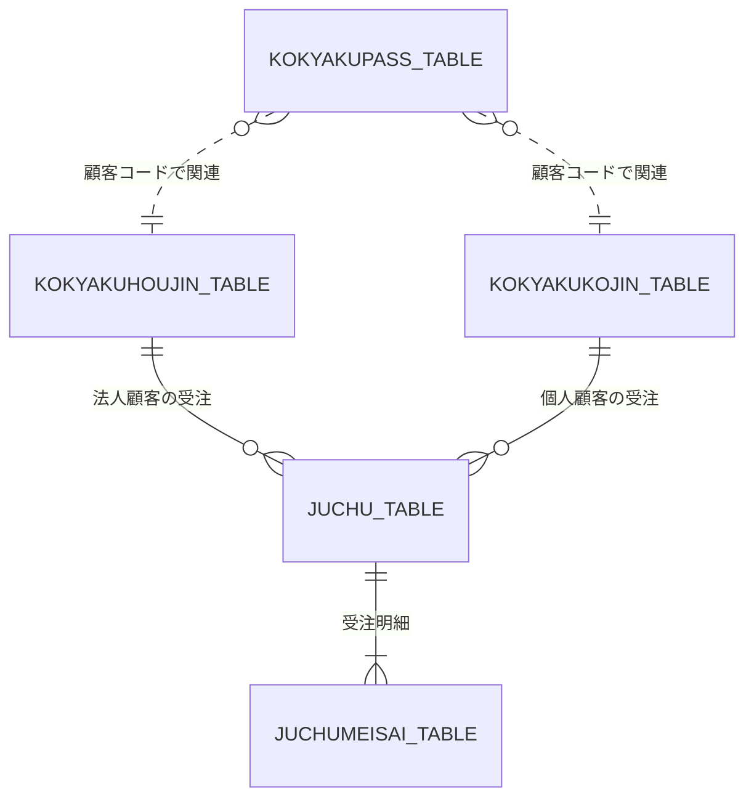

# Web注文システム ver.3 DB設計書

## 1. 文書情報

| 項目 | 内容 |
|---|---|
| システム名 | Web注文システム |
| 対象バージョン | ver.3 |
| 対象プロジェクト | `juchu03`（予定） |
| 対象データベース | `COSCOMMON03`（予定） |
| 基準バージョン | ver.2 / `juchu02` |
| 文書種別 | DB設計書（初版） |
| 文書状態 | 初版・レビュー前 |

※ プロジェクト名およびデータベース名は、既存のバージョン管理方針に基づく予定名称である。実際の作成環境に合わせて確定する。

---

## 2. 目的

本書は、Web注文システム ver.3 において個人顧客を扱えるようにするため、データベースの変更方針、テーブル構成、項目、制約およびテーブル間の関連を定義する。

ver.3では、既存の法人顧客向け機能を維持しながら、次の機能に対応する。

- 個人顧客情報の登録・管理
- 個人顧客のログイン認証
- 個人顧客による受注
- 個人顧客の与信限度額の管理
- 法人・個人それぞれの支払方法への対応

本書は初版であり、既存DDL・Javaソース・サンプルデータとの照合を行いながら内容を確定する。

## 3. DB設計方針

### 3.1 基本方針

1. ver.2の既存テーブルを基準とし、法人顧客の既存機能に影響を与えない。
2. 個人顧客情報を法人顧客情報と区別して管理する。
3. 法人・個人の認証情報を管理する仕組みを整理し、顧客コードによる識別を維持する。
4. 受注情報には顧客コードを保持し、受注時の顧客を識別できる構成とする。
5. 個人顧客の与信限度額は1,000,000円とする。
6. 個人顧客コードは先頭桁が4～8の範囲となる仕様に対応する。
7. DB変更はver.3用の環境で実施し、ver.2以前の環境は変更しない。

### 3.2 DB変更対象の概要

| 区分 | テーブル | ver.3での方針 |
|---|---|---|
| 既存 | `KOKYAKUHOUJIN_TABLE` | 法人顧客情報を管理する。既存機能を維持する |
| 既存 | `KOKYAKUPASS_TABLE` | 顧客コードと認証情報を管理する。個人顧客対応方法を検討する |
| 既存 | `JUCHU_TABLE` | 受注情報を管理する。支払方法の保存仕様を確認する |
| 既存 | `JUCHUMEISAI_TABLE` | 受注明細を管理する。ver.3での変更要否を確認する |
| 既存 | `CTR_CURCODE_TABLE` | 顧客コード等の採番管理を確認する |
| 新設候補 | `KOKYAKUKOJIN_TABLE` | 個人顧客情報を管理する |
| 要確認 | その他の関連テーブル | 既存DDL・SQLを調査し、変更要否を判定する |

※ 新設候補のテーブル名は設計上の仮称であり、実際の命名規則と既存ソースとの整合性を確認して確定する。

---

## 4. テーブル関連図

### 4.1 関連図の補足

- `JUCHU_TABLE`は顧客コードを保持する既存構成を前提とする。
- 法人・個人の顧客情報をどのように参照するかは、顧客コード体系およびDAOの実装方式と合わせて確定する。
- `KOKYAKUPASS_TABLE`と顧客情報テーブルの関連は、現行DDLで外部キー制約が定義されていることを確認したものではない。図中の関連は論理的な関係を示す。
- `JUCHUMEISAI_TABLE`との関連についても、既存DDLの主キー・外部キー定義を確認する。

---

## 5. テーブル定義

### 5.1 `KOKYAKUHOUJIN_TABLE`（既存）

#### 役割

法人顧客情報を管理する既存テーブルである。ver.3では法人顧客の登録・ログイン・受注処理との互換性を維持する。

#### 設計方針

- 既存のテーブル構造を原則として維持する。
- 法人顧客の与信限度額および売掛残高を既存仕様に従って管理する。
- 個人顧客対応のために既存の法人データを不必要に変更しない。
- 顧客コード・売掛残高・与信限度額の実際のカラム定義は、ver.2のDDLで確認する。

| 項目 | 内容 |
|---|---|
| テーブル名 | `KOKYAKUHOUJIN_TABLE` |
| 用途 | 法人顧客情報の管理 |
| 主キー | 要確認（既存DDLで確定） |
| ver.3での変更 | 原則変更なし。個人顧客対応との整合性を確認 |

### 5.2 `KOKYAKUKOJIN_TABLE`（新設候補）

#### 役割

個人顧客の基本情報、連絡先、売掛残高、与信限度額などを管理する。

#### 項目定義（初版）

以下は、個人顧客のサンプルデータに基づく論理項目である。物理カラム名・データ型・桁数・NULL制約は、既存DDLおよび実装方針を確認して確定する。

| No. | 論理項目 | 物理カラム名（案） | データ型・制約 | 備考 |
|---:|---|---|---|---|
| 1 | 顧客コード | `KOKYAKUCD` | 要確認 | 主キー候補。6桁の顧客コードを想定 |
| 2 | 顧客名 | 要確認 | 要確認 | 個人顧客の氏名 |
| 3 | 顧客名カナ | 要確認 | 要確認 | 氏名のカナ表記 |
| 4 | 郵便番号 | 要確認 | 要確認 | 郵便番号 |
| 5 | 県コード | 要確認 | 要確認 | 都道府県コード |
| 6 | 住所1 | 要確認 | 要確認 | 都道府県・市区町村等 |
| 7 | 住所2 | 要確認 | 要確認 | 番地・建物等 |
| 8 | 連絡先電話番号 | 要確認 | 要確認 | 電話番号 |
| 9 | FAX番号 | 要確認 | 要確認 | サンプルデータにNULLあり |
| 10 | メールアドレス | 要確認 | 要確認 | サンプルデータにNULLあり |
| 11 | 売掛残高 | 要確認 | 要確認 | 初期サンプル値は0 |
| 12 | 与信限度額 | 要確認 | 要確認 | 個人顧客は1,000,000円 |
| 13 | 営業所コード | 要確認 | 要確認 | 既存の営業所コード体系を使用する想定 |
| 14 | 登録日 | 要確認 | 要確認 | 顧客登録日 |
| 15 | 誕生日 | 要確認 | 要確認 | 個人顧客の生年月日情報 |

#### 主な制約・確認事項

- 顧客コードは一意であること。
- 顧客コードの先頭桁は4～8の範囲とする。
- 与信限度額の初期値は1,000,000円とする。
- FAX番号・メールアドレスは、サンプルデータにNULLが含まれるため、NULL許容の要否を確認する。
- メールアドレスの重複を法人・個人間で禁止するかは要確認。
- 法人テーブルと共通化できる項目があっても、既存コードとの互換性を確認せずにテーブル統合は行わない。

### 5.3 `KOKYAKUPASS_TABLE`（既存）

#### 役割

顧客コードと認証情報を管理する既存テーブルである。

#### 現時点で把握している定義

| 項目 | 内容 |
|---|---|
| テーブル名 | `KOKYAKUPASS_TABLE` |
| 顧客コード | `KOKYAKUCD` |
| 顧客コードの型 | `CHAR(6)` |
| 主キー | `KOKYAKUCD` |
| 用途 | 顧客の認証情報管理 |

※ 上記は既存構成として把握している情報である。パスワードカラムの名称・型・保存方式・NULL制約などは既存DDLを確認する。

#### ver.3での設計方針

- 個人顧客のログインにも既存認証テーブルを使用できるか検討する。
- 法人・個人の顧客コードが重複しないようにする。
- 認証時に顧客種別を判定する方法を、顧客コード体系と既存の認証処理に合わせて確定する。
- 顧客コードをキーとする顧客情報取得処理が、個人顧客テーブルにも対応する必要がある。
- 認証テーブルと顧客情報テーブル間の外部キー制約の有無を確認する。

### 5.4 `JUCHU_TABLE`（既存）

#### 役割

受注情報を管理する。ver.3では法人顧客の受注機能を維持し、個人顧客の受注にも対応する。

#### 現時点で把握している定義

| 項目 | 内容 |
|---|---|
| テーブル名 | `JUCHU_TABLE` |
| 顧客識別 | 顧客コードを保持 |
| 支払方法 | `SIHARAI_TYPE` |
| `SIHARAI_TYPE`の型 | `TINYINT(1)` |
| ver.3での変更 | 支払方法の保存値と顧客種別との整合性を確認 |

#### 設計方針

- 既存の受注情報と受注明細の構造を維持する。
- 個人顧客の受注でも顧客コードを保存する。
- 法人・個人で支払方法が異なるため、支払方法コードと画面選択肢の対応を確定する。
- 現行仕様では法人向けの「月末一括お支払い」が存在し、画面上の値は`0`である。
- 個人向けの代金引換・銀行振込について、保存コードと表示名称の対応は要確認とする。

| 論理項目 | 物理カラム名 | 現状・方針 |
|---|---|---|
| 顧客コード | 要確認 | 既存の顧客コード項目を使用 |
| 支払方法 | `SIHARAI_TYPE` | `TINYINT(1)`。コード体系を確認 |
| その他の受注項目 | 要確認 | 既存DDLを維持し、変更要否を判定 |

### 5.5 `JUCHUMEISAI_TABLE`（既存）

#### 役割

受注に含まれる商品・数量などの明細情報を管理する。

#### 設計方針

- 個人顧客対応に伴う直接的な変更は、現時点では想定しない。
- 受注ヘッダーとの関連、主キー、数量・金額などの項目を既存DDLで確認する。
- ver.3の受注処理が既存の明細登録処理を利用できることを確認する。

### 5.6 `CTR_CURCODE_TABLE`（既存）

#### 役割

顧客コードなどの採番に関連する管理テーブルである。

#### 設計方針

- 法人顧客と個人顧客のコード採番方式を確認する。
- 個人顧客コードの先頭桁4～8という要件を満たす採番方法を設計する。
- 法人用の既存採番処理に影響を与えない。
- 管理テーブルのキー、管理対象コード、現在値の更新方法を既存DDL・DAOで確認する。

#### 要確認事項

- 法人と個人で採番管理を共用するか、別管理とするか。
- 個人顧客コードの具体的な採番開始値。
- 同時登録時に重複コードを発行しないための更新方式。
- 既存の採番値と個人顧客のサンプルデータとの整合性。

---

## 6. 個人顧客サンプルデータ

### 6.1 登録対象

個人顧客のサンプルデータとして、次の4件を登録対象とする。

| 顧客コード | 顧客名 | 県コード | 売掛残高 | 与信限度額 | 営業所コード | 登録日 | 誕生日 |
|---|---|---:|---:|---:|---|---|---|
| 400000 | 山田太郎 | 28 | 0 | 1,000,000 | 01 | 20090302 | 19800402 |
| 400001 | 山田花子 | 13 | 0 | 1,000,000 | 02 | 20090501 | 19850203 |
| 400002 | 鈴木一郎 | 40 | 0 | 1,000,000 | 03 | 20101101 | 19760917 |
| 400003 | 花山治郎 | 40 | 0 | 1,000,000 | 03 | 20101101 | 19671111 |

※ 氏名・住所・連絡先などの全項目は、提供されたサンプルデータを基に登録SQL作成時に反映する。上表は主要項目の確認用である。

### 6.2 サンプルデータ登録時の注意

- 顧客コードを文字列として扱い、桁数や先頭桁を保持する。
- 電話番号・郵便番号は数値ではなく文字列として管理することを検討する。
- FAX番号とメールアドレスにはNULLが含まれるため、空文字列とNULLの扱いを統一する。
- 住所・氏名などは文字化けがないことを確認する。
- 与信限度額は4件とも1,000,000円、売掛残高は0であることを確認する。
- サンプルデータの顧客コードと本番の採番方式を混同しない。

---

## 7. 制約・整合性設計

### 7.1 顧客コード

| 項目 | 設計方針 |
|---|---|
| 桁数 | 6桁を想定。既存仕様との整合性を確認 |
| 法人顧客 | 既存コード体系を維持 |
| 個人顧客 | 先頭桁4～8 |
| 一意性 | 法人・個人を含めて重複しないこと |
| 採番 | 採番管理テーブルおよびDAOの実装方式を確認 |

### 7.2 与信限度額・売掛残高

- 個人顧客の与信限度額は1,000,000円とする。
- 個人顧客の初期売掛残高は0とする。
- 受注可否の判定では、顧客種別に対応する与信限度額と売掛残高を参照する必要がある。
- 現行の売掛残高更新処理は法人顧客テーブルを対象としているため、個人顧客の受注後にどのテーブルを更新するかを設計・実装時に確認する。
- 金額カラムのデータ型、符号、桁数およびNULL制約は既存DDLに合わせる。

### 7.3 メールアドレス

- サンプルデータではメールアドレスがNULLの個人顧客が存在する。
- メールアドレスを必須とするかは、登録仕様と合わせて確定する。
- 法人顧客テーブル内の重複チェックだけでなく、個人顧客との重複を許可するか確認する。
- DB制約で一意性を保証するか、アプリケーション側のチェックとするかを決定する。

### 7.4 外部キー

既存DDLで外部キー制約が明示されているかを確認し、論理的な関連と物理制約を区別する。

初版では、既存テーブルに対する外部キー制約を新たに追加することは確定しない。既存SQL・DAOへの影響を確認したうえで判断する。

---

## 8. 変更対象と実装への影響

| 対象 | 変更・確認内容 |
|---|---|
| DDL | 個人顧客テーブルの追加要否と定義を確定 |
| 初期データSQL | 個人顧客のサンプルデータを追加 |
| 顧客コード採番 | 個人顧客コードの採番方法を追加・確認 |
| 認証テーブル | 個人顧客の認証情報を登録できることを確認 |
| 顧客DAO | 個人顧客の登録・取得・重複チェックに対応 |
| 受注DAO | 顧客種別に応じた与信確認・残高更新に対応 |
| 受注テーブル | 支払方法コードの追加要否を確認 |
| SQL確認用ファイル | 件数・コード・与信・残高・支払方法を検証するSQLを用意 |

---

## 9. DB検証項目

実装後、少なくとも次の観点でDBの状態を確認する。

| No. | 確認項目 | 期待結果 |
|---:|---|---|
| 1 | 個人顧客テーブルの存在 | 設計どおりに作成されている |
| 2 | 個人顧客サンプルデータ | 4件が正しく登録されている |
| 3 | 顧客コード | 重複がなく、個人顧客コードの先頭桁が4～8である |
| 4 | 与信限度額 | 個人顧客の初期値が1,000,000円である |
| 5 | 売掛残高 | サンプルデータの初期値が0である |
| 6 | NULL項目 | FAX・メールアドレスのNULLが仕様どおり扱われる |
| 7 | 認証情報 | 個人顧客の顧客コードと認証情報が対応している |
| 8 | 法人顧客データ | ver.2からの既存データに不必要な変更がない |
| 9 | 受注登録 | 個人顧客の顧客コードが受注情報に保存される |
| 10 | 支払方法 | 選択した支払方法が設計したコードで保存される |
| 11 | 与信判定 | 顧客種別に応じた与信限度額が使用される |
| 12 | 残高更新 | 対象顧客の残高が正しいテーブルに反映される |

※ 本表はDB設計段階の確認観点であり、正式なテスト仕様書およびテスト結果を代替するものではない。

---

## 10. 要確認事項一覧

| ID | 確認事項 | 確認方法 | 確定する内容 |
|---|---|---|---|
| DB-01 | 個人顧客テーブル名 | 既存命名規則・Javaソースを確認 | 物理テーブル名 |
| DB-02 | 法人顧客テーブルの全カラム | ver.2のDDLを確認 | 既存定義・変更要否 |
| DB-03 | 個人顧客テーブルの物理項目 | サンプルデータ・既存DDLを照合 | カラム名・型・桁数 |
| DB-04 | 顧客コードの採番方式 | 採番DAO・管理テーブルを確認 | 採番範囲・更新方法 |
| DB-05 | 認証テーブルの項目 | 既存DDL・認証DAOを確認 | パスワード項目・制約 |
| DB-06 | 法人・個人の認証情報の管理 | 認証処理とテーブル構造を確認 | 共通管理または別管理 |
| DB-07 | 受注テーブルの顧客コード | 既存DDL・受注DAOを確認 | 顧客種別の識別方法 |
| DB-08 | 支払方法コード | 画面・受注処理・DDLを照合 | コードと名称の対応 |
| DB-09 | 個人顧客の与信判定 | 受注DAOのSQLを確認 | 判定対象テーブルと計算 |
| DB-10 | 売掛残高の更新 | 受注DAOの更新SQLを確認 | 更新対象と更新条件 |
| DB-11 | メールアドレスの重複 | 顧客登録DAOを確認 | 法人・個人間の重複ルール |
| DB-12 | NULL制約 | サンプルデータと画面仕様を確認 | 必須項目・NULL許容 |
| DB-13 | 外部キー制約 | 既存DDLを確認 | 物理制約の有無 |
| DB-14 | ver.3のDB名・配置 | バージョン管理方針を確認 | DB名・SQL配置先 |

---

## 11. 初版のまとめ

ver.3では、既存の法人顧客向けDB構成を維持しながら、個人顧客情報の管理、認証、受注、与信判定に必要なDB対応を行う。

個人顧客用テーブルは新設候補とし、既存の認証・受注テーブルとの関連を整理した。ただし、物理カラム定義、顧客コード採番、支払方法コード、与信・残高更新の具体的なSQLは、現時点では未確定である。

次の作業では、ver.2の`create.sql`・`insert.sql`・`select.sql`と、顧客・認証・受注関連DAOの実装を照合し、本書の「要確認」事項を順に確定する。確定内容を反映した後、詳細設計書と整合性を確認し、実装用のDDLおよびデータ登録SQLを作成する。