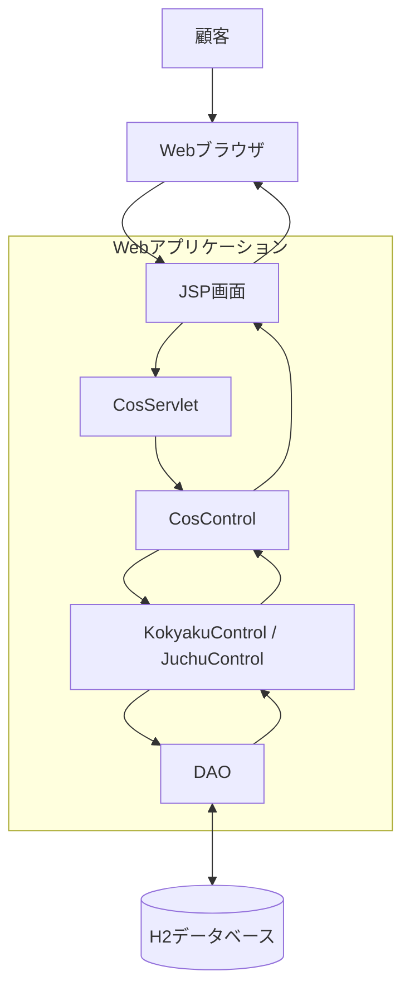
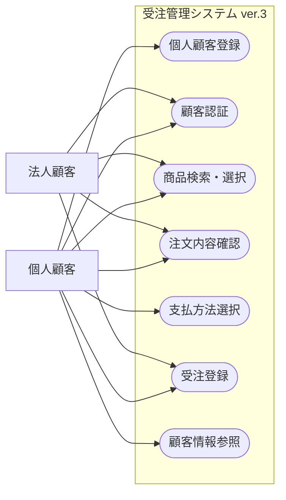
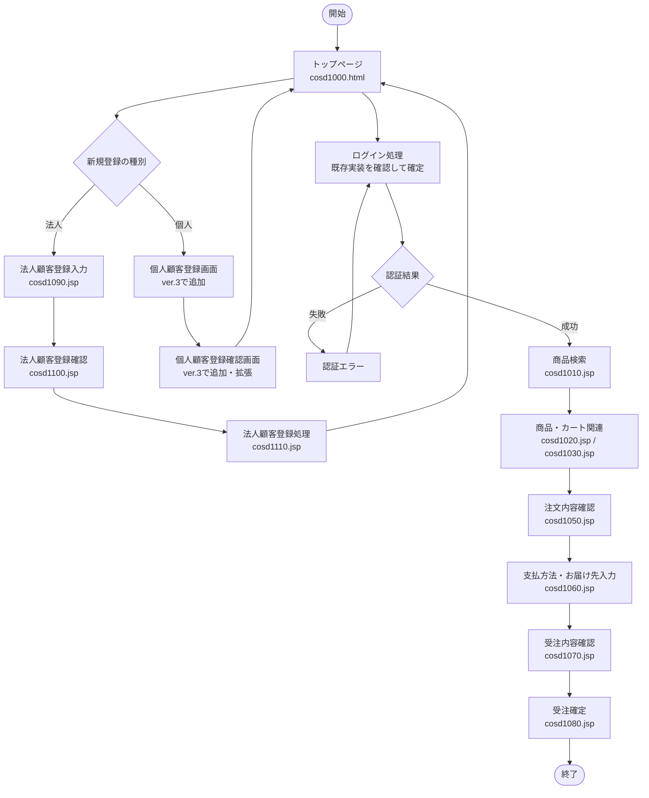

# ver.3 基本設計書

## 1. 文書情報

| 項目 | 内容 |
|---|---|
| 対象システム | 受注管理システム |
| 対象バージョン | ver.3 |
| 基準バージョン | ver.2（`juchu02`） |
| 文書名 | 基本設計書 |
| ファイル名 | `基本設計書.md` |
| 参照資料 | ver.3仕様書、要求分析書、DB改修方針、既存ソースコード、既存DB定義 |
| 文書状態 | 初版 |

## 2. 基本設計の目的

### 2.1 目的

本書は、ver.3で実施する個人顧客対応について、システム構成、画面構成、画面遷移、機能間の関係および業務処理の概要を定義する。

本書を詳細設計書、DB設計書およびテスト仕様書の作成における基準とする。

### 2.2 改修の背景

ver.2では、法人顧客を対象とした顧客登録、認証、商品選択および受注登録を行う構成となっている。

ver.3では、個人顧客の登録・認証・受注に対応するため、顧客情報の管理、認証処理、支払方法の選択および受注処理を拡張する。

既存の法人顧客向け機能への影響を抑え、商品検索、商品選択、受注ヘッダ・受注明細の登録および在庫関連処理は、可能な範囲で既存機能を再利用する。

### 2.3 改修対象機能

| 機能ID | 機能名 | 改修概要 |
|---|---|---|
| F-01 | 個人顧客登録 | 個人顧客情報および認証情報の登録機能を追加する |
| F-02 | 顧客情報参照 | 顧客種別に応じて適切な顧客情報を取得する |
| F-03 | 顧客認証 | 個人顧客の認証に対応する |
| F-04 | 商品検索・選択 | 既存の商品検索・選択機能を利用する |
| F-05 | 受注登録 | 個人顧客の受注登録に対応する |
| F-06 | 支払方法選択 | 顧客種別に応じた支払方法を選択できるようにする |
| F-07 | 与信・売掛残高管理 | 個人顧客の与信条件と残高管理方式を定義する |
| F-08 | 法人顧客機能の維持 | 既存の法人顧客向け機能を維持する |

## 3. システム構成

### 3.1 現行システムの構成

現行システムは、Java、JSP、サーブレット、DAOおよびH2データベースを利用するWebアプリケーションである。

既存の主要な処理構成は次のとおり。

1. WebブラウザからJSP等へリクエストを送信する。
2. `CosServlet` がリクエストを受け取る。
3. `CosControl` が処理種別に応じて顧客登録処理または受注処理へ振り分ける。
4. `KokyakuControl` または `JuchuControl` が各業務処理を実行する。
5. DAOを介してデータベースを参照・更新する。
6. 処理結果に応じて画面を表示する。

個人顧客対応では、既存の処理構造を基本的に維持し、顧客種別に応じた制御処理、データアクセス処理および画面を追加・変更する。

### 3.2 論理配置図

本図は論理的な処理構成を示す。実際のクラス間の呼び出し関係や変更対象クラスの詳細は、詳細設計書で定義する。

## 4. 利用者と業務機能

### 4.1 利用者区分

| 利用者 | 主な機能 |
|---|---|
| 個人顧客 | 個人顧客登録、認証、商品検索・選択、支払方法選択、受注 |
| 法人顧客 | 法人顧客登録、認証、商品検索・選択、月末一括払いによる受注 |

### 4.2 顧客種別ごとの基本条件

| 項目 | 法人顧客 | 個人顧客 |
|---|---|---|
| 顧客情報テーブル | `KOKYAKUHOUJIN_TABLE` | `KOKYAKUKOJIN_TABLE` を新設する方針 |
| 認証情報テーブル | `KOKYAKUPASS_TABLE` | 既存テーブルを共有する方針 |
| 顧客コード | 既存ルールを維持 | 先頭1桁を4～8とする |
| 与信限度額 | 既存仕様を維持 | 1,000,000円 |
| 支払方法 | 月末一括払い | 代金引換、銀行振込 |
| 商品検索・選択 | 既存機能を利用 | 既存機能を利用 |
| 受注登録 | 既存機能を利用 | 既存機能を拡張して利用 |

個人顧客情報と法人顧客情報を混同しないことを基本方針とする。

### 4.3 ユースケース図

本図は利用者と機能の関係を示す概念図である。各機能の詳細な事前条件・事後条件は、詳細設計書およびテスト仕様書で定義する。

## 5. 画面構成と画面遷移

### 5.1 既存画面の構成

既存コードで確認した主要画面は次のとおり。

| 画面・ファイル | 現行の用途 | ver.3での方針 |
|---|---|---|
| `cosd1000.html` | トップページ | 個人顧客の新規登録導線を追加する |
| `cosd1010.jsp` | 商品検索画面 | 既存機能を利用する |
| `cosd1020.jsp` | 商品関連画面 | 既存機能を利用する |
| `cosd1030.jsp` | 商品・カート関連画面 | 既存機能を利用する |
| `cosd1050.jsp` | 注文内容確認 | 既存機能を利用する |
| `cosd1060.jsp` | 支払方法・お届け先入力 | 個人顧客の支払方法に対応する |
| `cosd1070.jsp` | 受注内容確認 | 既存機能を利用する |
| `cosd1080.jsp` | 受注確定関連 | 既存機能を利用する |
| `cosd1090.jsp` | 法人顧客登録入力 | 個人顧客登録画面の追加・拡張を検討する |
| `cosd1100.jsp` | 法人顧客登録内容確認 | 個人顧客登録内容の確認方式を設計する |
| `cosd1110.jsp` | 法人顧客登録処理の遷移先 | 個人顧客登録処理の追加・拡張を検討する |

画面の実際の遷移先と処理の割り当ては、既存の `KokyakuControl`、`JuchuControl` 等の画面マッピングに基づいて詳細設計で確定する。

### 5.2 画面遷移図

図中の個人顧客登録画面はver.3で追加・拡張する想定であり、実際の画面名と遷移先は詳細設計で確定する。

また、ログイン画面のJSP名および実際のログイン処理の遷移先は、既存マッピングとの照合を完了したうえで確定する。図のログイン部分は現時点では論理的な表現である。

### 5.3 画面設計方針

- 既存画面を可能な限り再利用する。
- 個人顧客登録では、個人顧客に必要な入力項目を扱える画面を用意する。
- 法人顧客の登録フローを維持する。
- 支払方法選択画面では顧客種別に応じた選択肢を表示する。
- 入力チェック、エラーメッセージ、戻る操作および画面遷移先は詳細設計書で定義する。

## 6. 機能の基本設計

### 6.1 個人顧客登録

現行の登録処理は法人顧客を前提としており、`KokyakuControl`、`DaoControl`、`DaoHoujin` を中心に法人顧客情報と認証情報を登録している。

ver.3では、個人顧客情報の登録先と認証情報の登録処理を追加する。

基本的な処理順序は次のとおり。

1. 個人顧客登録画面で顧客情報および認証情報を入力する。
2. 入力内容を検証する。
3. 個人顧客コードを採番する。
4. 個人顧客情報を `KOKYAKUKOJIN_TABLE` に登録する。
5. 認証情報を `KOKYAKUPASS_TABLE` に登録する。
6. 登録結果を画面に表示する。

顧客情報と認証情報の不整合を防ぐため、登録処理のトランザクション範囲とエラー時のロールバック方式を詳細設計書で定義する。

個人顧客コードの先頭1桁は4～8とする。採番の初期値、採番管理情報および重複防止の方法はDB設計書・詳細設計書で確定する。

### 6.2 顧客認証・情報参照

既存システムでは、認証情報を `KOKYAKUPASS_TABLE` で管理し、顧客情報の参照は法人顧客テーブルを前提とした実装になっている。

ver.3では、認証後に顧客種別を判定し、適切な顧客情報を取得できるようにする。

基本方針は次のとおり。

- 法人顧客の認証・情報参照を維持する。
- 個人顧客の認証・情報参照を追加する。
- 顧客コードと顧客情報の対応を維持する。
- 顧客種別に応じて適切な顧客テーブルを参照する。
- 認証失敗時の処理は既存方式と整合させる。

顧客種別の識別方法、DAOの振り分け方法および認証後のセッション情報は詳細設計書で定義する。

### 6.3 商品検索・選択

個人顧客は、認証後に既存の商品検索・選択機能を利用する。

商品マスタ、商品検索、営業所別在庫およびカート処理は、個人顧客対応に必要な変更がない限り既存機能を再利用する。

商品選択機能そのものの大幅な変更は、本改修の主目的ではない。

### 6.4 受注登録

既存の受注処理では、`JuchuControl` が顧客情報を受注データに設定し、`DaoJuchu.insertData()` が受注登録、与信判定および売掛残高更新などを実施する構造となっている。

ver.3では、受注・受注明細の登録と在庫関連処理を可能な範囲で再利用し、顧客情報の参照先、支払方法、与信判定および売掛残高更新を個人顧客に対応させる。

基本的な処理順序は次のとおり。

1. 注文内容を確認する。
2. ログイン中の顧客種別と顧客情報を取得する。
3. 顧客種別に応じた支払方法を確認する。
4. 必要な与信判定を行う。
5. 受注ヘッダ・受注明細を登録する。
6. 在庫関連処理を実行する。
7. 必要な場合は対象顧客の売掛残高を更新する。
8. 受注結果を画面に表示する。

現行の `DaoJuchu.insertData()` では、売掛残高更新先が `KOKYAKUHOUJIN_TABLE` に固定されているため、個人顧客の受注で誤った顧客テーブルを更新しないようにする。

個人顧客の売掛残高更新の要否、与信判定条件、エラー時のロールバックおよびトランザクション範囲は、詳細設計書で定義する。

### 6.5 支払方法選択

現行の `cosd1060.jsp` では、支払方法として「月末一括お支払い」が設定され、値 `0` が使用されている。

ver.3では、顧客種別に応じて支払方法の選択肢を切り替える。

| 顧客種別 | 支払方法 | コード値 |
|---|---|---|
| 法人顧客 | 月末一括払い | `0`（既存値を維持） |
| 個人顧客 | 代金引換 | 詳細設計で確定 |
| 個人顧客 | 銀行振込 | 詳細設計で確定 |

受注ヘッダの `JUCHU_TABLE.SIHARAI_TYPE` に保存する値、画面上の表示、受注処理での判定を一致させる。

支払方法のコード値は、既存DB定義および関連処理を確認して確定する。

### 6.6 与信・売掛残高管理

個人顧客の与信限度額は1,000,000円とする。

現行の受注処理では、与信限度額、売掛残高および今回の受注金額を用いて判定し、売掛残高の更新先は法人顧客テーブルに固定されている。

個人顧客の支払方法は代金引換・銀行振込であるため、個人顧客に対する与信判定と売掛残高更新の適用方法は、業務要件との整合を踏まえて定義する。

基本方針は次のとおり。

- 法人顧客の既存処理を維持する。
- 個人顧客の与信限度額を1,000,000円とする。
- 個人顧客の売掛残高の更新要否と更新タイミングを確定する。
- 個人顧客の受注によって法人顧客の売掛残高が誤更新されないようにする。

具体的な判定条件と更新処理は詳細設計書で定義する。

## 7. データ管理の基本方針

### 7.1 顧客情報

法人顧客情報は既存の `KOKYAKUHOUJIN_TABLE` を利用する。

個人顧客情報については、DB改修方針に基づき `KOKYAKUKOJIN_TABLE` を新設する方針とする。

個人顧客情報には、次の項目を保持する。

- 顧客コード
- 顧客名
- 顧客名カナ
- 郵便番号
- 県コード
- 住所1
- 住所2
- 連絡先電話番号
- FAX番号
- メールアドレス
- 売掛残高
- 与信限度額
- 営業所コード
- 登録日
- 誕生日

実際のカラム名、データ型、桁数、NULL可否、主キーおよび制約はDB設計書で定義する。

### 7.2 認証情報

認証情報は既存の `KOKYAKUPASS_TABLE` を法人・個人で共有する方針とする。

同テーブルでは `KOKYAKUCD` が主キーとして定義されているため、法人顧客と個人顧客の顧客コードが重複しないようにする。

また、認証情報と顧客情報の対応関係を維持し、認証後に顧客種別に応じた顧客情報を取得できるようにする。

### 7.3 顧客コードの採番管理

現行の法人顧客登録では、`CTR_CURCODE_TABLE` の法人顧客テーブルに対応する管理情報を利用して顧客コードを採番している。

個人顧客についても採番管理を設ける方針とするが、管理行の構成、初期値、採番処理および排他制御はDB設計書・詳細設計書で確定する。

サンプルデータの顧客コードと新規登録時の採番値が重複しないようにする。

### 7.4 受注情報

受注ヘッダと受注明細には、既存の `JUCHU_TABLE` と `JUCHUMEISAI_TABLE` を利用する方針とする。

支払方法は `JUCHU_TABLE.SIHARAI_TYPE` に保存する。

個人顧客コードの保存方法、顧客情報との関連付け、売掛残高更新の対象テーブルは、DB設計書で定義する。

### 7.5 サンプルデータ

提供された個人顧客サンプルデータ4件を、登録・参照・認証などのテストに利用する。

| 顧客コード | 顧客名 | 営業所コード | 与信限度額 |
|---|---|---|---:|
| 400000 | 山田太郎 | 01 | 1,000,000円 |
| 400001 | 山田花子 | 02 | 1,000,000円 |
| 400002 | 鈴木一郎 | 03 | 1,000,000円 |
| 400003 | 花山治郎 | 03 | 1,000,000円 |

FAX番号やメールアドレスが未設定のデータを含むため、NULLと空文字の扱いを統一する。

## 8. 共通設計方針

### 8.1 既存機能への影響

個人顧客対応の追加によって、既存の法人顧客登録、認証、商品選択、受注登録、月末一括払いおよび与信・売掛残高管理が損なわれないこと。

### 8.2 データ整合性

- 顧客情報と認証情報の対応関係を維持する。
- 顧客種別に応じた顧客情報を取得する。
- 顧客コードの重複を防止する。
- 受注情報と顧客情報の関連を維持する。
- 支払方法の画面表示値とDB保存値を一致させる。
- 登録処理や更新処理の途中でエラーが発生した場合の不整合を防止する。

### 8.3 入力チェック・エラー処理

入力チェック、未設定値、エラーメッセージおよび再入力時の動作は、既存の処理方式を確認したうえで詳細設計書に定義する。

FAX番号・メールアドレスの未設定値については、NULLと空文字の扱いを統一する。

### 8.4 テスト方針

テスト仕様書では、少なくとも以下を確認する。

1. 個人顧客を登録できること。
2. 個人顧客コードが要求条件を満たすこと。
3. 個人顧客情報を正しく参照できること。
4. 個人顧客が認証できること。
5. 個人顧客が商品を選択して受注できること。
6. 個人顧客に代金引換・銀行振込が表示されること。
7. 支払方法が正しい値で受注データに保存されること。
8. 個人顧客の与信条件が要求どおりに扱われること。
9. 個人顧客の受注で法人顧客情報が誤って更新されないこと。
10. 法人顧客の既存機能が従来どおり動作すること。
11. 個人顧客サンプルデータ4件を利用した参照等の確認ができること。

## 9. 詳細設計・DB設計への引き継ぎ事項

| ID | 項目 | 決定する内容 | 主な設計書 |
|---|---|---|---|
| B-01 | 個人顧客コード採番 | 採番方式、初期値、重複防止、管理情報 | DB設計書・詳細設計書 |
| B-02 | 顧客種別の識別 | 認証後に法人・個人を判定する方式 | 詳細設計書 |
| B-03 | 顧客情報の参照先 | 顧客種別に応じたDAO・検索先の切り替え | 詳細設計書 |
| B-04 | 支払方法コード | 代金引換・銀行振込のコード値と保存方法 | DB設計書・詳細設計書 |
| B-05 | 与信判定 | 個人顧客に適用する判定条件 | 詳細設計書 |
| B-06 | 売掛残高 | 個人顧客の更新要否、更新先、更新タイミング | 基本設計書・詳細設計書・DB設計書 |
| B-07 | 登録処理の整合性 | 顧客情報・認証情報のトランザクション範囲 | 詳細設計書 |
| B-08 | 顧客項目の制約 | 必須項目、桁数、NULL可否、入力チェック | DB設計書・詳細設計書 |
| B-09 | 画面構成 | 個人顧客登録画面の新設・拡張、実際の遷移先 | 基本設計書・詳細設計書 |
| B-10 | 受注との関連付け | 個人顧客コードを受注データに関連付ける方法 | DB設計書・詳細設計書 |
| B-11 | 認証情報の関連 | 共有認証テーブルと顧客情報の対応付け | DB設計書・詳細設計書 |

## 10. 基本設計のまとめ

ver.3では、個人顧客の登録・認証・受注機能を追加し、顧客種別に応じた支払方法を扱えるようにする。

既存の法人顧客向け機能と商品・受注関連処理を可能な限り再利用しつつ、個人顧客の情報管理、採番、認証、支払方法、与信判定および売掛残高管理を適切に分離する。

本書を基準として、詳細設計書では具体的なクラス、メソッド、処理条件およびエラー処理を定義し、DB設計書ではテーブル、カラム、制約および初期データを確定する。
