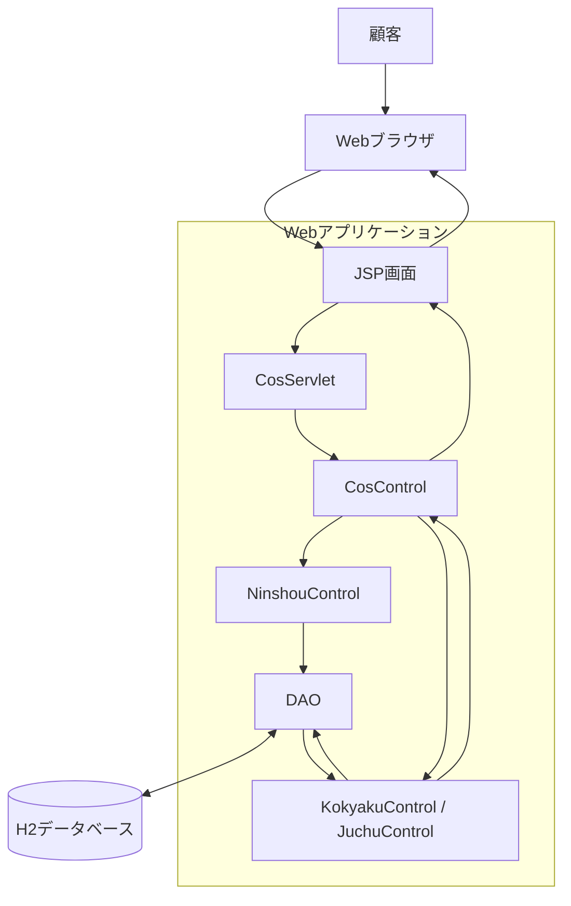
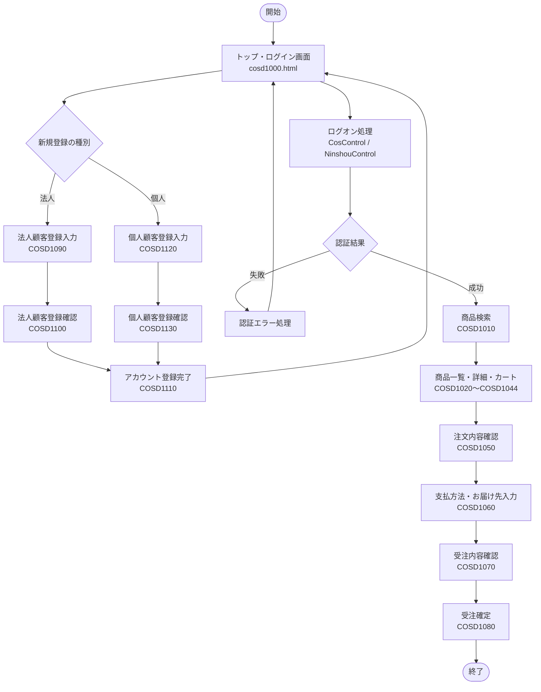

# ver.3 基本設計書

## 1. 文書情報

| 項目 | 内容 |
|---|---|
| 対象システム | 受注管理システム |
| 対象バージョン | ver.3 |
| 基準バージョン | ver.2（`juchu02`） |
| 文書名 | 基本設計書 |
| ファイル名 | `基本設計書.md` |
| 参照資料 | ver.3仕様書、要求分析書、DB改修方針、既存ソースコード、既存DB定義 |
| 文書状態 | 修正版 |

## 2. 基本設計の目的

### 2.1 目的

本書は、ver.3で実施する個人顧客対応について、システム構成、画面構成、画面遷移、機能間の関係および業務処理の概要を定義する。

本書を詳細設計書、DB設計書およびテスト仕様書の作成における基準とする。

### 2.2 改修の背景

ver.2では、法人顧客を対象とした顧客登録、認証、商品選択および受注登録を行う構成となっている。

ver.3では、個人顧客の登録・認証・受注に対応するため、顧客情報の管理、認証処理、支払方法の選択および受注処理を拡張する。

既存の法人顧客向け機能への影響を抑え、商品検索、商品選択、受注ヘッダ・受注明細の登録および在庫関連処理は、可能な範囲で既存機能を再利用する。

### 2.3 改修対象機能

| 機能ID | 機能名 | 改修概要 |
|---|---|---|
| F-01 | 個人顧客登録 | 個人顧客情報および認証情報の登録機能を追加する |
| F-02 | 顧客情報参照 | 顧客種別に応じて適切な顧客情報を取得する |
| F-03 | 顧客認証 | 個人顧客の認証に対応する |
| F-04 | 商品検索・選択 | 既存の商品検索・選択機能を利用する |
| F-05 | 受注登録 | 個人顧客の受注登録に対応する |
| F-06 | 支払方法選択 | 顧客種別に応じた支払方法を選択できるようにする |
| F-07 | 与信・売掛残高管理 | 個人顧客の与信条件と残高管理方式を定義する |
| F-08 | 法人顧客機能の維持 | 既存の法人顧客向け機能を維持する |

## 3. システム構成

### 3.1 現行システムの構成

現行システムは、Java、JSP、サーブレット、DAOおよびH2データベースを利用するWebアプリケーションである。

既存の主要な処理構成は次のとおり。

1. Webブラウザからリクエストを送信する。
2. `CosServlet` がリクエストを受け取る。
3. `CosControl` がリクエスト内容に応じて顧客登録処理、受注処理またはログオフ処理へ振り分ける。
4. `KokyakuControl`、`JuchuControl` または `NinshouControl` が、それぞれの担当処理を実行する。
5. DAOを介してデータベースを参照・更新する。
6. 処理結果に応じて画面を表示する。

主要クラスの役割は次のとおり。

| クラス | 主な役割 |
|---|---|
| `CosServlet` | Webリクエストの受付 |
| `CosControl` | 顧客登録・受注・ログオフ等の処理振り分け |
| `KokyakuControl` | 顧客登録処理 |
| `JuchuControl` | 商品選択から受注確定までの処理 |
| `NinshouControl` | ログオン認証・ログオフ |
| `cosDAO.DaoControl` | DAOへの処理振り分け |
| `DaoHoujin` | 法人顧客情報・認証情報の登録および法人顧客情報の取得 |
| `DaoJuchu` | 受注登録、与信判定、在庫関連処理、売掛残高更新等 |

現行コードでは、顧客登録・顧客情報取得のDAO処理が法人顧客を前提としている。ver.3では、この構造を踏まえ、個人顧客に対応する制御処理とデータアクセス処理を追加・変更する。

### 3.2 論理配置図

本図は論理的な処理構成を示す。実際のクラス間の呼び出し関係や変更対象クラスの詳細は、詳細設計書で定義する。

## 4. 利用者と業務機能

### 4.1 利用者区分

| 利用者 | 主な機能 |
|---|---|
| 個人顧客 | 個人顧客登録、認証、商品検索・選択、支払方法選択、受注 |
| 法人顧客 | 法人顧客登録、認証、商品検索・選択、月末一括払いによる受注 |

### 4.2 顧客種別ごとの基本条件

| 項目 | 法人顧客 | 個人顧客 |
|---|---|---|
| 顧客情報テーブル | `KOKYAKUHOUJIN_TABLE` | `KOKYAKUKOJIN_TABLE` |
| 認証情報テーブル | `KOKYAKUPASS_TABLE` | `KOKYAKUPASS_TABLE` |
| 顧客コード | 既存ルールを維持 | 6桁、先頭1桁を4～8とする |
| 与信限度額 | 既存仕様を維持 | 1,000,000円 |
| 支払方法 | 月末一括払い | 代金引換、銀行振込 |
| 商品検索・選択 | 既存機能を利用 | 既存機能を利用 |
| 受注登録 | 既存機能を利用 | 既存処理を可能な範囲で再利用 |

個人顧客情報は `KOKYAKUKOJIN_TABLE` で管理する。認証情報は既存の `KOKYAKUPASS_TABLE` を法人顧客と共有する。

個人顧客情報と法人顧客情報を混同しないことを基本方針とする。

### 4.3 利用者と機能の関係

本図は利用者と機能の関係を示す概念図である。各機能の詳細な事前条件・事後条件は、詳細設計書およびテスト仕様書で定義する。

## 5. 画面構成と画面遷移

### 5.1 既存画面の構成

既存コードで確認した主要画面は次のとおり。

| 画面・ファイル | 現行の用途 | ver.3での方針 |
|---|---|---|
| `cosd1000.html` | トップ・ログイン画面 | 新規登録時に法人・個人を選択できるようにする |
| `cosd1010.jsp` | 商品検索画面 | 既存機能を利用する |
| `cosd1020.jsp` | 商品一覧画面 | 既存機能を利用する |
| `cosd1030.jsp` | カート内リスト画面 | 既存機能を利用する |
| `cosd1040.jsp`～`cosd1044.jsp` | 商品詳細画面 | 既存機能を利用する |
| `cosd1050.jsp` | 注文内容確認画面 | 既存機能を利用する |
| `cosd1060.jsp` | 支払方法・お届け先入力画面 | 個人顧客向けの支払方法に対応する |
| `cosd1070.jsp` | 受注内容確認画面 | 個人顧客情報の表示に対応する |
| `cosd1080.jsp` | 受注完了画面 | 既存機能を利用する |
| `cosd1090.jsp` | 法人顧客登録入力画面 | 既存機能を維持する |
| `cosd1100.jsp` | 法人顧客登録確認画面 | 既存機能を維持する |
| `cosd1110.jsp` | アカウント登録完了画面 | 法人・個人で共通利用する |
| `cosd1120.jsp` | 個人顧客登録入力画面 | 新設する |
| `cosd1130.jsp` | 個人顧客登録確認画面 | 新設する |
| `cosd151E.jsp` | 在庫引当エラー画面 | 既存のエラー処理を維持する |
| `cosd152E.jsp` | 与信エラー画面 | 個人顧客の銀行振込にも対応する |
| `cosd155E.jsp` | システムエラー画面 | 既存のエラー処理を維持する |

画面名と用途は、既存の画面ファイルおよび `JuchuControl` の画面マッピングを基準に整理している。

ver.3では、個人顧客登録用として `cosd1120.jsp` および `cosd1130.jsp` を新設する。登録完了画面は既存の `cosd1110.jsp` を法人・個人で共通利用する。

画面遷移および各画面の操作仕様は、画面設計書に定義する。

### 5.2 画面遷移図

本図は基本的な業務の流れを示す概念図であり、すべてのボタン操作や例外遷移を示すものではない。

ログオン処理は、`CosControl` が `NinshouControl` に委譲し、認証成功時に `JuchuControl` を生成する既存構造を基本とする。

個人顧客登録では、COSD1120からCOSD1130へ進み、登録処理が正常に完了すると法人顧客と共通のCOSD1110へ遷移する。

### 5.3 画面設計方針

- 既存のjuchu02の画面構成およびデザインを基本とする。
- 既存画面のレイアウトや操作方法を可能な限り維持する。
- 個人顧客登録では、COSD1120およびCOSD1130を新設する。
- 法人顧客の登録フローは既存のCOSD1090、COSD1100を維持する。
- 登録完了画面はCOSD1110を共通利用する。
- 支払方法選択画面では、顧客種別に応じた選択肢を表示する。
- 入力項目、入力チェック、エラーメッセージおよび画面遷移は画面設計書に定義する。
- 登録処理、認証処理、受注処理およびデータベースアクセスの詳細は詳細設計書に定義する。

## 6. 機能の基本設計

### 6.1 個人顧客登録

現行の登録処理は法人顧客を前提としており、`KokyakuControl`、`cosDAO.DaoControl`、`DaoHoujin` を中心に法人顧客情報と認証情報を登録している。

`KokyakuControl` では顧客クラス名を受け取る構造があるが、現行DAOの登録処理は法人顧客向けに実装されている。そのため、顧客クラスの生成だけで登録先テーブルが個人顧客用に切り替わるわけではない。

ver.3では、個人顧客情報の登録先と認証情報の登録処理を追加する。

基本的な処理順序は次のとおり。

1. 個人顧客登録画面で顧客情報および認証情報を入力する。
2. 入力内容を検証する。
3. 個人顧客コードを採番する。
4. 個人顧客情報を `KOKYAKUKOJIN_TABLE` に登録する。
5. 認証情報を `KOKYAKUPASS_TABLE` に登録する。
6. 登録結果を画面に表示する。

顧客情報と認証情報の不整合を防ぐため、登録処理のトランザクション範囲とエラー時のロールバック方式を詳細設計書で定義する。

個人顧客コードの先頭1桁は4～8とする。個人顧客の初期データとして `400000`～`400003` を登録し、初期データ登録後の次回採番値は `400004` とする。採番管理には既存の `CTR_CURCODE_TABLE` に個人顧客用の管理行を追加して利用する。

採番処理の実装箇所、管理情報の更新タイミングおよび同時登録時の競合対策は詳細設計書で定義する。

### 6.2 顧客認証・情報参照

現行システムでは、認証情報を `KOKYAKUPASS_TABLE` で管理している。認証後の顧客情報取得は法人顧客テーブルを前提としており、個人顧客情報を取得する処理は未対応である。

現行の `NinshouControl` では、顧客コードの先頭1桁によって法人顧客として扱うかを判定する処理がある。現行実装では先頭が `1`～`3` の顧客コードを法人顧客として扱い、それ以外はログオン失敗とする。

また、現行の `cosDAO.DaoControl` および `DaoHoujin` による顧客情報取得は法人顧客テーブルを前提としている。

ver.3では、認証後に顧客種別を判定し、適切な顧客情報を取得できるようにする。

基本方針は次のとおり。

- 法人顧客の認証・情報参照を維持する。
- 個人顧客コードの先頭1桁が4～8の場合に個人顧客として扱えるようにする。
- 個人顧客の認証・情報参照を追加する。
- 顧客種別に応じて適切な顧客テーブルを参照する。
- 顧客コードと顧客情報の対応関係を維持する。
- 認証失敗時の処理は既存方式と整合させる。

顧客種別の識別方法、DAOの振り分け方法および認証後のセッション情報は詳細設計書で定義する。

### 6.3 商品検索・選択

個人顧客は、認証後に既存の商品検索・選択機能を利用する。

商品マスタ、商品検索、営業所別在庫およびカート処理は、個人顧客対応に必要な変更がない限り既存機能を再利用する。

現行の `JuchuControl` には、商品検索、カート操作、商品詳細表示および受注手続きへの画面マッピングが定義されている。個人顧客でもこれらの機能を利用できるようにするため、顧客種別による制御の影響を確認する。

商品選択機能そのものの大幅な変更は、本改修の主目的ではない。

### 6.4 受注登録

既存の受注処理では、`JuchuControl` が顧客情報を受注データに設定し、`DaoJuchu.insertData()` が受注登録、与信判定および売掛残高更新などを実施する構造となっている。

ver.3では、受注・受注明細の登録と在庫関連処理を可能な範囲で再利用し、顧客情報の参照先、支払方法、与信判定および売掛残高更新を個人顧客に対応させる。

基本的な処理順序は次のとおり。

1. 注文内容を確認する。
2. ログイン中の顧客種別と顧客情報を取得する。
3. 顧客種別に応じた支払方法を確認する。
4. 必要な与信判定を行う。
5. 受注ヘッダ・受注明細を登録する。
6. 在庫関連処理を実行する。
7. 必要な場合は対象顧客の売掛残高を更新する。
8. 受注結果を画面に表示する。

現行の `DaoJuchu.insertData()` では、売掛残高更新先が `KOKYAKUHOUJIN_TABLE` に固定されている。そのため、個人顧客の受注で法人顧客テーブルを誤って更新しないように変更する必要がある。

与信判定および売掛残高更新の業務ルールは6.6に示すとおりとする。DAOの変更範囲、処理の組み込み方法、エラー時のロールバックおよびトランザクション範囲は詳細設計書で定義する。

### 6.5 支払方法選択

現行の `cosd1060.jsp` では、支払方法として「月末一括お支払い」が設定され、値 `0` が使用されている。

`JuchuControl` は画面から `shiharaitype` を取得し、受注データに設定する。`DaoJuchu` は、その値を `JUCHU_TABLE.SIHARAI_TYPE` に保存する。

ver.3では、顧客種別に応じて支払方法の選択肢を切り替える。

| 顧客種別 | 支払方法 | コード値 |
|---|---|---|
| 法人顧客 | 月末一括払い | `0` |
| 個人顧客 | 代金引換 | `1` |
| 個人顧客 | 銀行振込 | `2` |

支払方法コードは既存の `JUCHU_TABLE.SIHARAI_TYPE` に保存する。

画面上の表示、画面から送信するコード値、受注処理での判定およびDBに保存する値を一致させる。

顧客種別に応じて利用可能な支払方法を制限し、法人顧客には月末一括払い、個人顧客には代金引換と銀行振込を提供する。

### 6.6 与信・売掛残高管理

個人顧客の与信限度額は1,000,000円とする。

個人顧客の与信判定および売掛残高更新は、支払方法に応じて次のように扱う。

| 顧客種別 | 支払方法 | 与信判定 | 売掛残高更新 |
|---|---|---|---|
| 法人顧客 | 月末一括払い | 既存仕様を維持 | 既存仕様を維持 |
| 個人顧客 | 代金引換 | 実施しない | 実施しない |
| 個人顧客 | 銀行振込 | 実施する | 実施する |

銀行振込の場合は、個人顧客の与信限度額と売掛残高を用いて与信判定を行う。与信条件を満たした場合、受注に応じて個人顧客の売掛残高を更新する。

代金引換の場合は、与信判定および売掛残高更新を行わない。

現行の `DaoJuchu.insertData()` では、売掛残高更新先が `KOKYAKUHOUJIN_TABLE` に固定されている。そのため、個人顧客の銀行振込では、個人顧客用の `KOKYAKUKOJIN_TABLE` を更新するように対応する必要がある。

法人顧客の既存処理は維持し、個人顧客の受注によって法人顧客の売掛残高が誤更新されないようにする。

具体的なDAOの変更範囲、処理の組み込み方法およびエラー時のトランザクション処理は詳細設計書で定義する。

## 7. データ管理の基本方針

### 7.1 顧客情報

法人顧客情報は既存の `KOKYAKUHOUJIN_TABLE` を利用する。

個人顧客情報は、個人顧客用の `KOKYAKUKOJIN_TABLE` で管理する。

個人顧客情報には、次の項目を保持する。

- 顧客コード
- 顧客名
- 顧客名カナ
- 郵便番号
- 県コード
- 住所1
- 住所2
- 連絡先電話番号
- FAX番号
- メールアドレス
- 売掛残高
- 与信限度額
- 営業所コード
- 登録日
- 誕生日

個人顧客テーブルの列名、データ型、桁数、NULL可否および主キーはDB設計書に従う。

FAX番号およびメールアドレスはDB上でNULLを許容する。新規登録時のメールアドレス必須チェックはアプリケーション側で行う。

誕生日は必須とし、DBではDATE型で管理する。

### 7.2 認証情報

認証情報は既存の `KOKYAKUPASS_TABLE` を法人顧客と個人顧客で共有する。

同テーブルでは `KOKYAKUCD` が主キーとして定義されているため、法人顧客と個人顧客の顧客コードが重複しないようにする。

認証情報と顧客情報の対応関係を維持し、認証後に顧客種別に応じた顧客情報を取得できるようにする。

### 7.3 顧客コードの採番管理

現行の法人顧客登録では、`CTR_CURCODE_TABLE` の法人顧客用管理情報を利用して顧客コードを採番している。

個人顧客についても、同じ `CTR_CURCODE_TABLE` に個人顧客用の管理行を追加して採番する。

個人顧客コードは6桁とし、先頭1桁を4～8とする。

個人顧客の初期データとして `400000`～`400003` を登録し、初期データ登録後の次回採番値は `400004` とする。

法人顧客用の採番管理情報は変更しない。

採番処理の実装箇所、管理情報の更新タイミングおよび同時登録時の競合対策は詳細設計書で定義する。既存の採番処理の方式を踏襲する。

### 7.4 受注情報

受注ヘッダと受注明細には、既存の `JUCHU_TABLE` と `JUCHUMEISAI_TABLE` を利用する方針とする。

支払方法は `JUCHU_TABLE.SIHARAI_TYPE` に保存する。

個人顧客コードの保存方法、顧客情報との関連付け、売掛残高更新の対象テーブルは、DB設計書で定義する。

### 7.5 サンプルデータ

提供された個人顧客サンプルデータ4件を、登録・参照・認証などのテストに利用する。

| 顧客コード | 顧客名 | 営業所コード | 与信限度額 |
|---|---|---|---:|
| 400000 | 山田太郎 | 01 | 1,000,000円 |
| 400001 | 山田花子 | 02 | 1,000,000円 |
| 400002 | 鈴木一郎 | 03 | 1,000,000円 |
| 400003 | 花山治郎 | 03 | 1,000,000円 |

FAX番号およびメールアドレスの未設定値は、DB上でNULLとして扱う。空文字は未設定値として使用しない。

## 8. 共通設計方針

### 8.1 既存機能への影響

個人顧客対応の追加によって、既存の法人顧客登録、認証、商品選択、受注登録、月末一括払いおよび与信・売掛残高管理が損なわれないこと。

### 8.2 データ整合性

- 顧客情報と認証情報の対応関係を維持する。
- 顧客種別に応じた顧客情報を取得する。
- 顧客コードの重複を防止する。
- 受注情報と顧客情報の関連を維持する。
- 支払方法の画面表示値とDB保存値を一致させる。
- 登録処理や更新処理の途中でエラーが発生した場合の不整合を防止する。
- 個人顧客の処理によって法人顧客の情報を誤更新しない。

### 8.3 入力チェック・エラー処理

入力チェック、未設定値、エラーメッセージおよび再入力時の動作は、既存の処理方式を確認したうえで詳細設計書に定義する。

FAX番号・メールアドレスの未設定値はNULLとして扱い、空文字は未設定値として使用しない。

### 8.4 テスト方針

テスト仕様書では、少なくとも以下を確認する。

1. 個人顧客を登録できること。
2. 個人顧客コードが要求条件を満たすこと。
3. 個人顧客情報を正しく参照できること。
4. 個人顧客が認証できること。
5. 個人顧客が商品を選択して受注できること。
6. 個人顧客に代金引換・銀行振込が表示されること。
7. 支払方法が正しい値で受注データに保存されること。
8. 個人顧客の与信条件が要求どおりに扱われること。
9. 個人顧客の受注で法人顧客情報が誤って更新されないこと。
10. 法人顧客の既存機能が従来どおり動作すること。
11. 個人顧客サンプルデータ4件を利用した参照等の確認ができること。

## 9. 詳細設計・DB設計への引き継ぎ事項

以下は、基本仕様として確定済みの事項を実装に反映するため、詳細設計・DB設計で具体化する項目である。

| ID | 項目 | 確定している前提 | 設計で具体化する内容 |
|---|---|---|---|
| B-01 | 個人顧客コード採番 | `CTR_CURCODE_TABLE` に個人顧客用管理行を追加し、次回採番値は `400004` とする | 採番処理の実装箇所、更新タイミング |
| B-02 | 顧客種別の識別 | 法人顧客は先頭1桁1～3、個人顧客は4～8 | 認証後の顧客種別判定とセッション管理 |
| B-03 | 顧客情報の参照先 | 法人は `KOKYAKUHOUJIN_TABLE`、個人は `KOKYAKUKOJIN_TABLE` | DAO・検索処理の切り替え |
| B-04 | 支払方法コード | 0：月末一括払い、1：代金引換、2：銀行振込 | 画面表示、送信値、サーバ側検証、保存処理 |
| B-05 | 与信判定 | 代金引換では行わず、銀行振込では行う | 既存与信処理への組み込み方法 |
| B-06 | 売掛残高 | 代金引換では更新せず、銀行振込では更新する | 更新先テーブル、更新処理、トランザクション |
| B-07 | 登録処理の整合性 | 顧客情報と認証情報の不整合を防止する | トランザクション範囲、ロールバック処理 |
| B-08 | 顧客項目の制約 | FAX・メールはDBでNULL許容、誕生日はDATE NOT NULL | 入力チェック、NULL・空文字の扱い |
| B-09 | 画面構成 | 個人顧客登録機能を追加する | 画面ファイル、画面遷移、入力・確認方式 |
| B-10 | 受注との関連付け | 既存の受注テーブルを利用し、顧客コードで関連付ける | 顧客種別に応じた参照・更新処理 |
| B-11 | 認証情報の関連 | `KOKYAKUPASS_TABLE` を共有する | 認証処理と顧客情報取得処理の連携 |

新たな外部キー制約は追加せず、顧客情報・認証情報・受注情報の整合性はアプリケーション処理およびトランザクションによって管理する。

詳細設計では、本書および仕様書で確定した業務ルールを変更せず、既存実装との整合を確認したうえで具体的な処理を定義する。

## 10. 基本設計のまとめ

ver.3では、個人顧客の登録・認証・受注機能を追加し、顧客種別に応じた支払方法を扱えるようにする。

既存の法人顧客向け機能と商品・受注関連処理を可能な限り再利用しつつ、個人顧客の情報管理、採番、認証、支払方法、与信判定および売掛残高管理を適切に分離する。

現行コードでは、顧客登録・顧客情報取得が法人顧客を前提としており、受注時の売掛残高更新先も法人顧客テーブルに固定されている。これらの制約を踏まえ、個人顧客対応に必要な変更を詳細設計書で具体化する。

本書を基準として、詳細設計書では具体的なクラス、メソッド、処理条件およびエラー処理を定義し、DB設計書ではテーブル、カラム、制約および初期データを確定する。
