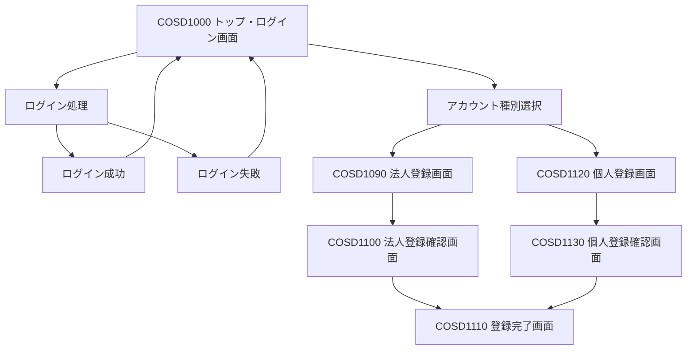
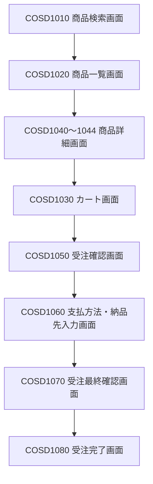

# ver.3 画面設計書

## 1. 概要

### 1.1 目的

本書は、受注システム ver.3 において追加する個人顧客機能に関する画面設計を定義する。

ver.2までの既存画面構成およびデザインを基本的に維持し、個人顧客の登録、ログイン、受注処理に必要な画面および表示項目を追加・変更する。

### 1.2 設計方針

画面構成を全面的に変更するのではなく、既存画面をベースとして必要な機能を追加する。

- 既存のヘッダー、コンテンツ、ナビゲーション、フッターの構成を維持する。
- 既存の法人顧客向け画面は、原則として現在のレイアウトを維持する。
- 個人顧客向けの登録画面は新設する。
- 個人顧客と法人顧客で共通利用できる画面は、可能な限り共通化する。
- 顧客種別によって表示内容や選択可能な項目が異なる場合は、顧客種別に応じて表示を切り替える。
- 既存の画面IDおよび画面遷移との整合性を確保する。

## 2. 画面一覧

### 2.1 既存画面

| 画面ID | 画面名 | ファイル名 | ver.3対応 |
|---|---|---|---|
| COSD1000 | トップページ | cosd1000.html | 新規登録欄を変更 |
| COSD1010 | 商品検索 | cosd1010.jsp | 原則変更なし |
| COSD1020 | 商品一覧 | cosd1020.jsp | 原則変更なし |
| COSD1030 | カート内ご注文リスト | cosd1030.jsp | 原則変更なし |
| COSD1040 | 商品詳細（文房具） | cosd1040.jsp | 原則変更なし |
| COSD1041 | 商品詳細（書籍） | cosd1041.jsp | 原則変更なし |
| COSD1042 | 商品詳細（食品） | cosd1042.jsp | 原則変更なし |
| COSD1043 | 商品詳細（AV機器） | cosd1043.jsp | 原則変更なし |
| COSD1044 | 商品詳細（PC） | cosd1044.jsp | 原則変更なし |
| COSD1050 | 注文内容の確認 | cosd1050.jsp | 原則変更なし |
| COSD1060 | お支払い方法・お届け先の入力 | cosd1060.jsp | 個人向け支払方法を追加 |
| COSD1070 | ご注文内容の確認 | cosd1070.jsp | 個人顧客情報の表示に対応 |
| COSD1080 | ご注文完了 | cosd1080.jsp | 原則変更なし |
| COSD1090 | ユーザー情報の入力（法人） | cosd1090.jsp | 原則変更なし |
| COSD1100 | ユーザー情報の確認（法人） | cosd1100.jsp | 原則変更なし |
| COSD1110 | ユーザー登録完了 | cosd1110.jsp | 共通利用を想定 |

### 2.2 新設画面

| 画面ID | 画面名 | ファイル名 | 概要 |
|---|---|---|---|
| COSD1120 | 個人ユーザー情報の入力 | cosd1120.jsp | 個人顧客の登録情報を入力する |
| COSD1130 | 個人ユーザー情報の確認 | cosd1130.jsp | 入力された個人顧客情報を確認する |

※ COSD1120、COSD1130は本設計書での仮採番とする。実装時に既存画面IDとの重複がないことを確認する。

## 3. 画面構成

### 3.1 画面一覧

| 画面ID | 画面名 | 概要 | 備考 |
|---|---|---|---|
| COSD1000 | トップ・ログイン画面 | ログインおよび新規アカウント作成への入口 | 既存画面を改修 |
| COSD1010 | 商品検索画面 | 商品を検索する | 既存画面 |
| COSD1020 | 商品一覧画面 | 検索結果を一覧表示する | 既存画面 |
| COSD1030 | カート画面 | カート内の商品を確認する | 既存画面 |
| COSD1040～1044 | 商品詳細画面 | 商品の詳細を表示する | 既存画面 |
| COSD1050 | 受注確認画面 | 注文内容を確認する | 既存画面 |
| COSD1060 | 支払方法・納品先入力画面 | 支払方法および納品先を入力する | 既存画面 |
| COSD1070 | 受注最終確認画面 | 注文内容の最終確認を行う | 既存画面 |
| COSD1080 | 受注完了画面 | 注文完了を表示する | 既存画面 |
| COSD1090 | 法人アカウント登録画面 | 法人アカウント情報を入力する | 既存画面 |
| COSD1100 | 法人アカウント登録確認画面 | 法人登録内容を確認する | 既存画面 |
| COSD1110 | アカウント登録完了画面 | アカウント登録完了を表示する | 既存画面 |
| COSD1120 | 個人アカウント登録画面 | 個人アカウント情報を入力する | 新規作成 |
| COSD1130 | 個人アカウント登録確認画面 | 個人登録内容を確認する | 新規作成 |

※画面IDは現時点の設計案である。実装前に既存画面IDとの重複がないことを確認する。

### 3.2 画面遷移

#### 3.2.1 ログイン・アカウント登録

ログイン時は、ログインIDとパスワードを入力する。ログインIDに対応する顧客情報を参照し、法人・個人を判別する。

新規アカウント登録時は、法人・個人のいずれかを選択し、対応する登録画面へ遷移する。

#### 3.2.2 受注処理

受注処理は既存の画面遷移を基本とし、個人顧客についても共通の受注画面を使用する。

### 3.3 画面構成の基本方針

- 現行のjuchu02の画面構成およびデザインを基本とする。
- 画面全体を一新するのではなく、既存画面を活用しながら個人顧客対応に必要な変更を行う。
- ログイン画面では、法人・個人を選択するためのラジオボタンは設けない。
- ログインIDに基づいて顧客種別を判別する。
- 新規登録では、法人・個人をラジオボタンで選択できるようにする。
- 法人登録は既存の登録画面を利用する。
- 個人登録は新規画面を追加する。
- 登録完了画面は法人・個人で共通利用する。
- 共通部分のレイアウトおよびCSSは、可能な限り既存のものを利用する。

---

## 4. 画面詳細設計

### 4.1 COSD1000 トップ・ログイン画面

#### 画面概要

ログインおよび新規アカウント登録を行うための画面である。

#### ログイン機能

| 項目 | 内容 |
|---|---|
| ログインID | 顧客IDを入力する |
| パスワード | パスワードを入力する |
| ログインボタン | 入力された情報で認証処理を行う |

#### ログイン処理

- ログインIDおよびパスワードを入力する。
- 認証処理により顧客情報を取得する。
- 顧客IDに基づいて法人・個人を判別する。
- 認証成功時はログイン状態とし、商品検索画面等へ進む。
- 認証失敗時はエラーメッセージを表示する。

#### 新規アカウント登録機能

| 項目 | 内容 |
|---|---|
| 法人・個人選択 | ラジオボタンで登録する顧客種別を選択する |
| アカウント作成ボタン | 選択された顧客種別に応じた登録画面へ遷移する |

#### 登録画面への遷移

| 選択内容 | 遷移先 |
|---|---|
| 法人 | COSD1090 法人アカウント登録画面 |
| 個人 | COSD1120 個人アカウント登録画面 |

※既存のCOSD1000に登録種別を選択する仕組みが存在する場合は、それを活用する。

### 4.2 COSD1090 法人アカウント登録画面

#### 画面概要

法人顧客が新規アカウントを作成するための情報入力画面である。

#### 設計方針

- 既存画面をそのまま利用する。
- 今回の個人顧客対応に伴う大幅な変更は行わない。
- 既存の入力チェックおよび登録処理を維持する。

### 4.3 COSD1100 法人アカウント登録確認画面

#### 画面概要

法人顧客が入力した登録内容を確認する画面である。

#### 設計方針

- 既存画面をそのまま利用する。
- 修正ボタンにより入力画面へ戻る。
- 登録ボタンにより登録処理を実行する。

### 4.4 COSD1120 個人アカウント登録画面

#### 画面概要

個人顧客が新規アカウントを作成するための情報入力画面である。

#### 入力項目

| 項目 | 必須 | 内容 |
|---|---|---|
| 氏名 | ○ | 個人顧客の氏名 |
| 氏名カナ |  | 氏名のカナ表記 |
| 郵便番号 | ○ | 郵便番号 |
| 都道府県 | ○ | 都道府県 |
| 住所1 | ○ | 市区町村・町域等 |
| 住所2 | ○ | 番地・建物名等 |
| 電話番号 | ○ | 電話番号 |
| FAX番号 |  | FAX番号 |
| メールアドレス | ○ | ログイン等に使用するメールアドレス |
| メールアドレス確認 | ○ | メールアドレスの再入力 |
| パスワード | ○ | ログイン用パスワード |
| パスワード確認 | ○ | パスワードの再入力 |
| 生年月日 | ○ | 生年月日 |

#### 入力チェック

- 必須項目が入力されていること。
- 郵便番号、電話番号等の形式が正しいこと。
- メールアドレスの形式が正しいこと。
- メールアドレスと確認用メールアドレスが一致すること。
- パスワードと確認用パスワードが一致すること。
- 生年月日が正しい日付であること。

※具体的な桁数・文字数・入力形式は、仕様書およびDB設計書との整合を確認して確定する。

#### ボタン

| ボタン | 処理 |
|---|---|
| 登録内容確認 | 入力チェックを行い、問題がなければCOSD1130へ遷移する |
| 戻る | COSD1000へ戻る |

### 4.5 COSD1130 個人アカウント登録確認画面

#### 画面概要

個人顧客が入力した登録内容を確認する画面である。

#### 表示項目

COSD1120で入力された内容を表示する。

パスワードはセキュリティ上の理由から、確認画面に平文で表示しない。

#### ボタン

| ボタン | 処理 |
|---|---|
| 修正 | COSD1120へ戻り、入力内容を修正する |
| 登録 | 個人顧客の登録処理を実行する |

#### 登録処理

- 個人顧客情報を登録する。
- 認証情報を登録する。
- 登録完了後、COSD1110へ遷移する。
- 登録処理に失敗した場合は、エラーメッセージを表示する。

### 4.6 COSD1110 アカウント登録完了画面

#### 画面概要

アカウント登録が完了したことを表示する画面である。

#### 設計方針

- 法人・個人で共通利用する。
- 登録完了メッセージを表示する。
- 登録された顧客IDを表示する。
- トップ画面へ戻るボタンを設ける。

---

## 5. 共通設計

### 5.1 画面デザイン

- 既存のjuchu02の画面デザインを基本とする。
- 既存のヘッダー、メニュー、入力欄、ボタン等の配置を可能な限り維持する。
- 新規作成する個人登録画面も既存画面と統一感のあるデザインとする。

### 5.2 CSS

- 既存の共通CSSを利用する。
- 個人登録画面で必要となる場合のみ、追加のスタイルを定義する。
- 既存画面への影響が発生しないようにする。

### 5.3 エラー表示

- 入力チェックでエラーが発生した場合は、対象項目およびエラー内容を明確に表示する。
- 登録処理でエラーが発生した場合は、処理が完了していないことを利用者に通知する。
- 既存画面のエラー表示方法を基本とする。

---

## 6. 個人顧客対応に伴う変更点

| 対象 | 変更内容 |
|---|---|
| COSD1000 | 新規登録時に法人・個人を選択できるようにする |
| ログイン処理 | 顧客IDに基づいて法人・個人を判別する |
| 個人登録画面 | COSD1120を新規作成する |
| 個人登録確認画面 | COSD1130を新規作成する |
| 登録処理 | 個人顧客情報および認証情報の登録処理を追加する |
| 登録完了画面 | 法人・個人で共通利用する |
| 受注処理 | 個人顧客も既存の受注画面を利用できるようにする |

---

## 7. 実装時の確認事項

1. COSD1000の登録種別選択処理が、法人・個人の両方に対応できること。
2. ログインIDから法人・個人を正しく判別できること。
3. 個人顧客の登録処理が正常に実行できること。
4. 個人顧客情報と認証情報が正しく関連付けられること。
5. FAX未入力時にNULLとして登録されること。
6. メールアドレス等の入力チェックが正常に動作すること。
7. 個人顧客でログインできること。
8. 個人顧客で商品検索から受注完了までの一連の処理が実行できること。
9. 法人顧客の既存機能に影響がないこと。
10. 既存画面と新規画面のデザインに統一性があること。

---

※本画面設計書は現時点の設計方針をまとめたものである。実装前に既存ソースコード、仕様書、基本設計書、詳細設計書およびDB設計書との整合性を確認し、必要に応じて修正する。