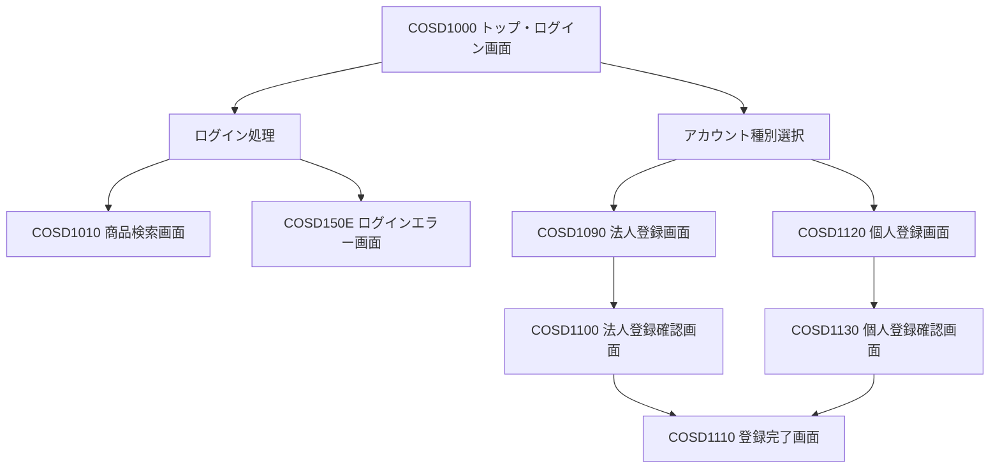
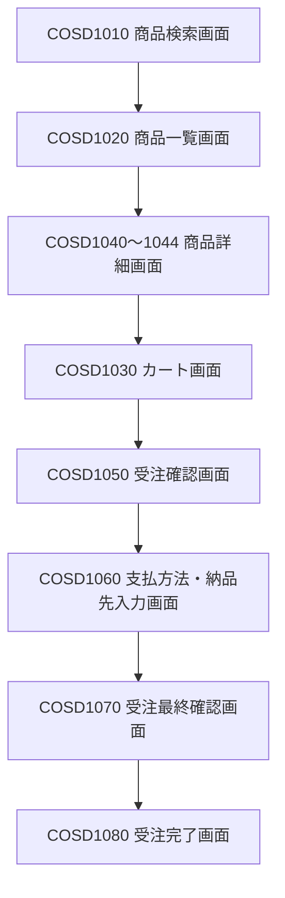

# ver.3 画面設計書

## 1. 概要

### 1.1 目的

本書は、受注システム ver.3 において追加する個人顧客機能に関する画面設計を定義する。

ver.2までの既存画面構成およびデザインを基本的に維持し、個人顧客の登録、ログイン、受注処理に必要な画面および表示項目を追加・変更する。

### 1.2 設計方針

画面構成を全面的に変更するのではなく、既存画面をベースとして必要な機能を追加する。

- 既存のヘッダー、コンテンツ、ナビゲーション、フッターの構成を維持する。
- 既存の法人顧客向け画面は、原則として現在のレイアウトを維持する。
- 個人顧客向けの登録画面は新設する。
- 個人顧客と法人顧客で共通利用できる画面は、可能な限り共通化する。
- 顧客種別によって表示内容や選択可能な項目が異なる場合は、顧客種別に応じて表示を切り替える。
- 既存の画面IDおよび画面遷移との整合性を確保する。

## 2. 画面一覧

### 2.1 既存画面

| 画面ID | 画面名 | ファイル名 | ver.3対応 |
|---|---|---|---|
| COSD1000 | トップページ | cosd1000.html | 新規登録欄を変更 |
| COSD1010 | 商品検索 | cosd1010.jsp | 原則変更なし |
| COSD1020 | 商品一覧 | cosd1020.jsp | 原則変更なし |
| COSD1030 | カート内ご注文リスト | cosd1030.jsp | 原則変更なし |
| COSD1040 | 商品詳細（文房具） | cosd1040.jsp | 原則変更なし |
| COSD1041 | 商品詳細（書籍） | cosd1041.jsp | 原則変更なし |
| COSD1042 | 商品詳細（食品） | cosd1042.jsp | 原則変更なし |
| COSD1043 | 商品詳細（AV機器） | cosd1043.jsp | 原則変更なし |
| COSD1044 | 商品詳細（PC） | cosd1044.jsp | 原則変更なし |
| COSD1050 | 注文内容の確認 | cosd1050.jsp | 原則変更なし |
| COSD1060 | お支払い方法・お届け先の入力 | cosd1060.jsp | 個人向け支払方法を追加 |
| COSD1070 | ご注文内容の確認 | cosd1070.jsp | 個人顧客情報の表示に対応 |
| COSD1080 | ご注文完了 | cosd1080.jsp | 原則変更なし |
| COSD1090 | ユーザー情報の入力（法人） | cosd1090.jsp | 原則変更なし |
| COSD1100 | ユーザー情報の確認（法人） | cosd1100.jsp | 原則変更なし |
| COSD1110 | ユーザー登録完了 | cosd1110.jsp | 共通利用を想定 |

### 2.2 新設画面

| 画面ID | 画面名 | ファイル名 | 概要 |
|---|---|---|---|
| COSD1120 | 個人ユーザー情報の入力 | cosd1120.jsp | 個人顧客の登録情報を入力する |
| COSD1130 | 個人ユーザー情報の確認 | cosd1130.jsp | 入力された個人顧客情報を確認する |

※ COSD1120、COSD1130は本設計書での仮採番とする。実装時に既存画面IDとの重複がないことを確認する。

## 3. 画面構成

### 3.1 画面一覧

| 画面ID | 画面名 | 概要 | 備考 |
|---|---|---|---|
| COSD1000 | トップ・ログイン画面 | ログインおよび新規アカウント作成への入口 | 既存画面を改修 |
| COSD1010 | 商品検索画面 | 商品を検索する | 既存画面 |
| COSD1020 | 商品一覧画面 | 検索結果を一覧表示する | 既存画面 |
| COSD1030 | カート画面 | カート内の商品を確認する | 既存画面 |
| COSD1040～1044 | 商品詳細画面 | 商品の詳細を表示する | 既存画面 |
| COSD1050 | 受注確認画面 | 注文内容を確認する | 既存画面 |
| COSD1060 | 支払方法・納品先入力画面 | 支払方法および納品先を入力する | 既存画面 |
| COSD1070 | 受注最終確認画面 | 注文内容の最終確認を行う | 既存画面 |
| COSD1080 | 受注完了画面 | 注文完了を表示する | 既存画面 |
| COSD1090 | 法人アカウント登録画面 | 法人アカウント情報を入力する | 既存画面 |
| COSD1100 | 法人アカウント登録確認画面 | 法人登録内容を確認する | 既存画面 |
| COSD1110 | アカウント登録完了画面 | アカウント登録完了を表示する | 既存画面 |
| COSD1120 | 個人アカウント登録画面 | 個人アカウント情報を入力する | 新規作成 |
| COSD1130 | 個人アカウント登録確認画面 | 個人登録内容を確認する | 新規作成 |

※画面IDは現時点の設計案である。実装前に既存画面IDとの重複がないことを確認する。

### 3.2 画面遷移

#### 3.2.1 ログイン・アカウント登録

ログイン時は、ログインIDとパスワードを入力する。ログインIDに対応する顧客情報を参照し、法人・個人を判別する。

新規アカウント登録時は、法人・個人のいずれかを選択し、対応する登録画面へ遷移する。

#### 3.2.2 受注処理

受注処理は既存の画面遷移を基本とし、個人顧客についても共通の受注画面を使用する。

### 3.3 画面構成の基本方針

- 現行のjuchu02の画面構成およびデザインを基本とする。
- 画面全体を一新するのではなく、既存画面を活用しながら個人顧客対応に必要な変更を行う。
- ログイン画面では、法人・個人を選択するためのラジオボタンは設けない。
- ログインIDに基づいて顧客種別を判別する。
- 新規登録では、法人・個人をラジオボタンで選択できるようにする。
- 法人登録は既存の登録画面を利用する。
- 個人登録は新規画面を追加する。
- 登録完了画面は法人・個人で共通利用する。
- 共通部分のレイアウトおよびCSSは、可能な限り既存のものを利用する。

---

## 4. 画面詳細設計

### 4.1 COSD1000 トップ・ログイン画面

#### 画面概要

ログインおよび新規アカウント登録を行うための画面である。

#### ログイン機能

| 項目 | 内容 |
|---|---|
| ログインID | 顧客IDを入力する |
| パスワード | パスワードを入力する |
| ログインボタン | 入力された情報で認証処理を行う |

#### ログイン処理

- ログインIDおよびパスワードを入力する。
- 認証処理により顧客情報を取得する。
- 顧客IDに基づいて法人・個人を判別する。
- 認証成功時はログイン状態とし、商品検索画面等へ進む。
- 認証失敗時はエラーメッセージを表示する。

#### 新規アカウント登録機能

| 項目 | 内容 |
|---|---|
| 法人・個人選択 | ラジオボタンで登録する顧客種別を選択する |
| アカウント作成ボタン | 選択された顧客種別に応じた登録画面へ遷移する |

#### 登録画面への遷移

| 選択内容 | 遷移先 |
|---|---|
| 法人 | COSD1090 法人アカウント登録画面 |
| 個人 | COSD1120 個人アカウント登録画面 |

※既存の登録種別選択用ラジオボタンを活用し、個人の選択肢を追加する。

### 4.2 COSD1090 法人アカウント登録画面

#### 画面概要

法人顧客が新規アカウントを作成するための情報入力画面である。

#### 設計方針

- 既存画面をそのまま利用する。
- 今回の個人顧客対応に伴う大幅な変更は行わない。
- 既存の入力チェックおよび登録処理を維持する。

### 4.3 COSD1100 法人アカウント登録確認画面

#### 画面概要

法人顧客が入力した登録内容を確認する画面である。

#### 設計方針

- 既存画面をそのまま利用する。
- 修正ボタンにより入力画面へ戻る。
- 登録ボタンにより登録処理を実行する。

### 4.4 COSD1120 個人アカウント登録画面

#### 画面概要

個人顧客が新規アカウントを作成するための情報入力画面である。

#### 入力項目

| 項目 | 必須 | 内容 |
|---|---|---|
| 氏名 | ○ | 個人顧客の氏名 |
| 氏名カナ |  | 氏名のカナ表記 |
| 郵便番号 | ○ | 郵便番号 |
| 都道府県 | ○ | 都道府県 |
| 住所1 | ○ | 市区町村・町域等 |
| 住所2 | ○ | 番地・建物名等 |
| 電話番号 | ○ | 電話番号 |
| FAX番号 |  | FAX番号 |
| メールアドレス | ○ | ログイン等に使用するメールアドレス |
| メールアドレス確認 | ○ | メールアドレスの再入力 |
| パスワード | ○ | ログイン用パスワード |
| パスワード確認 | ○ | パスワードの再入力 |
| 生年月日 | ○ | 生年月日 |

#### 入力チェック

- 必須項目が入力されていること。
- 郵便番号、電話番号等の形式が正しいこと。
- メールアドレスの形式が正しいこと。
- メールアドレスと確認用メールアドレスが一致すること。
- パスワードと確認用パスワードが一致すること。
- 生年月日が正しい日付であること。

※具体的な桁数・文字数・入力形式は、仕様書およびDB設計書との整合を確認して確定する。

#### ボタン

| ボタン | 処理 |
|---|---|
| 登録内容確認 | 入力チェックを行い、問題がなければCOSD1130へ遷移する |
| 戻る | COSD1000へ戻る |

### 4.5 COSD1130 個人アカウント登録確認画面

#### 画面概要

個人顧客が入力した登録内容を確認する画面である。

#### 表示項目

COSD1120で入力された内容を表示する。

パスワードはセキュリティ上の理由から、確認画面に平文で表示しない。

#### ボタン

| ボタン | 処理 |
|---|---|
| 修正 | COSD1120へ戻り、入力内容を修正する |
| 登録 | 個人顧客の登録処理を実行する |

#### 登録処理

- 個人顧客情報を登録する。
- 認証情報を登録する。
- 登録完了後、COSD1110へ遷移する。
- 登録処理に失敗した場合は、エラーメッセージを表示する。

### 4.6 COSD1110 アカウント登録完了画面

#### 画面概要

アカウント登録が完了したことを表示する画面である。

#### 設計方針

- 法人・個人で共通利用する。
- 登録完了メッセージを表示する。
- 登録された顧客IDを表示する。
- トップ画面へ戻るボタンを設ける。

### 4.7 COSD1060 お支払い方法・お届け先の入力画面

#### 画面概要

受注時に支払方法および納品予定日・納品時間帯を入力する画面である。

法人顧客と個人顧客で選択可能な支払方法を切り替える。

既存画面のレイアウトおよび納品情報の入力方法は基本的に維持する。

#### 表示・入力項目

| 項目 | 法人顧客 | 個人顧客 | 内容 |
|---|---|---|---|
| 顧客名 | ○ | ○ | ログイン中の顧客名を表示する |
| ログオフボタン | ○ | ○ | ログオフ処理を行う |
| 支払方法 | 月末一括払い | 代金引換・銀行振込 | 顧客種別に応じて選択肢を切り替える |
| お届け先郵便番号 | ○ | ○ | 顧客情報に登録された郵便番号 |
| お届け先住所 | ○ | ○ | 顧客情報に登録された住所 |
| お届け先名 | ○ | ○ | 顧客名を表示する |
| 電話番号 | ○ | ○ | 顧客情報に登録された電話番号 |
| お届け日 | ○ | ○ | 既存の納品予定日選択方式を維持する |
| お届け時間帯 | ○ | ○ | 既存の納品時間帯選択方式を維持する |

#### 支払方法の表示

顧客種別に応じて、以下の支払方法を表示する。

| 顧客種別 | 支払方法 | 支払方法コード |
|---|---|---:|
| 法人顧客 | 月末一括払い | 0 |
| 個人顧客 | 代金引換 | 1 |
| 個人顧客 | 銀行振込 | 2 |

- 法人顧客には、従来どおり月末一括払いを表示する。
- 個人顧客には、代金引換と銀行振込をラジオボタンで表示する。
- 個人顧客は、いずれか一方を選択する。
- 選択された支払方法コードを受注データに設定する。
- 顧客種別と支払方法の組み合わせが不正にならないよう、画面側だけでなく業務処理側でも確認する。

#### お届け先

- 既存画面と同様に、顧客情報に登録されている住所を表示する。
- ver.3では、お届け先の入力方式を新設せず、既存の表示方式を維持する。
- 納品予定日および納品時間帯の選択方式も既存仕様を維持する。

#### ボタン

| ボタン | 処理 |
|---|---|
| ご注文確認へ戻る | COSD1050へ戻る |
| 次へ | 入力された支払方法・納品予定情報を受注データに設定し、COSD1070へ進む |
| ログオフ | ログオフ処理を行う |

#### 変更方針

- 既存のCOSD1060をベースとして改修する。
- 顧客種別の判定にはログイン中の顧客情報を使用する。
- 法人顧客の表示および選択内容は従来仕様を維持する。
- 個人顧客の場合のみ、支払方法の選択肢を切り替える。
- 支払方法コードはDB設計書の定義と一致させる。

### 4.8 COSD1070 ご注文内容の確認画面

#### 画面概要

受注内容、顧客情報、支払方法および納品情報を確認し、注文を確定する画面である。

法人顧客と個人顧客で共通利用する。

#### 表示項目

| 項目 | 内容 |
|---|---|
| 顧客名 | ログイン中の顧客名 |
| 担当者名 | 法人顧客の場合のみ表示する |
| メールアドレス | 顧客情報に登録されたメールアドレス |
| 今回の購入商品数 | 受注明細の商品数 |
| ご購入金額 | 商品購入金額 |
| 消費税 | 消費税額 |
| 合計金額 | ご購入金額と消費税の合計 |
| お支払い方法 | 選択された支払方法 |
| お届け先住所 | 顧客情報に登録された住所 |
| お届け日 | COSD1060で指定した納品予定日 |
| お届け時間帯 | COSD1060で指定した納品時間帯 |

#### 顧客種別による表示切り替え

| 表示項目 | 法人顧客 | 個人顧客 |
|---|---|---|
| 顧客名 | 表示 | 表示 |
| 担当者名 | 表示 | 表示しない |
| メールアドレス | 表示 | 表示 |
| お届け先住所 | 表示 | 表示 |
| 支払方法 | 月末一括払い | 代金引換または銀行振込 |

- 顧客情報は法人・個人共通の顧客クラスを通じて取得する。
- 担当者名は法人顧客固有の情報であるため、個人顧客の場合は表示しない。
- 支払方法は受注データに設定された支払方法を表示する。
- 金額表示は既存画面の表示方式を維持する。

#### ボタン

| ボタン | 処理 |
|---|---|
| お支払い方法・お届け先の入力へ戻る | COSD1060へ戻る |
| ご注文を確定する | 受注確定処理を実行し、COSD1080へ進む |
| ログオフ | ログオフ処理を行う |

#### 変更方針

- 既存のCOSD1070をベースとして改修する。
- 法人・個人の両方で共通の顧客情報クラスを利用する。
- 法人顧客固有の担当者情報は、顧客種別に応じて表示を切り替える。
- 支払方法の表示は、受注データに設定されたコードと対応させる。
- 商品数、購入金額、消費税、合計金額の表示方式は既存仕様を維持する。
- ver.3では割引機能を追加しない。割引計算はver.4の対象とする。

### 4.9 COSD1010 商品検索画面

#### 画面概要

商品カテゴリを選択し、該当する商品を検索する画面である。

#### 表示項目

| 項目 | 内容 |
|---|---|
| 顧客名 | ログイン中の顧客名 |
| 商品カテゴリ | 商品カテゴリ・サブカテゴリを選択する |
| カート内商品数 | カートに登録されている商品数 |
| カート内金額 | カート内商品の合計金額 |

#### ボタン

| ボタン | 処理 |
|---|---|
| ログオフ | ログオフ処理を行う |
| 検索 | 選択されたカテゴリの商品を検索し、COSD1020へ遷移する |
| カート内リスト | COSD1030へ遷移する |

#### 変更方針

- 既存画面のレイアウトおよび機能を維持する。
- 顧客名は共通の顧客情報クラスから取得する。
- 法人・個人で表示内容を切り替える必要はない。

### 4.10 COSD1020 商品一覧画面

#### 画面概要

選択された商品カテゴリに該当する商品を一覧表示する画面である。

#### 表示項目

| 項目 | 内容 |
|---|---|
| 顧客名 | ログイン中の顧客名 |
| 商品カテゴリ | 選択された商品カテゴリ名 |
| 商品コード | 商品を識別するコード |
| 商品名 | 商品名 |
| 単価 | 商品の販売単価 |
| 在庫状況 | 商品の在庫状況 |
| 購入数 | カートに追加する数量を入力する |
| カート内商品数 | カートに登録されている商品数 |
| カート内金額 | カート内商品の合計金額 |

#### ボタン

| ボタン | 処理 |
|---|---|
| ログオフ | ログオフ処理を行う |
| 検索 | 選択されたカテゴリの商品を再検索する |
| 詳細 | 選択した商品の詳細画面へ遷移する |
| カートに入れる | 入力された購入数でカートを更新する |
| カート内リスト | COSD1030へ遷移する |

#### 変更方針

- 既存画面のレイアウトおよび商品一覧表示機能を維持する。
- 顧客名は共通の顧客情報クラスから取得する。
- 商品情報および在庫情報の表示方法は変更しない。
- 法人・個人による表示内容の切り替えは行わない。

### 4.11 COSD1030 カート内ご注文リスト画面

#### 画面概要

カートに追加された商品、購入数量および金額を一覧表示する画面である。

購入数量の変更や商品の取り消しを行うことができる。

#### 表示項目

| 項目 | 内容 |
|---|---|
| 顧客名 | ログイン中の顧客名 |
| 商品コード | 商品を識別するコード |
| 商品名 | 商品名 |
| 単価 | 商品の販売単価 |
| 購入数 | 現在カートに登録されている数量 |
| 金額 | 商品ごとの購入金額 |
| 小計 | 商品購入金額の合計 |
| 消費税 | 消費税額 |
| 合計金額 | 小計と消費税の合計 |

#### ボタン

| ボタン | 処理 |
|---|---|
| ログオフ | ログオフ処理を行う |
| ご購入を続ける | COSD1010へ戻る |
| ご注文手続きへ | COSD1050へ遷移する |
| 再計算 | 入力された購入数量に基づいてカートの金額を再計算する |

#### 変更方針

- 既存画面のレイアウトおよびカート機能を維持する。
- 顧客名は共通の顧客情報クラスから取得する。
- 商品情報、購入数量、金額の表示方法は変更しない。
- 法人・個人による表示内容の切り替えは行わない。

### 4.12 COSD1040～COSD1044 商品詳細画面

#### 画面概要

選択された商品の詳細情報を表示する画面である。

商品カテゴリごとに画面を分け、各カテゴリ固有の商品情報を表示する。

#### 画面一覧

| 画面ID | 対象カテゴリ | 主な表示内容 |
|---|---|---|
| COSD1040 | 文房具 | 商品コード、商品名、単価、在庫、メーカー名、セット数、色、型番、サイズ、材質等 |
| COSD1041 | 書籍 | 商品コード、商品名、単価、在庫、出版社、セット数、巻数、ISBN、著者、ページ数、発行日、寸法等 |
| COSD1042 | 食品 | 商品コード、商品名、単価、在庫、メーカー名、セット数、味、内容量、製造国、熱量、原材料、栄養成分等 |
| COSD1043 | AV機器 | 商品コード、商品名、単価、在庫、メーカー名、セット数、色、型番、画面サイズ、画面解像度、出力音量、記憶容量等 |
| COSD1044 | PC | 商品コード、商品名、単価、在庫、メーカー名、セット数、色、型番、画面サイズ、CPU、メモリ容量、HDD容量、OS等 |

#### 共通表示項目

- 商品画像
- 商品説明
- 商品コード
- 商品名
- 単価
- 在庫状況
- メーカー名

#### 変更方針

- 既存のカテゴリ別商品詳細画面を維持する。
- 商品カテゴリ固有の表示項目およびレイアウトは変更しない。
- 顧客情報を表示する画面ではないため、個人顧客対応による変更は行わない。
- ver.3では商品詳細画面の構成変更を行わない。

### 4.13 COSD1050 注文内容の確認画面

#### 画面概要

カートに登録された商品、購入数量および金額を確認する画面である。

#### 表示項目

| 項目 | 内容 |
|---|---|
| 顧客名 | ログイン中の顧客名 |
| 商品コード | 商品を識別するコード |
| 商品名 | 商品名 |
| 単価 | 商品の販売単価 |
| 購入数 | 注文する数量 |
| 金額 | 商品ごとの購入金額 |
| 小計 | 商品購入金額の合計 |
| 消費税 | 消費税額 |
| 合計金額 | 小計と消費税の合計 |

#### ボタン

| ボタン | 処理 |
|---|---|
| ログオフ | ログオフ処理を行う |
| カート内ご注文リストへ戻る | COSD1030へ戻る |
| お支払い・お届け先入力 | COSD1060へ遷移する |

#### 変更方針

- 既存画面のレイアウトおよび注文内容表示機能を維持する。
- 顧客名は共通の顧客情報クラスから取得する。
- 商品情報および金額の表示方法は変更しない。
- 法人・個人による表示内容の切り替えは行わない。

### 4.14 COSD1080 ご注文完了画面

#### 画面概要

注文確定処理が完了したことを表示する画面である。

#### 表示項目

| 項目 | 内容 |
|---|---|
| 顧客名 | ログイン中の顧客名 |
| ご注文番号 | 確定した注文番号 |
| ご注文受付日 | 注文を受け付けた日付 |
| 完了メッセージ | 注文が確定したことを通知する |

#### ボタン

| ボタン | 処理 |
|---|---|
| ログオフ | ログオフ処理を行う |
| トップページへ | トップページへ戻る |

#### 変更方針

- 既存画面のレイアウトおよび注文完了表示機能を維持する。
- 顧客名は共通の顧客情報クラスから取得する。
- 注文番号および注文受付日の表示方法は変更しない。
- 法人・個人による表示内容の切り替えは行わない。

---

## 5. 共通設計

### 5.1 画面デザイン

- 既存のjuchu02の画面デザインを基本とする。
- 既存のヘッダー、メニュー、入力欄、ボタン等の配置を可能な限り維持する。
- 新規作成する個人登録画面も既存画面と統一感のあるデザインとする。

### 5.2 CSS

- 既存の共通CSSを利用する。
- 個人登録画面で必要となる場合のみ、追加のスタイルを定義する。
- 既存画面への影響が発生しないようにする。

### 5.3 エラー表示

- 入力チェックでエラーが発生した場合は、対象項目およびエラー内容を明確に表示する。
- 登録処理でエラーが発生した場合は、処理が完了していないことを利用者に通知する。
- 既存画面のエラー表示方法を基本とする。

### 5.4 顧客種別による画面表示の切り替え

個人顧客と法人顧客で共通利用する画面では、ログイン中の顧客種別に応じて表示内容を切り替える。

| 対象画面 | 切り替え内容 |
|---|---|
| COSD1060 | 支払方法の選択肢 |
| COSD1070 | 担当者名の表示有無、支払方法の表示 |

画面ごとに顧客種別を独自に判定するのではなく、ログイン時に取得した顧客情報を利用する。

### 5.5 共通顧客情報の利用

法人顧客と個人顧客で共通する情報は、共通の顧客情報クラスを利用して取得する。

共通項目の例：

- 顧客コード
- 顧客名
- 郵便番号
- 住所
- 電話番号
- FAX番号
- メールアドレス
- 売掛残高
- 与信限度額

法人顧客固有の情報は、法人顧客固有のクラスで管理する。

個人顧客固有の情報は、個人顧客固有のクラスで管理する。

画面側では、共通項目と顧客種別固有項目を区別して表示する。

---

## 6. 個人顧客対応に伴う変更点

| 対象 | 変更内容 |
|---|---|
| COSD1000 | 新規登録時に法人・個人を選択できるようにする |
| ログイン処理 | 顧客IDに基づいて法人・個人を判別する |
| 個人登録画面 | COSD1120を新規作成する |
| 個人登録確認画面 | COSD1130を新規作成する |
| 登録処理 | 個人顧客情報および認証情報の登録処理を追加する |
| 登録完了画面 | 法人・個人で共通利用する |
| 受注処理 | 個人顧客も既存の受注画面を利用できるようにする |

---

## 7. 実装時の確認事項

1. COSD1000の登録種別選択処理が、法人・個人の両方に対応できること。
2. ログインIDから法人・個人を正しく判別できること。
3. 個人顧客の登録処理が正常に実行できること。
4. 個人顧客情報と認証情報が正しく関連付けられること。
5. FAX未入力時にNULLとして登録されること。
6. メールアドレス等の入力チェックが正常に動作すること。
7. 個人顧客でログインできること。
8. 個人顧客で商品検索から受注完了までの一連の処理が実行できること。
9. 法人顧客の既存機能に影響がないこと。
10. 既存画面と新規画面のデザインに統一性があること。

---
## 8. 画面遷移・操作仕様

### 8.1 COSD1000 トップ・ログイン画面

#### 8.1.1 ログイン操作

| 操作 | 処理内容 | 遷移先 |
|---|---|---|
| ログオン | 入力された顧客IDとパスワードで認証処理を行う | 認証成功時：COSD1010 |
| ログオン | 認証に失敗した場合、エラー画面を表示する | COSD150E |

- ログイン時は顧客IDとパスワードを使用して認証する。
- 顧客IDに基づいて法人・個人を判別する。
- 認証成功時は、取得した顧客情報を受注データに設定する。
- 認証後はセッションを利用して顧客情報および受注情報を管理する。
- ver.3では、個人顧客の顧客IDにも対応できるよう認証処理を改修する。

#### 8.1.2 新規アカウント登録操作

| 操作 | 処理内容 | 遷移先 |
|---|---|---|
| 法人を選択して新規登録 | 法人顧客用の登録処理を開始する | COSD1090 |
| 個人を選択して新規登録 | 個人顧客用の登録処理を開始する | COSD1120 |

- 登録する顧客種別をラジオボタンで選択する。
- 選択された顧客種別に応じて登録処理を開始する。
- 法人顧客は既存の登録処理を利用する。
- 個人顧客は新設する個人登録処理を利用する。

### 8.2 法人アカウント登録

#### 8.2.1 COSD1090 → COSD1100

| 操作 | 処理内容 | 遷移先 |
|---|---|---|
| 次へ | 入力された法人顧客情報を取得し、顧客データに設定する | COSD1100 |

- 入力された法人顧客情報を顧客データに設定する。
- 法人固有情報である業種、担当者名、担当部署名も取得する。
- 入力内容を確認画面へ引き継ぐ。

#### 8.2.2 COSD1100 → COSD1090 / COSD1110

| 操作 | 処理内容 | 遷移先 |
|---|---|---|
| 修正 | 入力内容を修正する | COSD1090 |
| ユーザー登録 | 法人顧客情報および認証情報を登録する | COSD1110 |

- 修正時は入力画面へ戻る。
- 登録時は顧客情報をデータベースへ登録する。
- 登録処理に失敗した場合は、エラー内容に応じたエラー画面へ遷移する。

### 8.3 個人アカウント登録

#### 8.3.1 COSD1120 → COSD1130

| 操作 | 処理内容 | 遷移先 |
|---|---|---|
| 登録内容確認 | 入力チェックを行い、個人顧客情報を一時保持する | COSD1130 |
| 戻る | 登録種別選択画面へ戻る | COSD1000 |

- 入力された個人顧客情報を取得する。
- 必須項目および入力形式を確認する。
- 入力内容に問題がなければ確認画面へ進む。
- 入力エラーがある場合は、エラー内容を表示して入力画面に留まる。

#### 8.3.2 COSD1130 → COSD1120 / COSD1110

| 操作 | 処理内容 | 遷移先 |
|---|---|---|
| 修正 | 入力内容を修正する | COSD1120 |
| 登録 | 個人顧客情報および認証情報を登録する | COSD1110 |

- 修正時は入力内容を保持した状態で入力画面へ戻る。
- 登録時は個人顧客情報および認証情報をデータベースへ登録する。
- 登録処理が正常に完了した場合は、共通の登録完了画面へ遷移する。
- 登録処理に失敗した場合は、エラー内容を表示する。

### 8.4 COSD1110 アカウント登録完了画面

| 操作 | 処理内容 | 遷移先 |
|---|---|---|
| トップページへ | 登録完了画面からトップページへ戻る | COSD1000 |

- 法人・個人で共通の画面を利用する。
- 登録された顧客IDを表示する。
- 登録完了後はトップページへ戻る。

### 8.5 受注処理

#### 8.5.1 商品検索・商品選択

| 現在の画面 | 操作 | 処理内容 | 遷移先 |
|---|---|---|---|
| COSD1010 | 検索 | 選択された商品カテゴリの商品を検索する | COSD1020 |
| COSD1010 | カート内リスト | カートの内容を表示する | COSD1030 |
| COSD1020 | 検索 | 選択されたカテゴリの商品を再検索する | COSD1020 |
| COSD1020 | 詳細 | 選択された商品の詳細情報を取得する | COSD1040～1044 |
| COSD1020 | カートに入れる | 入力された数量の商品をカートに追加する | COSD1020 |
| COSD1020 | カート内リスト | カートの内容を表示する | COSD1030 |
| COSD1040～1044 | カート内リスト | カートの内容を表示する | COSD1030 |

- 商品検索時は、ログイン中の顧客に設定された営業所コードを使用する。
- 商品詳細画面は商品コードに対応するカテゴリ別画面へ遷移する。
- カートへの追加時は、入力された数量に基づいて受注明細と合計金額を更新する。

#### 8.5.2 カート操作

| 現在の画面 | 操作 | 処理内容 | 遷移先 |
|---|---|---|---|
| COSD1030 | ご購入を続ける | 商品検索画面へ戻る | COSD1010 |
| COSD1030 | 再計算 | 入力された数量で受注明細と合計金額を更新する | COSD1030 |
| COSD1030 | ご注文手続きへ | 注文内容を確認する | COSD1050 |

- 再計算時は、各商品の購入数量を取得して受注明細を更新する。
- 数量更新後、受注金額を再計算する。
- 注文手続きへ進む場合は、カートの内容を次画面へ引き継ぐ。

#### 8.5.3 注文内容確認・支払方法入力

| 現在の画面 | 操作 | 処理内容 | 遷移先 |
|---|---|---|---|
| COSD1050 | カート内ご注文リストへ戻る | カート画面へ戻る | COSD1030 |
| COSD1050 | お支払い・お届け先入力 | 支払方法および納品情報の入力画面へ進む | COSD1060 |
| COSD1060 | ご注文確認へ戻る | 注文内容確認画面へ戻る | COSD1050 |
| COSD1060 | 次へ | 支払方法・納品予定日・お届け時間帯を受注データに設定する | COSD1070 |

- COSD1060では、顧客種別に応じた支払方法を選択する。
- 選択された支払方法コードを受注データに設定する。
- 納品予定日およびお届け時間帯を受注データと受注明細に設定する。
- 法人顧客と個人顧客で選択可能な支払方法が異なるため、顧客種別と支払方法の組み合わせを確認する。

#### 8.5.4 受注最終確認・注文確定

| 現在の画面 | 操作 | 処理内容 | 遷移先 |
|---|---|---|---|
| COSD1070 | お支払い方法・お届け先の入力へ戻る | 支払方法および納品情報を修正する | COSD1060 |
| COSD1070 | ご注文を確定する | 受注登録処理を実行する | COSD1080 |

- 注文確定時は、受注データをデータベースへ登録する。
- 商品の引当ができない場合は、引当エラー画面へ遷移する。
- 与信限度額を超過した場合は、与信エラー画面へ遷移する。
- システムエラーが発生した場合は、システムエラー画面へ遷移する。
- 正常に受注登録が完了した場合は、受注完了画面へ遷移する。

#### 8.5.5 受注完了

| 操作 | 処理内容 | 遷移先 |
|---|---|---|
| トップページへ | トップページへ戻る | COSD1000 |
| ログオフ | セッションを終了してログオフする | COSD1000 |

- 受注登録が正常に完了したことを表示する。
- 注文番号等の受注情報を表示する。
- ログオフ時はセッションを無効化する。

### 8.6 共通操作

#### 8.6.1 ログオフ

- ログオフボタンを押下すると、ログオフ処理を実行する。
- ログイン中のセッションを無効化する。
- ログオフ後はCOSD1000へ遷移する。

#### 8.6.2 セッション管理

- ログイン成功時に顧客情報を取得し、受注処理で利用する。
- 受注処理中は受注データをセッションに保持する。
- 画面遷移時は、セッションに保持された受注データを引き継ぐ。
- 法人・個人の顧客種別は、ログイン時に取得した顧客情報を基準とする。
- 画面ごとに顧客種別を独自に判定しない。

### 8.7 ver.3で追加・変更する操作

| 対象 | 変更内容 |
|---|---|
| COSD1000 | 新規登録時に法人・個人を選択できるようにする |
| ログイン処理 | 個人顧客IDによる認証に対応する |
| COSD1120 | 個人顧客情報の入力処理を追加する |
| COSD1130 | 個人顧客情報の確認・登録処理を追加する |
| COSD1110 | 法人・個人の登録完了画面として共通利用する |
| COSD1060 | 個人顧客向けの支払方法選択に対応する |
| COSD1070 | 個人顧客情報の表示に対応する |
| 受注登録処理 | 個人顧客の支払方法に応じた受注処理に対応する |

---

※本画面設計書は現時点の設計方針をまとめたものである。実装前に既存ソースコード、仕様書、基本設計書、詳細設計書およびDB設計書との整合性を確認し、必要に応じて修正する。