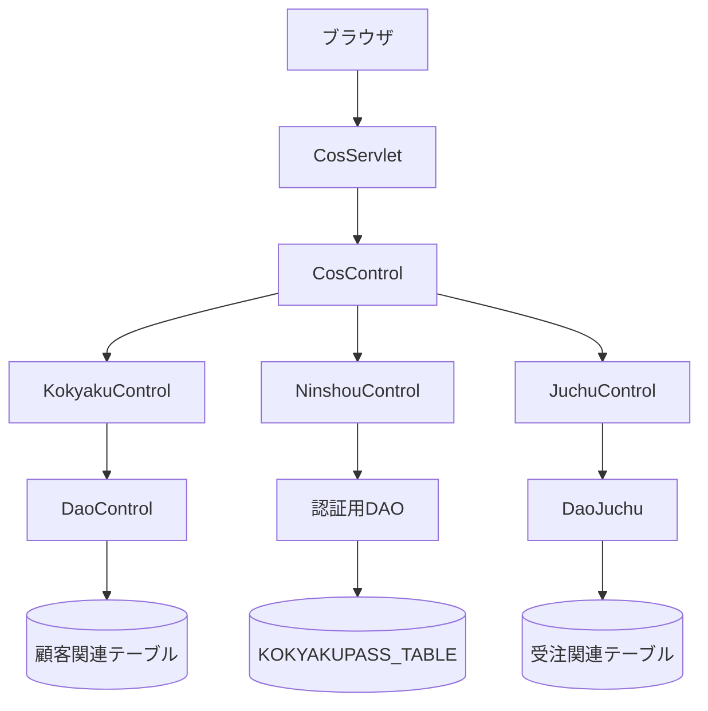
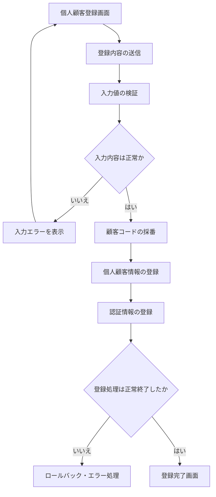
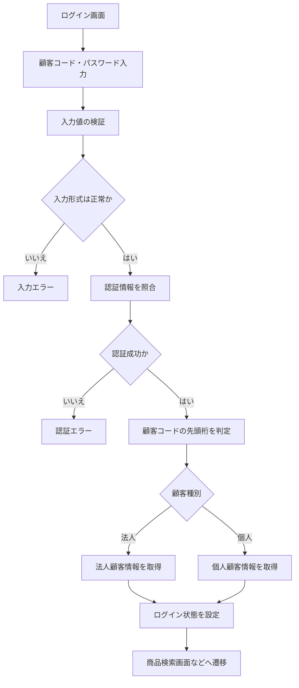
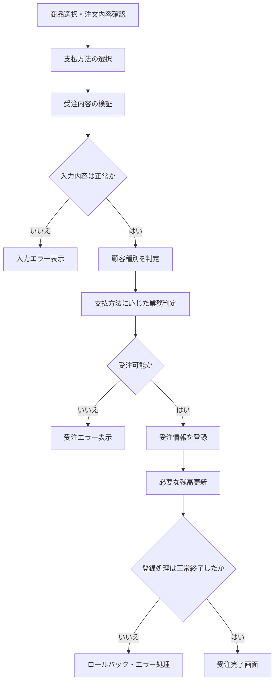
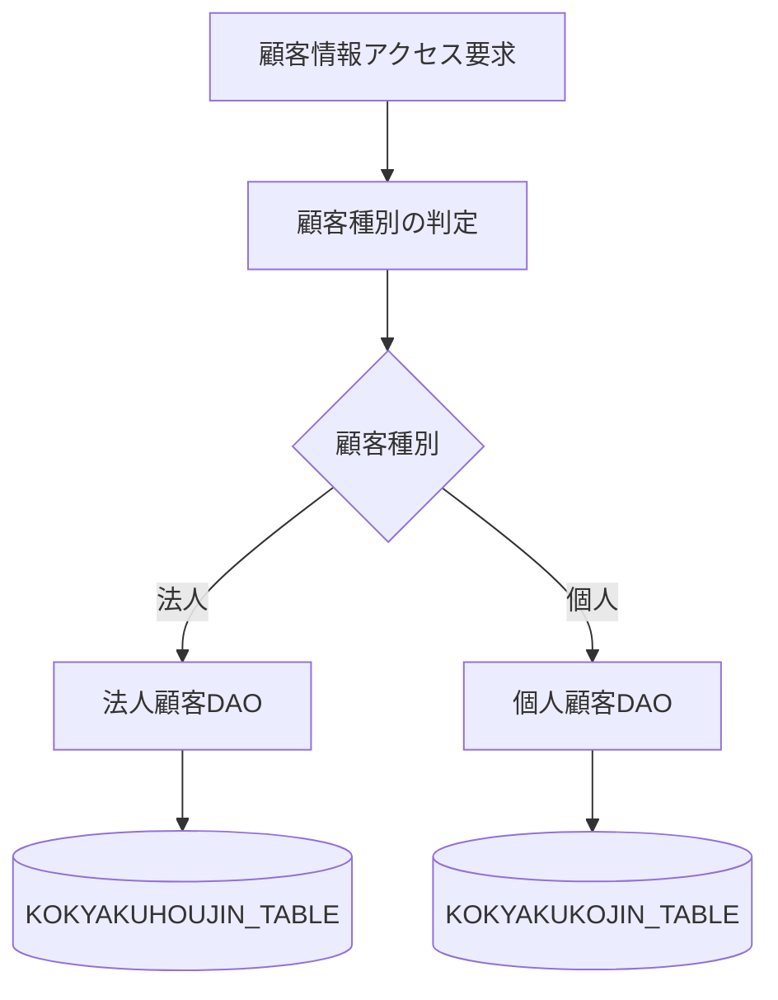

# ver.3 詳細設計書

## 1. 文書情報

| 項目 | 内容 |
|---|---|
| 文書名 | ver.3 詳細設計書 |
| 対象システム | 受注管理システム |
| 対象バージョン | ver.3 |
| ベースバージョン | ver.2（`juchu02`） |
| 文書形式 | Markdown |
| 文書の位置付け | 基本設計を基に、実装・DB設計・テストに必要な処理詳細を定義する |
| 作成状況 | 初版 |
| 関連文書 | ver.3 仕様書、ver.3 基本設計書、ver.3 DB設計書、ver.3 テスト仕様書 |

---

## 2. 詳細設計の概要

### 2.1 目的

本書は、受注管理システムの ver.3 において実施する改修について、クラスの責務、処理の流れ、データアクセス、入力検証、エラー処理などの詳細を定義することを目的とする。

本バージョンでは、既存の法人顧客向け機能を維持しながら、個人顧客に対応するための機能を追加する。

本書の内容を基に、DB設計書、テスト仕様書および実装内容の整合性を確保する。

### 2.2 改修の背景

ver.2 までのシステムでは、法人顧客を中心とした顧客登録、認証、商品検索、受注などの機能が実装されている。

ver.3 では、個人顧客の登録および受注に対応するため、顧客情報の管理、認証処理、支払方法、与信判定などを拡張する。

### 2.3 対象範囲

本書では、次の機能を設計対象とする。

1. 個人顧客情報の登録
2. 顧客コードの採番および顧客種別の判定
3. ログイン認証および顧客情報の取得
4. 顧客種別に応じたDAOの振り分け
5. 個人顧客の受注処理
6. 個人顧客向け支払方法の追加
7. 与信判定および売掛残高更新の整理
8. 画面遷移、入力検証およびエラー処理
9. 顧客情報と認証情報の登録整合性の確保

商品検索など、今回の改修対象外となる既存機能は、原則として既存処理を利用する。

### 2.4 設計上の区分

本書では、設計内容を次の3種類に区分する。

| 区分 | 意味 |
|---|---|
| 既存仕様 | ver.2 のソースコードで確認できた処理 |
| 改修仕様 | ver.3 の要求に対応するために追加・変更する処理 |
| 要確認 | 仕様書や既存コードだけでは確定できず、追加確認が必要な事項 |

要確認事項については、DB設計および実装前の仕様確認を通じて確定する。

---

## 3. システム構成およびクラス設計

### 3.1 処理構成

既存システムでは、Servlet がリクエストを受け付け、Control クラスが業務処理を振り分け、DAO がデータベースへのアクセスを担当する構成となっている。

※ 図は論理構成を示す。認証用DAOなどの具体的なクラス名・呼び出し関係については、関連ソースコードを追加確認したうえで確定する。

### 3.2 クラス別の責務

| クラス | 既存の役割 | ver.3での対応方針 |
|---|---|---|
| `CosServlet` | ブラウザからのリクエストを受け付ける | 既存の受付処理を基本的に維持する |
| `CosControl` | リクエスト内容に応じて処理を振り分ける | 個人顧客登録などの追加処理への接続を検討する |
| `KokyakuControl` | 顧客登録関連の処理を担当する | 個人顧客の登録処理と顧客種別に応じた処理を追加する |
| `NinshouControl` | ログイン・ログアウトなどの認証処理を担当する | 個人顧客コードによる認証に対応する |
| `JuchuControl` | 受注処理を担当する | 個人顧客の支払方法などを受け渡せるようにする |
| `DaoControl` | 顧客情報に関するDAOを生成・利用する | 顧客種別に応じたDAOの選択方法を変更する |
| `DaoHoujin` | 法人顧客情報の登録・取得などを担当する | 法人向け既存処理を維持し、必要な共通処理を整理する |
| `DaoKokyaku` | 顧客認証・顧客情報取得に関連する処理を担当する | 個人顧客の情報取得先を含めて処理を見直す |
| `DaoJuchu` | 受注登録、与信判定、売掛残高更新などを担当する | 顧客種別・支払方法に応じた処理を設計する |

※ クラスの責務は初版の整理である。各メソッドの引数・戻り値・例外・SQLは、実装コードとの詳細照合後に確定する。

### 3.3 顧客種別の判定方針

ver.3 では、顧客コードの先頭桁を顧客種別の判定に利用する。

| 顧客種別 | 顧客コードの先頭桁 | 顧客情報の管理先 |
|---|---|---|
| 法人顧客 | 1～3 | `KOKYAKUHOUJIN_TABLE` |
| 個人顧客 | 4～8 | `KOKYAKUKOJIN_TABLE`（追加予定） |

顧客コードの先頭桁による判定は、認証処理と顧客情報取得処理で一貫して使用する。

顧客コードが未入力、形式不正、または対象外の先頭桁である場合は、認証・顧客情報取得を行わず、適切なエラー処理に移行する。

---

## 4. 個人顧客登録処理

### 4.1 概要

個人顧客登録処理では、画面から入力された個人顧客情報を検証し、個人顧客情報と認証情報を登録する。

法人顧客登録の既存処理を参考にしながら、個人顧客向けのデータ項目および登録先テーブルに対応する。

### 4.2 登録処理フロー

※ 採番処理、登録順序、トランザクション境界は初版の設計方針である。既存のDB制約および採番方式を確認して確定する。

### 4.3 入力項目

個人顧客情報の登録対象項目は、既存の顧客情報および提供された個人顧客サンプルデータを基に整理する。

| 項目 | 内容 | 設計上の注意点 |
|---|---|---|
| 顧客コード | 個人顧客を識別するコード | 先頭桁が4～8となること |
| 顧客名 | 個人顧客の氏名 | 必須・文字数はDB設計で確定する |
| 顧客名カナ | 氏名のカナ表記 | 入力規則は要確認 |
| 郵便番号 | 住所の郵便番号 | 形式・桁数は要確認 |
| 県コード | 都道府県を識別するコード | コード体系を既存DBと照合する |
| 住所1 | 都道府県・市区町村など | 必須範囲は要確認 |
| 住所2 | 住所の続き | 任意項目の扱いは要確認 |
| 連絡先電話番号 | 電話番号 | 形式・必須条件は要確認 |
| FAX番号 | FAX番号 | NULLを許容するか確認する |
| メールアドレス | メールアドレス | NULLおよび重複の扱いを確認する |
| 売掛残高 | 顧客の売掛残高 | 初期値および更新方針は要確認 |
| 与信限度額 | 顧客の与信限度額 | 個人顧客は100万円を基準とする |
| 営業所コード | 管轄営業所 | 既存コード体系を利用する |
| 登録日 | 顧客の登録日 | 設定方法は要確認 |
| 誕生日 | 個人顧客の生年月日 | 必須・任意および日付形式は要確認 |

### 4.4 顧客コードの採番

個人顧客の顧客コードは、先頭桁が4～8となるように採番する。

採番時には、次の点を考慮する。

1. 既存の顧客コードと重複しないこと。
2. 個人顧客として識別できること。
3. 同時登録が発生しても同一コードが採番されないこと。
4. 顧客情報と認証情報の両方で同じ顧客コードを使用すること。

採番管理に既存の `CTR_CURCODE_TABLE` を利用するか、個人顧客用の採番管理を別途設けるかは、既存テーブルの仕様を確認して決定する。

### 4.5 顧客情報の登録

個人顧客情報は、追加予定の `KOKYAKUKOJIN_TABLE` に登録する。

認証情報は、法人顧客と共通の `KOKYAKUPASS_TABLE` に登録する方針とする。

登録時には、顧客コード、パスワード、顧客情報の対応関係が崩れないようにする。

顧客情報の登録と認証情報の登録を同一のトランザクションで実行できる構成とし、片方の登録に失敗した場合は、両方の登録結果が不整合な状態で確定しないようにする。

具体的なトランザクション制御方法は、既存DAOのコネクション管理を確認したうえで確定する。

### 4.6 登録時のエラー処理

| エラー条件 | 処理方針 |
|---|---|
| 必須項目が未入力 | 登録処理を中止し、入力画面へ戻す |
| 入力形式が不正 | 登録処理を中止し、対象項目の修正を促す |
| 顧客コードの採番に失敗 | 登録を中止し、エラーを記録する |
| 顧客コードが重複 | 登録を中止し、採番処理を確認する |
| 顧客情報の登録に失敗 | トランザクションを取り消す |
| 認証情報の登録に失敗 | 顧客情報を含む登録処理を取り消す |
| DB接続エラー | 登録を中止し、システムエラーとして扱う |

入力画面に表示するメッセージと、サーバー側で記録する詳細なエラー情報は分けて管理する。

---

## 5. 認証・顧客情報取得処理

### 5.1 概要

認証処理では、入力された顧客コードとパスワードを確認し、認証成功後に対象顧客の情報を取得する。

ver.3 では、法人顧客に加えて個人顧客の認証と情報取得に対応する。

### 5.2 認証処理フロー

### 5.3 認証情報の照合

認証情報は `KOKYAKUPASS_TABLE` を使用して照合する方針とする。

認証処理では、少なくとも次の点を確認する。

- 顧客コードが入力されていること。
- パスワードが入力されていること。
- 顧客コードに対応する認証情報が存在すること。
- 入力されたパスワードが登録情報と一致すること。
- 顧客コードの先頭桁が許可された範囲であること。

パスワードの保存方式や照合方式は、既存実装を確認したうえで扱いを統一する。

### 5.4 顧客情報の取得

認証に成功した後は、顧客コードに応じて取得先テーブルを切り替える。

| 顧客種別 | 判定条件 | 取得先 |
|---|---|---|
| 法人顧客 | 先頭桁が1～3 | `KOKYAKUHOUJIN_TABLE` |
| 個人顧客 | 先頭桁が4～8 | `KOKYAKUKOJIN_TABLE` |

取得先の切り替えは、認証処理、顧客情報取得処理、受注処理で一貫したルールを使用する。

認証情報が存在しても顧客情報が存在しない場合は、不整合として扱い、正常なログイン状態を確立しない。

### 5.5 ログアウト処理

ログアウト処理では、既存のセッション管理方式に従ってログイン状態を解除する。

個人顧客の追加に伴い、法人顧客と個人顧客でログアウト処理が分岐しない構成を基本とする。

セッションに保持する顧客情報の項目や破棄方法は、既存実装を確認して確定する。

---

## 6. 受注処理

### 6.1 概要

受注処理では、ログイン中の顧客が選択した商品および数量を基に受注情報を登録する。

ver.3 では既存の受注処理を可能な限り再利用し、顧客種別と支払方法に応じた処理を追加する。

### 6.2 受注処理フロー

※ 与信判定、残高更新およびトランザクションの詳細は、DB設計および支払業務ルールの確定後に反映する。

### 6.3 受注情報の検証

受注登録前に、次の項目を確認する。

1. ログイン状態が有効であること。
2. 顧客情報が取得できること。
3. 注文対象の商品が存在すること。
4. 注文数量が業務上許容される値であること。
5. 支払方法が顧客種別に対して許可されていること。
6. 受注金額を正しく算出できること。

具体的な数量上限、商品在庫の確認方法、金額計算の仕様は既存処理を確認して確定する。

### 6.4 顧客種別と支払方法

ver.3 の支払方法は、次の方針を基準として設計する。

| 顧客種別 | 支払方法 | 状態 |
|---|---|---|
| 法人顧客 | 月末一括払い | 既存機能 |
| 個人顧客 | 代金引換 | 追加対象 |
| 個人顧客 | 銀行振込 | 追加対象 |

支払区分の具体的なコード値は、既存の `SIHARAI_TYPE` の定義と画面の送信値を確認して確定する。

画面側で選択できる支払方法と、サーバー側で許可する支払方法が一致するようにする。

### 6.5 支払区分の受け渡し

既存の `JuchuControl` では、画面から送信された `shiharaitype` を受注情報に設定する処理がある。

ver.3 では、この処理を利用しつつ、受け取った支払区分が顧客種別に対して有効であるかをサーバー側で検証する。

画面から送信された値を無条件に受け入れず、許可されていない支払区分の場合は受注登録を行わない。

### 6.6 与信判定

既存の `DaoJuchu` では、与信限度額、売掛残高および今回の受注金額を利用した判定が行われている。

ver.3 では、個人顧客の与信限度額を100万円とする仕様を基準に、顧客種別に応じた判定を設計する。

ただし、個人顧客のすべての支払方法に既存の与信判定を適用するかどうかは未確定である。

設計を確定する際には、次の事項を整理する。

- 法人顧客の既存与信判定を変更しないこと。
- 個人顧客の与信限度額を正しく参照すること。
- 支払方法ごとの与信判定の要否。
- 与信判定に使用する売掛残高の範囲。
- 与信超過時の画面遷移とエラーメッセージ。

### 6.7 売掛残高の更新

既存の `DaoJuchu` では、売掛残高更新処理が法人顧客テーブルを対象としている。

個人顧客への対応では、顧客種別に応じた更新先の切り替えが必要となる可能性がある。

ただし、代金引換および銀行振込に対して、売掛残高をいつ、どのように更新するかは業務仕様の確認が必要である。

支払方法と売掛残高の関係を確定するまでは、個人顧客の残高更新方法を確定仕様として扱わない。

### 6.8 受注登録時の整合性

受注情報の登録と売掛残高の更新を同一の業務処理として扱う場合、途中でエラーが発生しても不整合なデータが確定しないようにする。

トランザクション制御の対象範囲は、既存DAOのコネクション管理とSQL実行順序を確認して確定する。

---

## 7. DAO・DBアクセス設計

### 7.1 基本方針

DBアクセスは既存のDAO構成を基本とし、業務処理を担当するControlクラスとSQL実行処理を分離する。

ver.3 では、法人顧客向けの既存処理を維持しながら、個人顧客向けのデータアクセスを追加する。

### 7.2 顧客DAOの振り分け

現状の `DaoControl` は `DaoHoujin` を利用する構成となっている。

この構成では個人顧客用テーブルへのアクセスに対応できないため、顧客種別に応じたDAOの選択方法を設計する。

個人顧客DAOの具体的なクラス名は、既存の命名規則と実装方針に合わせて決定する。

### 7.3 使用テーブル

| テーブル名 | 用途 | ver.3での扱い |
|---|---|---|
| `KOKYAKUHOUJIN_TABLE` | 法人顧客情報 | 既存テーブルを継続利用 |
| `KOKYAKUKOJIN_TABLE` | 個人顧客情報 | 追加予定 |
| `KOKYAKUPASS_TABLE` | 顧客認証情報 | 法人・個人で共通利用する方針 |
| `CTR_CURCODE_TABLE` | 顧客コード採番管理 | 個人顧客への適用可否を確認する |
| `JUCHU_TABLE` | 受注情報 | 既存テーブルを継続利用する方針 |
| その他の受注関連テーブル | 商品・受注明細など | 既存の関係と処理を確認する |

※ カラム定義、型、NULL制約、主キー、外部キー、インデックスはDB設計書で定義する。

### 7.4 認証情報の登録と参照

`KOKYAKUPASS_TABLE` は法人・個人で共通利用する方針とする。

顧客コードをキーとして認証情報を管理し、顧客情報本体は顧客種別に応じたテーブルから取得する。

認証情報と顧客情報の対応関係を維持するため、登録・更新・削除時の整合性ルールをDB設計で定義する。

### 7.5 メールアドレスの重複確認

既存の `DaoHoujin` では、法人顧客テーブルを対象にメールアドレスの重複確認を行う処理がある。

ver.3 では、個人顧客にもメールアドレスが存在するため、重複をどの範囲で禁止するかを明確にする必要がある。

法人・個人を横断して重複を禁止するか、顧客種別ごとに重複を許容するかは、仕様確認後に決定する。

### 7.6 SQLおよびトランザクション

SQLの具体的な文面は、DB設計書でカラムと制約を確定した後に詳細化する。

登録・更新処理では、次の事項を明確にする。

- SQLの実行順序
- 更新対象テーブル
- 主キー・一意制約違反時の処理
- コミットのタイミング
- ロールバックの対象範囲
- SQL例外発生時のエラー処理

---

## 8. 画面・入力・遷移設計

### 8.1 基本方針

画面構成は既存のJSPを基本とし、個人顧客の登録および支払方法の選択に必要な画面・入力項目を追加または変更する。

画面名、送信パラメータ、遷移先は、実際のJSPとServletの処理を照合して確定する。

### 8.2 既存画面の確認対象

| ファイル | 既存用途の整理 | ver.3での確認事項 |
|---|---|---|
| `cosd1000.html` | ログイン・顧客登録種別の選択 | 個人顧客登録への導線 |
| `cosd1010.jsp` | 商品検索 | 既存機能への影響 |
| `cosd1020.jsp` | 商品・注文関連画面 | 既存の入力・遷移 |
| `cosd1030.jsp` | 商品・カート関連画面 | 既存の入力・遷移 |
| `cosd1050.jsp` | 注文内容確認 | 顧客情報・注文情報の表示 |
| `cosd1060.jsp` | 支払方法・配送先関連 | 個人向け支払方法の追加 |
| `cosd1070.jsp` | 受注確認 | 支払方法の表示 |
| `cosd1080.jsp` | 受注完了 | 既存の完了処理 |
| `cosd1090.jsp` | 法人登録入力 | 個人登録画面との関係 |
| `cosd1100.jsp` | 法人登録確認 | 個人登録確認画面の必要性 |
| `cosd1110.jsp` | 法人登録処理 | 個人登録処理の追加方法 |

※ 画面の正式な名称、呼び出し条件、遷移先については、各ファイルの内容およびServletの振り分け条件を追加確認して確定する。

### 8.3 個人顧客登録画面

個人顧客登録では、個人顧客情報の入力、登録内容の確認、登録処理、登録完了の各段階を整理する。

既存の法人登録画面を再利用できる部分と、個人固有の入力項目や処理が必要な部分を分けて設計する。

画面ファイル名は、既存の命名規則を確認したうえで決定する。

### 8.4 支払方法画面

既存の支払方法画面では、月末一括払いが選択肢として設定されている。

ver.3 では、個人顧客に対して代金引換および銀行振込を選択できるようにする。

画面表示だけでなく、サーバー側でも顧客種別と支払区分の組み合わせを検証する。

### 8.5 画面入力の検証

画面から送信された値について、サーバー側でも検証を実施する。

主な検証対象は次のとおりとする。

- 必須項目の入力有無
- 顧客コードの形式
- 顧客種別に応じた入力条件
- 支払区分の妥当性
- 注文数量および金額の妥当性
- 顧客情報の存在確認

HTMLやJSP側の入力制限だけに依存せず、業務処理を実行する前にサーバー側で検証する。

---

## 9. エラー処理・例外処理

### 9.1 基本方針

業務上の入力エラーと、DB接続障害などのシステムエラーを区別する。

利用者に表示するメッセージには、内部構造やSQLなどの詳細情報を直接表示しない。

### 9.2 エラー区分

| エラー区分 | 発生例 | 処理方針 |
|---|---|---|
| 入力エラー | 必須項目未入力、形式不正 | 入力画面へ戻し、修正を促す |
| 認証エラー | 顧客コード・パスワード不一致 | 認証を成立させない |
| 顧客情報エラー | 顧客情報が存在しない | 処理を中止し、エラーを表示する |
| 重複エラー | 顧客コードなどの重複 | 登録を中止する |
| 与信エラー | 与信条件を満たさない | 受注登録を中止する |
| DBエラー | SQL実行・接続エラー | トランザクションを適切に処理し、システムエラーとする |
| 想定外エラー | 予期しない例外 | エラーを記録し、安全なエラー画面へ遷移する |

### 9.3 ロールバック方針

複数テーブルを更新する処理では、処理の一部だけが確定することを防ぐ。

特に、次の処理はトランザクションの対象範囲を明確にする。

- 個人顧客情報と認証情報の登録
- 受注情報と受注明細の登録
- 受注情報と売掛残高の更新

実際のロールバック制御は、既存DAOのコネクション管理を確認して確定する。

---

## 10. 実装時の留意事項

### 10.1 既存機能への影響

ver.3 の改修では、既存の法人顧客向け機能を維持することを前提とする。

特に、次の機能について回帰テストを実施する。

- 法人顧客登録
- 法人顧客ログイン・ログアウト
- 商品検索
- カート操作
- 法人顧客の受注
- 月末一括払い
- 既存の与信判定
- 受注完了までの画面遷移

### 10.2 顧客種別判定の一貫性

顧客種別を判定する条件は、各ControlやDAOに個別に実装する場合でも同じルールを使用する。

顧客コードの先頭桁と顧客情報の取得先が一致しない場合は、認証・受注処理を正常に継続させない。

### 10.3 入力値の信頼性

画面から送信された顧客種別、支払区分、顧客コードなどの値は、サーバー側で検証する。

画面上の選択肢だけを根拠として処理を許可しない。

### 10.4 既存処理の再利用

既存処理を再利用する場合は、法人顧客専用の条件やテーブル名が処理内部に固定されていないか確認する。

共通化によって既存の法人処理に影響する場合は、変更範囲と回帰テスト対象を明確にする。

---

## 11. 未確定事項・確認事項

本書は初版であるため、以下の事項はDB設計および仕様確認と合わせて確定する。

| ID | 確認事項 | 確認する内容 | 関連箇所 |
|---|---|---|---|
| D-01 | 個人顧客コードの採番 | 既存採番テーブルの利用可否、重複防止方法 | 第4章・第7章 |
| D-02 | 個人顧客テーブル | カラム、型、主キー、制約 | 第4章・第7章 |
| D-03 | 顧客DAOの構成 | 個人用DAOの新設と既存DAOの変更範囲 | 第3章・第7章 |
| D-04 | 認証処理 | 顧客種別判定と情報取得の接続方法 | 第5章 |
| D-05 | パスワード管理 | 既存の保存方式と照合方式 | 第5章 |
| D-06 | 支払区分コード | 代金引換・銀行振込のコード値 | 第6章・第8章 |
| D-07 | 個人顧客の与信 | 支払方法ごとの与信判定の要否 | 第6章 |
| D-08 | 個人顧客の売掛残高 | 支払方法ごとの残高更新方針 | 第6章・第7章 |
| D-09 | メールアドレス重複 | 法人・個人を横断した重複禁止の要否 | 第4章・第7章 |
| D-10 | 登録トランザクション | 顧客情報・認証情報の登録制御 | 第4章・第9章 |
| D-11 | 受注トランザクション | 受注・明細・残高更新の制御範囲 | 第6章・第9章 |
| D-12 | 画面ファイルと遷移 | 個人登録画面、送信パラメータ、遷移先 | 第8章 |

これらは設計を確定するための確認事項であり、未確定の状態で実装仕様として固定しない。

---

## 12. 後続工程との対応

| 後続工程 | 本書から引き継ぐ内容 |
|---|---|
| DB設計書 | テーブル、カラム、主キー、制約、採番、更新対象 |
| テスト仕様書 | 登録、認証、顧客種別判定、支払方法、与信、エラー処理 |
| 実装 | クラス責務、処理フロー、DAOの振り分け、入力検証 |
| 改修詳細報告書 | 変更したクラス、変更理由、処理の変更内容 |
| テスト結果報告書 | 設計上の期待結果と実測結果の比較 |

---

## 13. まとめ

ver.3 では、既存の法人顧客向け機能を維持しながら、個人顧客の登録、認証、受注および支払方法に対応する。

特に、顧客種別に応じたDAOの振り分け、顧客コードの採番、認証情報との整合性、与信判定、売掛残高の更新を重要な設計項目とする。

本書の未確定事項をDB設計および追加のソースコード照合によって確定し、詳細設計書とDB設計書の整合性を確認した後、テスト仕様書の作成と実装に進む。
